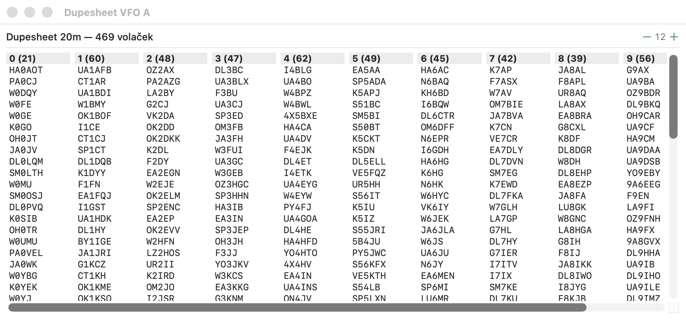

# Callsign check



Aids below the callsign field in the entry window.

## Worked before, by band

Equivalent of N1MM **Check** (band colors at the callsign) and DXLog **Check
callsign**. As soon as the callsign in the field has at least 3 characters and the
station is already in the log, a line appears:

```
Pracováno 3×, naposledy 1412Z:  160  80  [40 CW]  20 CW/SSB  15  10
```

(That is, "Worked 3×, most recently 1412Z".)

- The bands are the contest bands (outside a contest 160–10 m); a band not on the
  list on which a QSO exists (e.g. 6 m) is appended at the end.
- A **highlighted** band = the station is already there, with modes. **Red** = it
  is also on the current band (dupe by band; dupe by contest rules is shown by the
  DUPE chip).
- Dimmed bands = not worked yet — where to move the station.
- Deleted QSOs are not counted, X-QSOs are.

## Visible Dupesheet

Equivalent of N1MM **Visible Dupesheet**
([doc](https://n1mmwp.hamdocs.com/manual-windows/visible-dupesheet-window/)).
Open it with **"Okno → Dupesheet"** (Window → Dupesheet).

- Worked callsigns for the **current band** (from the rig, without CAT from the
  last QSO) — according to the contest's dupe rules also for the current mode
  (`PER_BAND_MODE`), mode only (`PER_MODE`) or the whole contest (`ONCE`). Outside
  a contest by band.
- Columns **0–9** by the digit of the area (OK1... → 1, `DL/OK1XOE` → 1),
  callsigns without a digit in the column **#**; counts in the header.
- Callsigns that contain the text typed in the callsign field (from 2 characters)
  are **highlighted** — a dupe is visible even before you finish typing.
- The dupesheet does not distinguish TOUR sessions (it shows the whole contest on
  the band).

## Downloading master.scp

Equivalent of N1MM **Tools → Download latest Check Partial file** and DXLog
**Update Super Check Partial database**. Menu **"Nástroje → Stáhnout master.scp"**
(Tools → Download master.scp):

- downloads the current `MASTER.SCP` from [supercheckpartial.com](https://www.supercheckpartial.com/),
- saves it to the file set in "Nastavení → Závod → Soubor master.scp" (Settings →
  Contest → master.scp file); when none is set, to the application data directory
  and sets the path right away,
- and loads it immediately — suggestions work with the new data without a restart.

It is downloaded to a temporary file and the original is overwritten only when the
content looks like master.scp (at least 1000 callsigns, not an HTML error page).
On an error the old file stays and the status line says why.

## Check partial: log, spots and master.scp

Equivalent of the N1MM **Check window** (including its [telnet
features](https://n1mmwp.hamdocs.com/manual-windows/check-window/#Special_Telnet_Features))
and DXLog **Check partials**. Suggestions below the callsign field (from 2
characters) come from three sources:

| Source | Appearance |
|---|---|
| **own log** | gray (already worked), red when it is a dupe on the band |
| **spots from the DX cluster** | underlined, in the highlight color — the station is on the band now |
| **master.scp** | normal |

Order: exact match → starts with the entered text → contains it; with an equal
match the log takes precedence, then spots, then master.scp. Thanks to the log and
spots, suggestions work even without a master.scp file and also find callsigns
that are not in it (new, special ones). Selection with the arrows / Enter / Alt+Y
as before.

## N+1

Equivalent of DXLog **Check N+1** and the N1MM **N+1** window. From 3 characters
of the callsign, a line `N+1:` appears below the suggestions with callsigns that
differ from the entered one by **exactly one character** — a substitution
(`OK1XOE` ↔ `OK1XDE`), an insertion (`OK1XOEE`) or an omission (`OK1XO`). It
catches reception errors that partial check does not find. Sources: log (gray),
spots and master.scp. A click takes the callsign into the field.

## Check window

Equivalent of the N1MM **Check window**
([doc](https://n1mmwp.hamdocs.com/manual-windows/check-window/)). Open it with **"Okno → Check"** (Window → Check).
It follows the call typed in the active entry window (the VFO B window too) and shows side by side panes:

| Pane | Source |
|---|---|
| **Deník** (Log) | the calls of the open log |
| **master.scp** | the loaded `master.scp` |
| **Telnet** | the stations spotted by the DX cluster — a call shows only after it was spotted **3 times** (while its spot is alive; adjustable) |
| **Call history** | the calls of the loaded call history |
| **Výměna** (Exchange) | in a contest: the values of the multiplier list behind the exchange field being typed (counties, sections…) |
| **Zpětné hledání** (Reverse lookup) | calls whose exchange matches what you typed (see below) |

The header of each pane shows the number of matches and the size of its source.

- From 2 characters a call is shown when it **contains** the typed text; from 3 characters also when it differs by
  **one character** (a substitution, an extra or a missing character — a likely copying error).
- Colours per character: typed characters plain, **green** characters complete the call, **red** marks where the
  call differs from what you typed. An **exact match** is bold italic.
- Order: exact match, starts with the text, contains it, one character off; then shorter calls first.
- A click puts the call into the call field (an exchange value into its field).

### Right-click menu

| Item | N1MM | Meaning |
|---|---|---|
| Skrýt tento panel | Hide this pane | hides the pane |
| Proporcionální šířka tohoto panelu | Proportional width this pane | 1×–4× the normal width |
| Zobrazené panely | (pane check boxes) | which panes are shown |
| Alt+Y: pořadí panelů | Yank: configuration | the order Alt+Y goes through the panes; a click moves a pane one place up |
| Alt+Y: i duplicitní volačky | Yank: allow dupes | Alt+Y also takes calls that are dupes on the band |
| Řazení: upřednostnit rozdíly na konci volačky | Sorting: Favor end-character differences | among equal matches, calls that differ only towards their end (`/P`, the last letter) come first |
| Telnet: volačka od počtu spotů | (3 spots) | how many spots a call needs for the Telnet pane |
| Zpětné hledání v call history a deníku | Reverse Call History Lookup | the reverse lookup on / off |
| Práh zpětného hledání (znaků) | Set Reverse Lookup Threshold | characters of an exchange value before it is searched (default 2) |
| Zpětné hledání: shoda od prvního znaku | (match from the beginning) | off = the typed text may be anywhere in the value |

The settings are kept in the configuration (`check*` keys).

### Alt+Y

**Alt+Y** in the call field takes the first call of the panes in the yank order (Deník, master.scp, Telnet, Call
history, Zpětné hledání by default), skipping dupes unless allowed. Pressing it again while the field still holds
that call takes the **next** one, round and round; typing anything else starts over. It works with the Check window
closed too. In an exchange field Alt+Y takes the first value of the exchange pane. Without any Check match it takes
the first Check partial suggestion, as before.

### Reverse lookup

N1MM **Reverse Call History Lookup**: type what you copied of the exchange (for example the county) and the pane lists
the calls whose **log QSOs or call history record** have it — every typed value must match, from the threshold's
number of characters, from the first character of the value (or anywhere, see the menu). A partly typed call narrows
the list to the calls containing it. Up to 100 calls; the report and the serial number are not searched.

## ✓ / ? in the call field

Equivalent of the N1MM check mark and **View → Show ? on Unmatched Calls**. From 3 characters the call field shows at
its right end:

- **✓** when a Check source (log, master.scp, a spot, call history) has the exact call, coloured by its multiplier
  status: green = more than one new multiplier, red = one new multiplier, blue = a new QSO, grey = a dupe;
- **?** when no source has it. **"Zobrazení → Zobrazovat ? u neznámých volaček"** (View → Show ? on unmatched calls)
  turns the question mark off.

The mark is shown while a Check is visible: the Check window, or the `SCP:` row of the entry window (Settings →
Contest).

