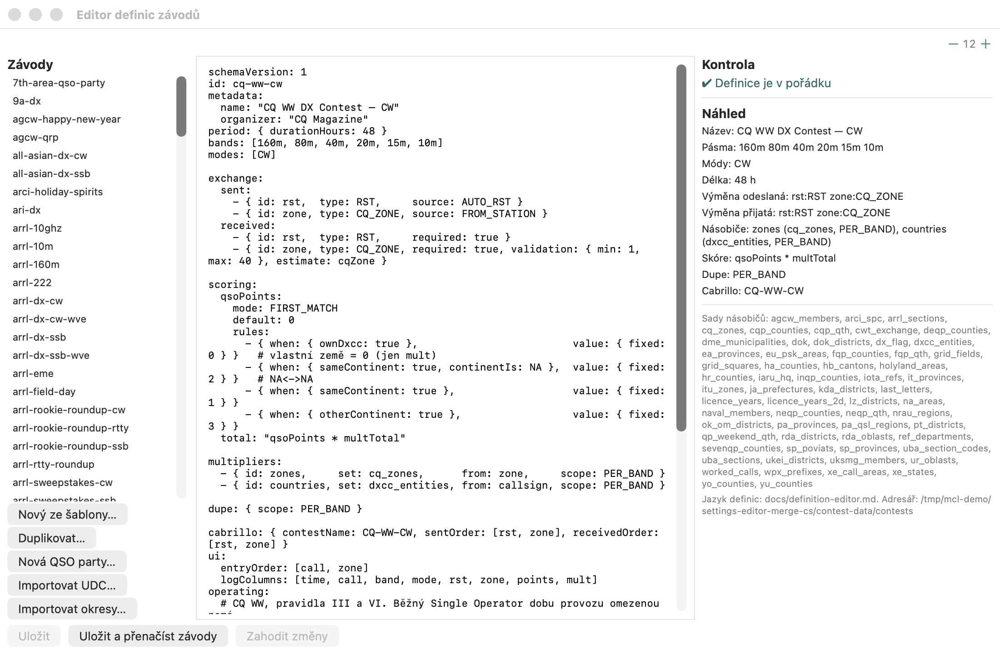

# Editor definic závodů



Obdoba N1MM+ **UDC Editor**
([The UDC Editor](https://n1mmwp.hamdocs.com/appendices/udc-editor/#The_UDC_Editor)).
Závody jsou deklarativní YAML v datové složce závodů („Nastavení → Závod →
Nastavení dat závodů…“); editor
je upravuje přímo v aplikaci.

Otevření: **„Nástroje → Editor definic…“**

## Okno

| Část | Co dělá |
|---|---|
| **Závody** (vlevo) | definice z `<data>/contests/*.yaml`; klik otevře soubor |
| **„Nový ze šablony…“** | zeptá se na id (= název souboru, malá písmena, číslice, `-`, `_`) a vloží platnou šablonu: RST + pořadové číslo, 1 bod za QSO, násobiče DXCC po pásmech |
| **„Duplikovat…“** | kopie otevřené definice pod novým id — nejrychlejší cesta k variantě existujícího závodu |
| **text** (uprostřed) | definice YAML, neproporcionální písmo |
| **Kontrola** (vpravo) | živě během psaní: syntaxe YAML (s řádkem a sloupcem), neznámé klíče, validátor definic, **odkazy na neexistující sady násobičů**, nesoulad `id` s názvem souboru. ✖ chyba, ⚠ varování |
| **Náhled** | název, pásma, módy, délka, pole výměny, násobiče, vzorec skóre, dupe, název pro Cabrillo |
| **„Uložit“** | atomicky zapíše soubor (nejdřív do dočasného, pak přesun) |
| **„Uložit a přenačíst závody“** | navíc znovu načte definice, aby šel závod hned vybrat v okně Nový závod |
| **„Zahodit změny“** | vrátí text do uloženého stavu |

Definici s chybami lze uložit (rozpracovaná práce), ale aplikace
ji při načítání přeskočí — v seznamu závodů se neobjeví, dokud chyby
neopravíte. Na jiný soubor lze přepnout jen bez neuložených změn.

## Jazyk definic ve zkratce

```yaml
schemaVersion: 1
id: my-contest                 # = název souboru
metadata: { name: "Můj závod", organizer: "", officialUrl: "" }
period: { durationHours: 24 }  # bez period = bez konce; sezení: sessions: { start: "1200", minutes: 30 }
bands: [80m, 40m, 20m]
modes: [CW, SSB]
exchange:
  sent:     [ { id: rst, type: RST, source: AUTO_RST }, { id: nr, type: SERIAL, source: AUTO_SERIAL } ]
  received: [ { id: rst, type: RST, required: true },   { id: nr, type: SERIAL, required: true } ]
scoring:
  qsoPoints: { mode: FIRST_MATCH, default: 1 }   # pravidla `rules:` s podmínkami when
  total: "qsoPoints * multTotal"
multipliers:
  - { id: countries, set: dxcc_entities, from: callsign, scope: PER_BAND }
dupe: { scope: PER_BAND_MODE, dupeWorthZero: true }
cabrillo: { contestName: MY-CONTEST, sentOrder: [rst, nr], receivedOrder: [rst, nr] }
ui: { entryOrder: [call, rst, nr], logColumns: [time, call, band, mode, rst, nr] }
```

- **type** pole: `RST RS SERIAL INTEGER TEXT LOCATOR CQ_ZONE ITU_ZONE DXCC PREFIX HQ
  NATIONAL STATE PROVINCE DISTRICT IOTA QTC`.
- **source** odesílaného pole: `MANUAL AUTO_RST AUTO_SERIAL FROM_STATION DERIVED ROVER_QTH`.
- **scope** násobičů a dupe: `PER_BAND PER_BAND_MODE PER_MODE ONCE`.
- **set** násobiče = id sady v `<data>/multipliers/` (seznam je
  dole v pravém panelu).

### Další pravidla (obdoby N1MM UDC)

| Klíč | Co dělá | N1MM UDC |
|---|---|---|
| `when: { timeBetween: "2200-0559" }` | podmínka, která platí pro QSO v tomto okně UTC (obě minuty včetně, může přecházet přes půlnoc) | `PointsMultAtTimeGMT` |
| `qsoPoints.factors: [ { when: …, factor: 2 } ]` | body QSO se násobí faktorem každé položky, jejíž podmínka platí (čas, pásmo, mód, kontinent, země…) | `PointsMultAtTime…`, `PointsMultByBand/Mode/Continent/Country` |
| `scoring.powerFactor: { HIGH: 1, LOW: 2, QRP: 4 }` | výsledné skóre se násobí faktorem výkonové kategorie zvolené v nastavení závodu (jako klíče fungují i `HP`/`LP`); neuvedená kategorie = ×1 | `PowerMult` |
| `when: { not: { ownDxcc: true } }` u násobiče | násobič se počítá jen u QSO splňujících podmínku — např. ne pro vlastní zemi, jen pro některé země (`dxccIn`) nebo kontinenty | `DoNotCountMeAsMult`, `CountMultOnlyFor`, `DoNotCountMultOnlyFor` |
| `dupe: { none: true }` | žádná kontrola dupe, stanici lze pracovat libovolněkrát | `DupeType 4` |
| `dupe: { reworkMinutes: 30 }` | stejnou stanici (v rámci `scope`) lze znovu pracovat 30 minut po posledním započítaném QSO | `DupeQSOMinutesAgo` |
| `dupe: { byField: qth }` | přijaté pole je součástí dupe: mobilní stanice nebo rover v jiném okrese / čtverci je nová stanice | `DupeSqlString` |
| `period.sessions: { start: "1200", minutes: 60, resetMultipliers: true }` | v každém sezení se násobiče počítají znovu | `ResetMultsEverySession` |
| `numbering: { perBand: true }` | pořadové číslo běží na každém pásmu zvlášť; s `multiOpOnly: true` jen v kategorii s více vysílači (`MULTI-OP` s `UNLIMITED` / `DISTRIBUTED`) | `QsoNumbersByBand 1` / `2` |
| `workable: { continentIs: EU }` | koho lze pracovat (libovolná podmínka); QSO mimo se zapíše s varováním a nemá body ani násobiče | `IsWorkable` |
| přijaté pole `prefill: [ { when: { entityIn: [223] }, value: "400" }, { value: "100" } ]` | mezerník při opuštění pole volačky vloží do pole, dokud je prázdné, hodnotu prvního pravidla, jehož podmínka platí pro pracovanou stanici (pravidlo bez `when` platí vždy); napsaná hodnota se nikdy nenahradí. Definice ARRL DX (W/VE a DX) to používají pro výchozí výkon DX stanice (100 W; 200 W UA/UA2/UA9/UK/UN/UR; 400 W G/GM/GI/GD/GW; 500 W I/IS) | výchozí výkon ARRL DX |
| odesílané pole `source: DERIVED` s `derive: lastCall2L` / `lastCallSuffix` | pošlou se poslední dvě písmena / sufix volačky předchozího QSO (cokoli za `/` se ignoruje) | `Last2L`, `LastCallSuff` |
| `exchange: { freeForm: true, … }` | zadávací okno má jedno pole výměny místo pole pro každou položku; slova se k polím přiřadí podle tvaru v libovolném pořadí (viz níže) | výměna Sweepstakes |
| `inState: { sections: [EB, LAX, SCV] }` + podmínka `inState: true` | domácí stanice QSO party: moje sekce ARRL (údaje stanice) je v seznamu; nový deník řekne, zda se počítáte jako domácí, nebo vnější stanice | in-state / out-of-state u QSO party |
| podmínka `fieldMatches: { field: qth, regex: "^[A-Z]{4}$" }` | přijaté pole odpovídá regulárnímu výrazu (např. kód okresu, ne státu) | `IsWorkable`, testy sekcí |
| hodnota sady `FIXED` s `attributes: { countsAs: CA }` | jiný zápis téhož násobiče, ne samostatná hodnota (kalifornský okres se počítá jako CA) | násobiče států u QSO party |
| `scoring.parts: [ { id: in, label: "Indiana", when: …, multipliers: [inCounties], total: "qsoPoints * multTotal", powerFactor: { QRP: 3 } } ]` | více závodů hodnocených z jednoho deníku: každá část bere body a QSO odpovídající jejímu `when`, součet vlastních vazeb násobičů (`multTotal`; k dispozici je i každé `mult.<id>`) a vlastní vzorec (výchozí `qsoPoints * multTotal`) a výkonový faktor; skóre je součet částí a okno Skóre je vypisuje. Verze bez tohoto klíče ho ignorují a použijí `scoring.total`, takže `total` ponechte jako rozumnou zálohu | spojené QSO party ve stejném víkendu (`IN7QPNE`) |
| `adif: { SAT_NAME: sat, PROP_MODE: "=SAT" }` | další pole ADIF exportu: hodnota přijatého pole nebo pevný `=text` | pole ADIF DXSATELLIT |
| `export: { text: "{date:10} {time:4} {call:13} {nr:-4}" }` | rozvržení Soubor → Export → Text ve formátu závodu (viz [import-export.md](import-export.md)) | `CabrilloString`, obecný výstup |
| přijaté pole `split: true` | hodnota `A/B/C` (stanice na hranici okresů) zapíše jedno QSO za každou část; kratší část převezme úvodní znaky první části (`ORDES/JEF` = `ORDES` + `ORJEF`) | county line 7QP |
| `period: { startWeekday: SAT, startTime: "1200" }` | dialog Nový závod navrhne jako začátek nejbližší takové datum (ledaže závod od uloženého začátku ještě běží) | `StartOfContest` |

**Volná výměna** (`freeForm: true`, ARRL Sweepstakes): napište výměnu do jednoho pole tak, jak ji slyšíte, např.
`123 A 72 OH`, `A 123 OH 72` nebo `123A 72OH`. Každé slovo jde do prvního pole, do kterého se hodí a které je ještě prázdné: napřed
pole s vlastním tvarem (číslo, report, zóna, lokátor nebo `validation`), volná textová pole nakonec;
slovo mísící číslice a písmena se rozdělí (`123A` = `123` + `A`). Znovu napsané slovo opraví dřívější hodnotu
(`123 A 72 OH 73` → check 73) a volačka v poli (`K1ABC`) se zapíše místo volačky z pole volačky.
Výklad se ukazuje nad polem (`nr 123 · prec A · ck 72 · sec OH`, `?` = slovo, které se nehodí nikam). Pořadové
číslo uvádějte před check, když jsou obě čísla.

Přijaté nebo odesílané pole typu `IOTA` se do Cabrilla zapisuje s pomlčkou (`EU123` → `EU-123`).

Body převzaté z hodnoty výměny (`Exchange, *`) jsou `value: { expr: "nr" }`; body za vyplněné pole
(`IsMisc`) jsou pravidlo s `when: { fieldPresent: misc }`.

Úplné příklady jsou ve vestavěných definicích (`contest-data/contests/` — CQ WW,
WPX, IARU, OK-OM DX...); nejlepší je jednu **duplikovat** a upravit.

## Vestavěné definice

Zveřejněná složka `contest-data/` obsahuje 160 definic (`metadata.description` každého souboru říká,
co je oproti oficiálním pravidlům zjednodušeno; `dx`, `dx-serial`, `dxpedition`, `dx-satellite`, `vhf-dx` a `vhf-serial` jsou obecné deníky N1MM DX, DXSERIAL, DXPEDITION, DXSATELLIT, VHFDX a VHFSERIAL): 10-10 International QSO Party — Phone, 10-10 International Sprint (10 October), 9A DX Contest (Croatian DX Contest), AGCW Happy New Year Contest, AGCW QRP Contest, All Asian DX Contest — CW, All Asian DX Contest — Phone, ARI International DX Contest, ARRL 10 GHz and Up Contest, ARRL 10-Meter Contest, ARRL 160-Meter Contest, ARRL 222 MHz and Up Distance Contest, ARRL Field Day, ARRL International DX Contest — CW, ARRL International DX Contest — CW (W/VE and DX), ARRL International DX Contest — SSB, ARRL International DX Contest — SSB (W/VE and DX), ARRL International EME Contest, ARRL January VHF Contest, ARRL June VHF Contest, ARRL November Sweepstakes — CW, ARRL November Sweepstakes — SSB, ARRL Rookie Roundup — CW, ARRL Rookie Roundup — RTTY, ARRL Rookie Roundup — SSB, ARRL RTTY Roundup, ARRL September VHF Contest, Baltic Contest, BARTG HF RTTY Contest, BARTG RTTY Sprint (January), California QSO Party (CQP), Commonwealth Contest (BERU), CQ 160-Meter Contest — CW, CQ 160-Meter Contest — SSB, CQ World Wide VHF Contest — Digital, CQ World Wide VHF Contest — SSB/CW/FM, CQ WPX Contest — CW, CQ WPX Contest — SSB, CQ WW DX Contest — CW, CQ WW DX Contest — SSB, CQ WW RTTY DX Contest, CQ WW RTTY WPX Contest, CQ-M International DX Contest, CWops CW Open, CWops CWT (mini-CWT), DARC 10m Contest, DARC Christmas Contest (XMAS), DX — volné logování, DXPEDITION — DXpedition log, DXSATELLIT — satellite log, EA PSK63 Contest, EA RTTY Contest (EARTTY), EA-QRP CW Contest, EU PSK DX Contest, EU Sprint — CW, EU Sprint — SSB, European HF Championship, Florida QSO Party (FQP), FOC Old School Classic 1960s QSO Party, GACW WWSA CW DX Contest, HA-DX Contest, His Majesty The King of Spain Contest — CW, His Majesty The King of Spain Contest — SSB, HSC CW Contest, IARU HF Championship, IARU Region 1 50 MHz Contest (CW/SSB), IARU Region 1 Field Day — CW, IARU Region 1 Field Day — SSB, IARU Region 1 UHF Contest (432 MHz), IARU Region 1 UHF/Microwave Contest (1.3-10 GHz), IARU Region 1 VHF Contest (144 MHz), International FT Challenge, International Naval Contest (INC), Japan International DX Contest — CW, Japan International DX Contest — Phone, JARL / JARTS WW RTTY Contest, KV Provozní aktiv (KVPA), LZ 2 Meters FM Open Contest, LZ DX Contest, LZ International Six Meters Contest, Makrothen RTTY Contest, Marconi Memorial Contest (144 MHz CW), Memoriál OK1WC (MWC), Mexico RTTY International Contest, Michigan QRP Labor Day CW Sprint, Nordic Activity Contest (NAC) — 1296 MHz, Nordic Activity Contest (NAC) — 144 MHz, Nordic Activity Contest (NAC) — 432 MHz, Nordic Activity Contest (NAC) — 50 MHz, New England QSO Party (NEQP), North American QSO Party — CW, North American QSO Party — RTTY, North American QSO Party — SSB, North American Sprint — CW, North American Sprint — SSB, NRAU-Baltic Contest — CW, NRAU-Baltic Contest — SSB, Oceania DX Contest — CW, Oceania DX Contest — Phone, OK DX RTTY Contest, OK-OM DX Contest — CW, OK-OM DX Contest — SSB, PA-Beker Contest, PACC Contest, Polní den na VKV (III. subregionální závod), Portugal Day Contest, QRP ARCI Holiday Spirits Homebrew Sprint, RDA Contest (Russian Districts Award), REF Contest (Coupe du REF) — CW, REF Contest (Coupe du REF) — SSB, REF DDFM 50 MHz Contest, RSGB 1.8 MHz Contest, RSGB 80m Autumn Series — CW, RSGB 80m Autumn Series — Data, RSGB 80m Autumn Series — SSB, RSGB 80m Club Championship — CW, RSGB 80m Club Championship — Data, RSGB 80m Club Championship — SSB, RSGB AFS Contest — CW, RSGB AFS Contest — Data, RSGB AFS Contest — SSB, RSGB Club Calls (AFS 160), RSGB International Low Power Contest, RSGB IOTA Contest, Russian 160m DX Contest - RU3AX Memorial, Russian DX Contest, Russian WW RTTY Contest, Russian YL/OM Contest, Scandinavian Activity Contest — CW, Scandinavian Activity Contest — SSB, SCC RTTY Championship, School Club Roundup, SP DX Contest, SP DX RTTY Contest, Spanish Municipalities Contest (CME), Stew Perry Topband Challenge, UBA DX Contest — CW, UBA DX Contest — SSB, UBA ON Contest — HF, UBA ON Contest — VHF, UBA PSK63 Prefix Contest, UBA Spring Contest, UK/EI DX Contest, Ukrainian DX Contest, UKSMG Summer Es Contest, UN DX Contest, USKA Helvetia Contest, VKV Provozní aktiv (OK Activity Contest VHF-UHF-SHF), WAE DX Contest — CW, WAE DX Contest — RTTY, WAE DX Contest — SSB, Winter Field Day, Worked All Germany (WAG) Contest, World Wide Digi DX Contest, World Wide Holyland Contest, YO DX HF Contest, YU DX HF Contest.

Dvě sady s algoritmem vycházejí ze samotné pracované volačky: `worked_calls` (každá stanice je násobič, např. stanice OK/OL
v OK DX RTTY) a `last_letters` (poslední znak volačky, memoriál OK1WC).

## Import souboru N1MM UDC

**„Importovat UDC…“** převede uživatelský závod N1MM+ (`.udc`) na definici a otevře
ji jako nový, neuložený soubor. Převádějí se názvy, mód, pásma, pravidlo dupe (`DupeType`, `DupeQSOMinutesAgo`, `DupeSqlString`),
výměna z `CabrilloString` (i `Last2L` / `LastCallSuff`), až tři násobiče s jejich rozsahem a
omezením na země, `PointsPerContact` (pevné, pásmo, mód, kontinent, země, vlastní země, vyplněná pole,
`Exchange, *`), násobení bodů podle času, pásma, módu, kontinentu a země, `PowerMult`, bonusové volačky, sezení,
číslování po pásmech, `IsWorkable`, obvyklý začátek a minimální přestávka. Vše, co nemá
obdobu, je vypsáno v komentářích `# UDC:` nahoře — projděte je, upravte definici a uložte ji.
Násobič nad seznamem sekcí, který aplikace nezná, dostane otevřenou sadu (`<id>_<list>`) v `multipliers/`; nahraďte
ji skutečným seznamem (Importovat okresy…), až ho budete mít. Převodník DXLog z javové verze 1.1.1 převzat
nebyl.

## Aktualizace definic z internetu

Obdoba N1MM **Check for updated contest definitions**. Menu **„Nástroje →
Aktualizovat definice z internetu“**:

- stáhne index (`index-v2.txt`, viz níže) a soubory v něm uvedené ze zveřejněné
  složky [`contest-data`](https://github.com/ok1xoe/MacContestLogger/tree/main/contest-data)
  (definice závodů, sady násobičů, bandplán, digitální
  frekvence) do datové složky závodů z Nastavení,
- přidá nové soubory a aktualizuje změněné — **nepřepíše lokálně
  upravené soubory** (pozná je podle hashe z posledního stažení v
  `.update-manifest.properties`),
- nezapíše definici, která neprojde kontrolou editoru,
- po stažení znovu načte definice; stavový řádek ukáže souhrn,
  okno zpráv podrobnosti.

Chcete-li upravený soubor vrátit na zveřejněnou verzi, prostě ho smažte a spusťte
aktualizaci znovu.

### Dva indexy

Zveřejněná složka nese dva seznamy souborů:

- `index-v2.txt` uvádí **všechny** zveřejněné soubory. Aplikace ho stahuje jako první.
- `index.txt` uvádí jen soubory, které umí načíst v0.9.0-rc1 a rc2. Tyto verze
  čtou jen `index.txt`, znají jen algoritmus sady násobičů `wpx` a načítání
  zbývajících sad násobičů zastaví u první sady, kterou načíst nedokážou.
  Sady `last_letters` a `worked_calls` (algoritmy `lastLetter`, `callsign`)
  a závody, které je používají (EA QRP CW, OK DX RTTY, OK1WC Memorial,
  Russian YL-OM), jsou proto uvedené jen v `index-v2.txt`.

Když `index-v2.txt` nejde stáhnout (například starší kopie
`contest-data` poskytovaná odjinud), aplikace se vrátí k `index.txt`.
Nový soubor, který umí načíst každá verze, patří do obou seznamů; soubor, který potřebuje
novější aplikaci, jen do `index-v2.txt` (testy kontrolují oba seznamy proti
složce).
