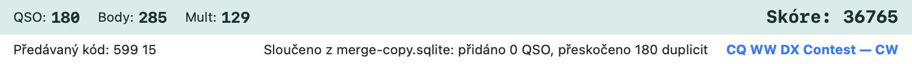

# Import a export

## ADIF

**„Soubor → Export → Export ADIF…“** (nebo příkaz
`EXPORT`) zapíše ADIF 3.1.4 s QSO aktivního závodu — nebo, při volném
logování, QSO zapsaná bez závodu:

| Pole | Obsah |
|---|---|
| `QSO_DATE`, `TIME_ON`, `CALL`, `BAND`, `FREQ`, `MODE` | základní údaje QSO |
| `RST_SENT`, `RST_RCVD`, `STX`, `SRX` | reporty a pořadová čísla |
| `STX_STRING`, `SRX_STRING` | celá odeslaná / přijatá výměna (zóna, okres, lokátor...) |
| `CONTEST_ID` | název aktivního závodu v Cabrillu (`CQ-WW-CW`) |
| `DXCC`, `COUNTRY`, `CONT` | země a kontinent |
| `APP_N1MM_RUNNING` | Run (`Y`) / S&P (`N`), rozšíření N1MM |
| `OPERATOR`, `COMMENT` | operátor, poznámka |
| `PFX` | prefix WPX značky |
| `APP_N1MM_EXCHANGE1` | přijatá výměna (pole N1MM) |
| `APP_N1MM_POINTS`, `APP_N1MM_ISRUNQSO` | body za QSO; Run (`1`) / S&P (`0`) |
| `APP_N1MM_MULT1`–`3` | násobiče, které QSO započítalo jako nové (z přehrání otevřeného závodu) |
| `APP_N1MM_RADIO_NR`, `APP_N1MM_RUN1RUN2` | rádio, na kterém bylo QSO zapsáno (1 / 2, viz [SO2R](so2v.md#číslo-rádia-u-qso)); vynechá se, když není známo |

Import (`IMPORT`) čte `SRX_STRING` / `STX_STRING` zpět do výměny (report
na začátku se neztrojí), takže export → import zachová výměnu
i pro přepočet skóre. Soubor z N1MM bez `SRX_STRING` dá výměnu z
`APP_N1MM_EXCHANGE1`, `APP_N1MM_ISRUNQSO` nastaví Run / S&P a `APP_N1MM_RADIO_NR` rádio.

### ADIF podle data

Obdoba N1MM **Export → ADIF by date**. **„Soubor → Export → ADIF podle data…“** se zeptá na **první a poslední
den (UTC)**; oba dny se započítají celé (od 00:00:00 UTC prvního do 23:59:59 UTC posledního). Okno začíná na prvním
a posledním dni otevřeného deníku a ukazuje, kolik QSO je ve zvoleném období; **Exportovat…** se pak zeptá na soubor
(navržený název `maccontestlogger-2026-11-28-2026-11-29.adi`). Obsah je stejný jako při celém exportu, omezený na
tato QSO aktivního závodu (nebo volného logování). Období bez QSO nezapíše žádný soubor a oznámí to.

**Ze všech závodů v databázi** — N1MM *ADIF by date from ALL contests* — spočítá a exportuje QSO všech závodů
uložených v otevřené databázi (i volného logování) v daném období. Takový soubor nemá `CONTEST_ID` (QSO patří
k různým závodům); navržený název začíná `maccontestlogger-all-`.

**Stanice sítě** — N1MM *Export ADIF by multi-user station name* — se objeví, když QSO pocházejí z více stanic
síťového deníku: exportují se jen QSO zapsaná zvolenou stanicí (ID stanice se přidá k navrženému
názvu).

## EDI (REG1TEST, VKV)

**„Soubor → Export → Export EDI (VKV)…“** zapíše pro
každé pásmo deníku soubor `<CALLSIGN>_<band>.edi` ve formátu **REG1TEST**
(IARU Region 1, VKV závody):

- hlavička: název závodu, data, volací značka, lokátor (musí mít 6 znaků
  v „Nastavení → Stanice“), sekce (SINGLE / MULTI podle
  kategorie závodu), pásmo (`144 MHz`), adresa, výkon a anténa ze stanice,
  operátoři,
- souhrny: počet QSO, body (km), počet velkých čtverců (`CWWLs`) a
  zemí (`CDXCs`), celkové skóre a **ODX** (nejvzdálenější spojení),
- řádky QSO: datum, čas, volací značka, kód módu (1 SSB, 2 CW, 6 FM...), reporty a
  čísla, lokátor, body (km), `N` pro nový čtverec a zemi, `D` pro dupe
  (0 bodů).

Lokátor protistanice se bere z pole výměny `LOCATOR` (VKV
závody v datech — IARU R1 VHF/UHF, Marconi Memorial — ho mají).

## CSV, text a souhrn

**„Soubor → Export → Export CSV, text a souhrn…“** zapíše do zvolené složky:

| Soubor | Obsah |
|---|---|
| `<CALLSIGN>.csv` | CSV (čárka, uvozovky podle RFC 4180) — čas, volací značka, pásmo, kHz, mód, reporty, čísla, výměny, země, kontinent, Run/S&P, operátor, X-QSO, poznámka |
| `<CALLSIGN>.txt` | textový výpis s pevnými sloupci — k tisku nebo jako příloha |
| `<CALLSIGN>-summary.txt` | souhrn: závod, stanice, nastavení závodu a údaje stanice (kategorie, odeslaná výměna, operátoři, začátek, lokátor, zóny…), období, QSO / body / násobiče / skóre (přepočítané), tabulka pásmo × mód |

### Text seřazený podle pásma

**„Soubor → Export → Text podle pásma…“** — N1MM *Export to file (generic), sorted by band* — zapíše stejný výpis
s pevnými sloupci jako `<CALLSIGN>.txt`, ale pásmo po pásmu od nejnižšího pásma, v rámci pásma v časovém pořadí
(navržený název `<CALLSIGN>-by-band.txt`).

## Cabrillo

**„Soubor → Export → Export Cabrillo…“** zapíše Cabrillo 3.0. Nastavení závodu nabízí kategorie Cabrilla 3.0,
včetně `CATEGORY-TIME: 8-HOURS`, `CATEGORY-STATION: DISTRIBUTED / EXPLORER / ROVER-LIMITED / ROVER-UNLIMITED` a
`CATEGORY-OVERLAY: YL / YOUTH / NOVICE-TECH / OVER-50`; `GRID-LOCATOR` se bere z lokátoru stanice.

**Multi-Two** (`CATEGORY-TRANSMITTER: TWO`) přidá do každého řádku QSO číslo vysílače (0 / 1). S více
stanicemi v síti je každá stanice jedním vysílačem (v pořadí jejich prvního QSO). Když celý deník pochází
z jednoho počítače se dvěma rádii, rozhoduje rádio, na kterém bylo QSO zapsáno, jako Run1/Run2 v N1MM: rádio 1 = 0,
rádio 2 = 1.

**Kopie pro master.scp.** S volbou *Nastavení → Other → Po exportu Cabrilla připravit e-mail s kopií na
logs@supercheckpartial.com* (ve výchozím stavu vypnuto; v N1MM *CC Cabrillo to logs@supercheckpartial.com*) otevře
úspěšný export Cabrilla v poštovním klientu novou zprávu adresovanou na `logs@supercheckpartial.com` s přiloženým
souborem. MacContestLogger sám nic neodesílá — zprávu odešlete nebo zahodíte vy.

## Slučování deníků

Obdoba N1MM **Merge logs** a DXLog **Merge**. **„Soubor → Import →
Sloučit deník…“** přidá do aktuálního deníku QSO z jiného deníku:

- databáze MacContestLogger (`.sqlite`, např. deník druhé stanice bez
  sítě) — vezmou se QSO stejného závodu, pokud je zdroj obsahuje,
  jinak všechna,
- soubor ADIF nebo Cabrillo (výměna se převede jako při importu).

Přidají se jen QSO, která v deníku ještě nejsou: stejná volací značka, pásmo a mód
a čas v rozmezí **±2 minuty** (rozdílné hodiny stanic), nebo stejné `uuid`.
Duplicity uvnitř slučovaného deníku se také přeskočí. Po sloučení se skóre
přepočítá a stavový řádek ukáže, kolik QSO bylo přidáno a kolik
přeskočeno.



## Kopírování závodu do jiné databáze

Obdoba N1MM **Copy This Contest to Another Database** a **Copy All Contests to Another Database**.
**„Soubor → Zkopírovat závod do jiné databáze…“** otevře okno:

- **Závod**: aktivní závod (výchozí), kterýkoli jiný závod otevřené databáze, nebo **Všechny
  závody** (QSO zapsaná bez závodu jdou s nimi),
- **Cílová databáze**: jiná existující databáze, nebo **Nebo nová databáze (název)** (nová databáze
  podle názvu; napsaný název má přednost před vybraným). Otevřená databáze nemůže být cílem.

Co se kopíruje: řádek závodu (snímek definice, nastavení, stanice), jeho QSO a jeho záznamy QTC (WAE).

- **Otevřená databáze se jen čte**, nikdy se nemění.
- **Identita se zachovává**: id závodu a `uuid`, verze a stanice každého QSO se kopírují tak, jak jsou. Opakované
  kopírování proto přidá jen QSO, která jsou ve zdroji nová (shoda podle `uuid`, pak podle značky, pásma, módu a času
  v rozmezí 2 minut jako při slučování), a databáze, která se později synchronizuje, vidí tatáž QSO, ne nová.
  Totéž QSO pak existuje ve dvou databázových souborech, ale otevřená je vždy jen jedna databáze.
- Závod, který už cíl má, si ponechá svůj uložený řádek; přidají se jen QSO, která mu chybí.
- Smazaná QSO (tombstones) se nekopírují.
- Kopírování do cíle je jedna transakce: pokud selže, cíl zůstane, jak byl.

Stavový řádek ohlásí cíl, počet zkopírovaných závodů a QSO a kolik QSO už tam bylo.

## Import souborů call history

**„Soubor → Import → Importovat call history…“** je **Import Call History** z N1MM s výběrem více souborů:
vyberte jeden nebo více souborů call history z N1MM (Cmd+klik) a sloučí se do načtené call history — přidají se do
**Nastavení → Závod → Call history → Další soubory call history**, hned se načtou a zůstanou i pro příští spuštění.
Pozdější soubor doplní prázdná pole již známých značek, připojí UserText a odlišný lokátor přesune do Loc2; platí
direktivy každého souboru (viz [Call history](call-history.md#více-souborů-v-jedné-tabulce)). Soubory, které se už
používají, se přeskočí. Vybrané soubory se nemění a **Aktualizovat call history z deníku** zapisuje jen hlavní soubor.

## Export call history

**„Soubor → Export → Call history (N1MM)…“** a **„… (CSV)…“**
zapíší **načtenou** call history (soubor v Nastavení → Závod → Call history, sloučený s dalšími soubory) do
zvoleného souboru, obdoba
**Export Call History** v N1MM:

- **N1MM** je textový formát, který deník čte (hlavička `!!Order!!`, názvy sloupců N1MM), takže soubor lze
  znovu načíst nebo předat jinému deníku,
- **CSV** je soubor připravený pro tabulkový procesor (RFC 4180, UTF-8): řádek hlavičky, jeden řádek na volací značku,
  hodnota s čárkou, uvozovkou nebo zalomením řádku v uvozovkách.

Volací značky jsou seřazené. Načtený soubor se nemění. Bez call history to stavový řádek oznámí.

## Export funkčních kláves

**Soubor → Export → Function Keys (.mc)…** (N1MM „Export Function Keys to file“) uloží
zprávy F-kláves, které klávesy zadávacího okna právě vysílají (CW, SSB nebo digitální podle módu), jako soubor
N1MM `.mc`: 12 zpráv pro Run, pak 12 pro S&P. Načtení souboru a vlastní soubory závodu
jsou v Nastavení → Function Keys ([cw-keyer.md](cw-keyer.md#soubory-funkčních-kláves-mc)).

## Tisk deníku

**„Soubor → Tisk deníku…“** otevře systémový dialog
tisku (tiskárna, PDF) a vytiskne textový výpis deníku — neproporcionální písmo,
záhlaví sloupců na každé stránce a v zápatí název závodu, volací značka a
číslo stránky.

## Přepočet DXCC v deníku

**„Nástroje → Přepočítat DXCC v deníku…“** projde všechna spojení a znovu odvodí
zemi (číslo DXCC, název, kontinent) z volací značky podle dnešního souboru zemí. Na rozdíl od
vyplňování při zápisu, které se dotýká jen prázdných polí, tato akce
**přepíše i to, co už je uložené** — včetně údajů z importovaného deníku,
které mohly být určeny přesněji než odhadem z prefixu. Proto
se ptá na potvrzení.

Hodí se, když jsou uložená čísla prokazatelně chybná (deníky zapsané předtím,
než bylo opraveno odvozování čísla DXCC z `cty.dat`). Spojení, jejichž
volací značku soubor zemí nezná, zůstanou beze změny — hádat se nemá.
Po dokončení ukáže stavový řádek, kolika QSO se akce týkala.

## Automatická záloha

**„Nastavení → Závod → Automatická záloha deníku“**:

- **interval** (výchozí 15 min, 0 = vypnuto) — záloha jen tehdy, když se deník od
  poslední zálohy změnil, a vždy při ukončení aplikace,
- **počet záloh** (výchozí 10) — starší automatické zálohy se mažou,
- **složka** (výchozí `.../MacContestLogger/backups`).

Zálohy `<log>-auto-<UTC time>.sqlite` jsou konzistentní kopie databáze
(SQLite `VACUUM INTO`) a lze je otevřít jako deník. Ruční záloha vedle
deníku: příkaz `COPYLOG` (ta se nemaže).

## Transakční soubor

Stejně jako soubor `.TRN` v N1MM se každý zápis do deníku — zapsané, upravené nebo smazané QSO, QSO přijaté ze
síťového deníku, import — připojí jako jeden řádek textu (JSON) do **transakčního souboru** vedle databáze:
`<database>.sqlite.trn` ve složce databází. Do souboru se jen připisuje, takže přežije poškozený nebo ztracený
databázový soubor a pokrývá QSO zapsaná od poslední zálohy.

**„Soubor → Import → Obnovit QSO z transakčního souboru…“** sestaví deník ze souboru `.trn` (vložení a úpravy
se přehrají v pořadí, smazaná QSO se vynechají) a přidá jeho QSO do otevřeného závodu: QSO otevřeného závodu, pokud
je soubor obsahuje, jinak QSO závodu, ke kterému patří poslední QSO souboru (typicky: vytvořte novou databázi
a závod, pak obnovte soubor staré databáze). QSO, které už v databázi je (stejné síťové id), se přeskočí, takže
dvojí obnovení nic nepřidá; řádek useknutý pádem se započítá jako nečitelný a přeskočí se. Skóre se poté přepočítá.

Soubor roste s databází; lze ho smazat, když databáze není otevřená (při příštím zápisu se založí
nový).

## Text ve formátu závodu

**Soubor → Export → Text ve formátu závodu…** zapíše jeden řádek na QSO podle
šablony v definici závodu (`export: { text: "…" }`, generický výstup N1MM / UDC `CabrilloString`), jinak
podle výchozí. Zástupné symboly `{name}` nebo `{name:width}`: kladná šířka doplní mezery vpravo, záporná
vlevo, delší hodnoty se oříznou. Názvy: `date`, `time`, `call`, `band`, `freq` (kHz), `mode`, `rsts`, `rstr`, `nrs`,
`nrr`, `sent`, `rcvd`, `op`, `points`, `note`, `mycall` a id kteréhokoli přijímaného pole, např.

```yaml
export: { text: "{date:10} {time:4} {call:13} {rsts:3} {nrs:-4} {rstr:3} {nr:-4} {loc:6}" }
```

Definice závodu může do exportu ADIF přidat i vlastní pole ADIF: `adif: { SAT_NAME: sat, PROP_MODE: "=SAT" }`
(hodnota přijímaného pole, nebo `=text` pro pevnou hodnotu).
