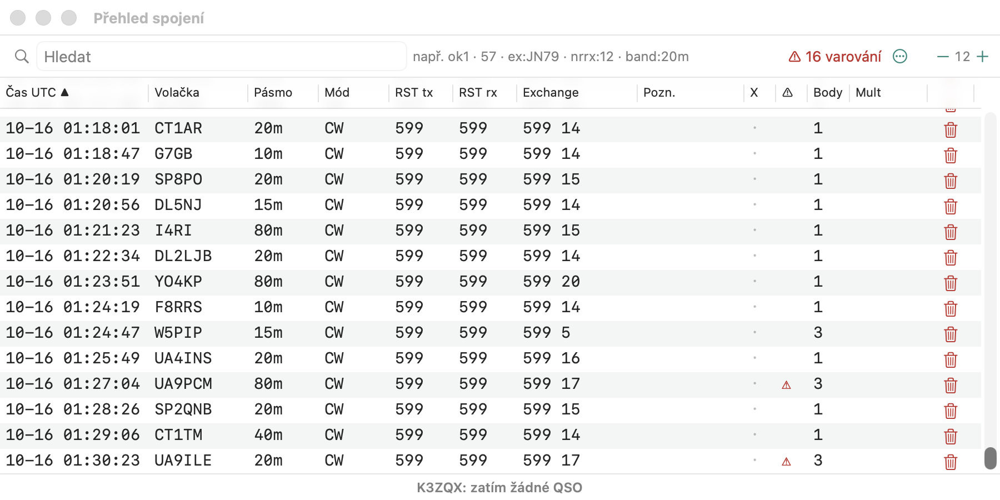

# Okno deníku (Přehled spojení)

Okno ukazuje QSO aktivního závodu. Při volném logování (není otevřený žádný
závod) ukazuje QSO zapsaná bez závodu — viz
[Začínáme → Volné logování](zaciname.md#volné-logování-bez-závodu).

## Menu řádku

Klik pravým tlačítkem na QSO (jako [kontextové menu okna Log v N1MM](https://n1mmwp.hamdocs.com/manual-windows/log-window/#Right-click_Menu)):

| Položka | Akce |
|---|---|
| **Upravit QSO…** | dialog úprav QSO (všechna pole). **◀ / ▶** uloží změny a přejdou na předchozí / další QSO tabulky; pořadová čísla mají šipky nahoru/dolů a čas kalendář (UTC) |
| **Označit jako X-QSO** | viz [Poznámky a X-QSO](#poznámky-a-x-qso) |
| **Přehrát nahrávku QSO** | přehraje nahrávku QSO |
| **Naladit na frekvenci QSO** | naladí rig na frekvenci a mód QSO |
| **Přepočítat od tohoto QSO** | přepočítá QSO od tohoto dál (v závodě), jako [Přepočítat posledních N hodin](score-window.md#přepočet-posledních-n-hodin) |
| **Rate k tomuto QSO v okně Info** | otevře okno Info s grafy rate tak, jak vypadaly u tohoto QSO (deník až po něj, k jeho času); **Aktuální rate** tam vrátí zobrazení do současnosti |
| **Kopírovat jako ADIF** | zkopíruje QSO — nebo celý výběr, jehož je součástí — do schránky jako ADIF |
| **Smazat QSO** | smaže QSO; lze ho obnovit, viz [Smazaná QSO](#smazaná-qso) |

## Předchozí QSO napsané značky

Stejně jako spodní panel okna Log v N1MM vypisuje spodní část okna, dokud je v zadávacím okně napsaná značka,
QSO, která s ní už byla zapsána — čas, pásmo, mód, reporty, odeslané a přijaté pořadové číslo, výměnu a
poznámku — nebo oznámí, že zatím žádné není.

## Volby zobrazení

Tlačítko **⋯** vpravo od pole hledání:

- **Jen QSO s poznámkou** — N1MM *View → Notes*: tabulka ukazuje jen QSO s poznámkou,
  hledání stále platí;
- **Zobrazit sloupec Mód** — N1MM *Show Mode Column*, pamatuje se v nastavení;
- **Smazaná QSO…** — viz níže.

## Smazaná QSO

Stejně jako deník DELETEDQS v N1MM se každé QSO smazané z deníku (menu řádku, výběr, Ctrl+D, WIPELOG) uchovává
v databázi. **⋯ → Smazaná QSO…** vypíše smazaná QSO závodu, naposledy smazaná první; vyberte je
a stiskněte **Obnovit**, aby se vrátila, nebo **Exportovat ADIF…**, abyste je uložili (vybraná,
nebo bez výběru všechna) do souboru ADIF. Obnovené QSO si ponechá svůj čas i všechna pole, zapíše se znovu jako
nové QSO (v multi-op clusteru se pošle ostatním stanicím jako nové QSO) a skóre se přepočítá.

## Hromadné úpravy

V režimu výběru (řádky vybírejte klikáním, Shift+klik pro rozsah, Cmd+klik pro
jednotlivé řádky) je v liště nad tabulkou menu úprav, jako v N1MM+
([Log window → Right-click Menu](https://n1mmwp.hamdocs.com/manual-windows/log-window/#Right-click_Menu)):

| Tlačítko | Akce |
|---|---|
| **Operátor…** | nastaví operátora u vybraných QSO (prázdné = smazat) |
| **Mód…** | nastaví mód (CW, SSB, RTTY, FT8...) |
| **Frekvence…** | nastaví frekvenci v kHz a podle ní pásmo |
| **Stanice…** | N1MM *Change Station Name*: nastaví stanici multi-op, na které byla QSO zapsána |
| **Posun času…** | posune časy: `+5` / `-5` minut, `+1:30`, `-2h`, `-90m` |
| **Interpolovat čas** | první a poslední vybrané QSO si ponechají své časy, ostatní dostanou časy rovnoměrně rozložené mezi nimi, zaokrouhlené na minuty (papírový deník zadávaný dodatečně). Vyžaduje aspoň 3 QSO |
| **Kopírovat jako ADIF** | vybraná QSO do schránky jako ADIF (v menu řádku) |
| **Smazat** | smaže vybraná QSO (s potvrzením) |

Každá úprava se uloží, v clusteru se pošle ostatním stanicím a skóre se
přepočítá.

## Poznámky a X-QSO

- Sloupec **Pozn.** je poznámka k QSO: kliknutím ji upravíte, v zadávacím okně
  se přidává klávesou **Ctrl+N** ([keyboard-shortcuts.md](keyboard-shortcuts.md)). Podle sloupce lze
  tabulku řadit.
- **X-QSO** (N1MM/DXLog „X-QSO flag“): QSO zůstává v deníku, ale **nepočítá se
  do skóre**. V Cabrillu se zapíše jako řádek `X-QSO:`, což je podle Cabrilla 3.0
  QSO, které by vyhodnocovatel neměl započítat (duplicita, neplatná výměna...).
  - přepnutí: klik do sloupce **X**, kontextové menu řádku, nebo hromadně tlačítkem
    **X-QSO** ve výběru (když jsou všechna vybraná X, značka se odebere);
  - řádek X-QSO je ztlumený;
  - příznak se přenáší i v multi-op clusteru.

## Upozornění na možné chyby

Jako N1MM ([Warning of Possible Errors](https://n1mmwp.hamdocs.com/manual-windows/log-window/#Warning_of_Possible_Errors))
označí tabulka ve sloupci **⚠** QSO, ve kterých může být chyba. Bublina nápovědy ukáže důvod:

- **výměna se liší** u stejné stanice na různých pásmech, např. zóna 5 na 20 m
  a 4 na 40 m. Označí se všechna dotčená QSO. Report a pořadová čísla se mění
  přirozeně, proto se nekontrolují;
- **volací značka není v master.scp** (možný překlep), jen když je SCP načtené;
- **zóna neodpovídá zemi**: přijatá zóna CQ nebo ITU není mezi zónami
  entity DXCC volací značky.

Tlačítko **⚠ n varování** v liště hledání ukáže jen QSO s varováním, další
klik opět všechna. X-QSO a smazaná QSO se nekontrolují.

## Dodatečné zadání papírového deníku

Režim pro přepis papírového deníku po závodě, obdoba DXLog „Postcontest mode“ a
N1MM „Entering Multiple QSOs After the Contest“. Zapíná se v menu **Závod →
Dodatečné zadání (papírový deník)** nebo příkazem `POSTCONTEST`, vypíná stejně nebo příkazem `NOPOSTCONTEST`.

- Do zadávacího okna přibude pole **Čas UTC**. QSO dostane zadaný čas, ne aktuální.
- Stačí zadat `1432` nebo `14:32`. Datum se bere z předchozího QSO, u prvního ze
  začátku závodu. **Přechod přes půlnoc** se rozpozná automaticky: po `2355` znamená `0005`
  následující den. Posun o pár minut zpět (neseřazený deník) den nemění. Datum lze také
  zadat celé: `2026-11-29 0110`.
- Čas zůstává v poli i pro další QSO, přepíše se jen tehdy, když se změní.
- **Nic se nevysílá**: F-klávesy a ESM jsou vypnuté, Enter jen zapisuje.
- Zadávací okno ukazuje `DODATEČNÉ ZADÁNÍ`.

Když papírový deník časy nemá, zadejte čas prvního QSO a pak skutečný čas posledního.
**Interpolovat čas** v hromadných úpravách rovnoměrně rozloží zbytek.

## Body a násobiče (Marking Multipliers)

Obdoba N1MM **Marking Multipliers**
([doc](https://n1mmwp.hamdocs.com/manual-windows/log-window/#Marking_Multipliers)).
V závodě má tabulka dva sloupce navíc:

- **Body** — body za QSO podle pravidel závodu; dupe ukazuje červeně `0 D`.
- **Mult** — nové násobiče, které QSO přineslo, s jejich hodnotami (zóna `14`, země,
  prefix, okres...). Násobič je vždy u **prvního** QSO, které ho získalo — po
  smazání nebo opravě QSO se značka přesune na další.

Počítá se přehráním deníku (jako Rescore) na pozadí po každé změně.
X-QSO a smazaná QSO značky nemají. Mimo závod se sloupce nezobrazují.

## QSO podle čtverce

Pole hledání přijímá `grid:JN79` (nebo `loc:`): QSO, jejichž přijatý lokátor tím začíná (`grid:JN` pro celé
pole). Řádek s lokátorem má v menu **QSO ve čtverci JN79**, které toto hledání nastaví
(QSOs by grid z N1MM).
