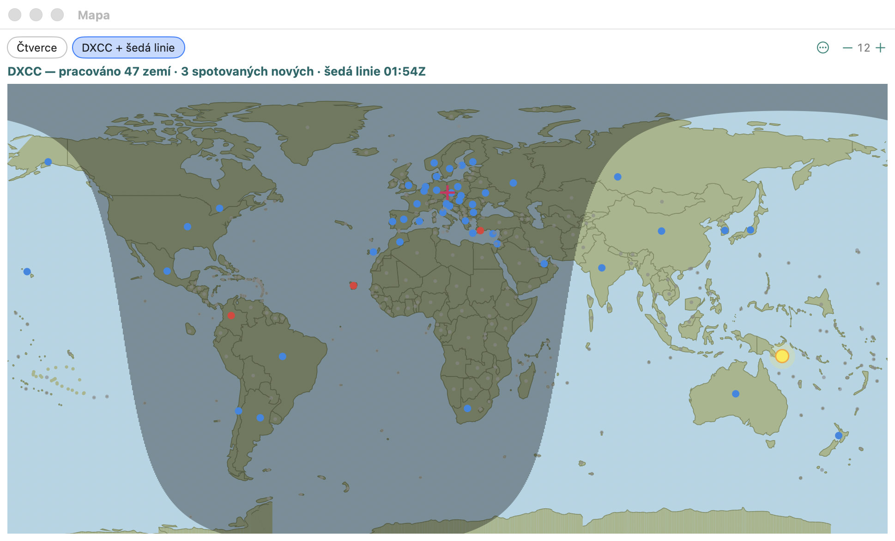

# Mapa

Okno mapy má dva režimy (přepínač nahoře):

## DXCC + šedá linie

Obdoba N1MM **Grayline / Mapping** a mapy DXLogu. **Okno → Mapa DXCC a šedá linie**
(bez závodu se okno otevře rovnou v tomto režimu).

- Noc je ztmavená, hranice dne a noci = **šedá linie** (terminátor spočítaný pro
  aktuální čas, přepočítává se každou minutu); žlutá tečka = Slunce v zenitu.
- Každá země DXCC je tečka ve svém středu: **modrá** = pracovaná (z deníku),
  **červená** = spotovaná a dosud nepracovaná, šedá = zatím nic.
- Křížek = moje stanice (lokátor / souřadnice z Nastavení → Stanice).

### Volby mapy (⋯ vpravo nahoře)

Nastavení Grayline z N1MM, pro oba režimy; volby se ukládají.

- **Zobrazit Slunce / rovník / nultý poledník / domácí polohu** — Slunce a stanice jsou ve výchozím stavu
  zapnuté, rovník a greenwichský poledník se po zapnutí kreslí
  čárkovaně.
- **Počet zobrazených spotů** — jen nejnovějších 0, 50, 100, 150 nebo 200
  spotů se na mapě počítá jako spotované (**Vše** = každý spot v seznamu, výchozí).
- **Smazat všechny spoty z mapy** — spoty, které jsou teď v seznamu, se už na
  mapě nezobrazují; spoty, které přijdou potom, ano. Seznam spotů a bandmapa je ponechají.

## Čtverce

Multiplikátory → Čtverce v mapě: lokátorová pole Maidenhead pro závod se čtverci (pracovaná,
spotovaná, dvojitá) — beze změny.

# Poznámky k pásmům

Obdoba DXLog **Band notes**. **Okno → Poznámky k pásmům**:

- poznámka **pro frekvenci** (kHz, např. `14100` „majáky NCDXF“) — v bandmapě fialová
  tečkovaná čára s textem, v zadávacím okně `📝 text`, když jste do 2 kHz od ní,
- poznámka **pro pásmo** (místo frekvence zadejte `20m`) — pro celé pásmo.

Poznámky se ukládají v nastavení (`bandNotes` v `config.json`) a platí pro všechny
závody.
