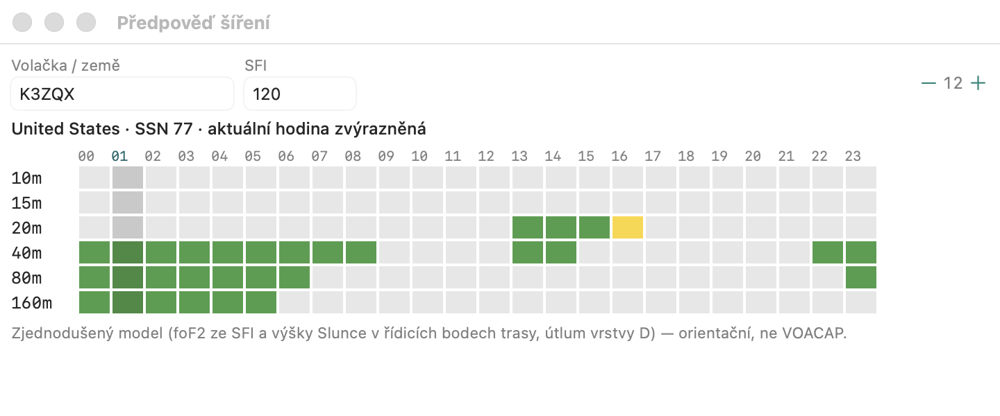

# Předpověď šíření

Obdoba grafu **HamCAP / VOACAP** z okna Info v N1MM — **zjednodušený vlastní
model**, ne VOACAP. Otevírá se přes **Okno → Předpověď šíření**.

- Trasa: z lokátoru stanice (Nastavení → Stanice) do země volačky z pole (nebo
  zadané volačky / prefixu).
- **SFI** se předvyplní z poslední zprávy WWV z DX clusteru (lze ho přepsat).
- Tabulka 24 hodin UTC × pásma 160–10 m: **zelená** = otevřeno, **žlutá** =
  na hraně (blízko MUF), šedá = zavřeno. Aktuální hodina je zvýrazněná.

## Model

1. SSN ze SFI (`(SFI − 63.7) / 0.728`).
2. Kritická frekvence foF2 v řídicích bodech trasy (1000 km od obou konců) podle
   výšky Slunce: noční minimum 2,3 + 0,012·SSN, polední maximum 5 + 0,055·SSN MHz.
3. MUF = nižší foF2 × koeficient skoku (až 3 pro skok 3000 km a delší).
4. LUF: útlum ve vrstvě D ve dne podle výšky Slunce na koncích trasy.
5. Otevřeno = mezi LUF a 85 % MUF, na hraně = až do MUF.

Výsledek je orientační — nezohledňuje sporadickou vrstvu E, geomagnetické bouře
(K-index) ani šíření dlouhou cestou.
