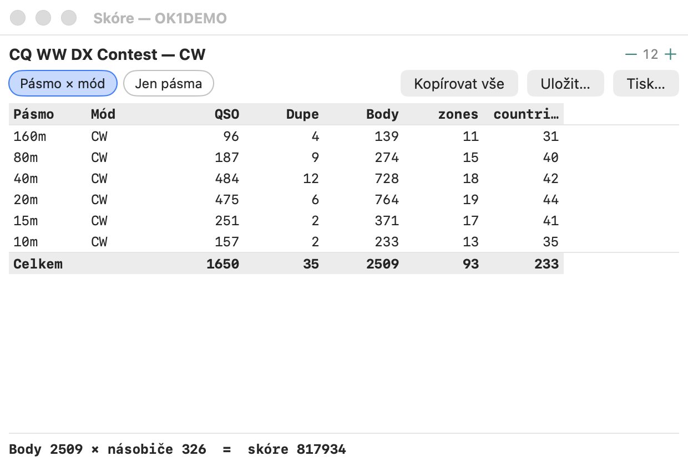

# Okno skóre

Obdoba N1MM+ **Score Summary**
([Score Window](https://n1mmwp.hamdocs.com/manual-windows/score-window/)) a DXLog
**Summary**. Otevřete ho přes **Okno → Skóre**, nebo klepnutím na pruh se skóre pod zadávacím oknem.

- Tabulka **pásmo × mód** (přepínač „Jen pásma“ sloučí módy): QSO, dupy, body a
  **nové násobiče podle typu** (zóny, země, prefixy… podle definice
  závodu).
- Násobič se připíše pásmu a módu, kde byl udělán **poprvé** — u násobičů
  počítaných jednou za závod (scope `ONCE`) tedy jen jednomu pásmu.
- Řádek **Celkem** a u vícemódových závodů také součty **podle módu**.
- Dole výsledek: `Points × multipliers (+ bonus) = score`. Kombinovaný závod hodnocený jako několik částí
  (QSO party téhož víkendu, viz [qso-party.md](qso-party.md)) vypíše body × násobiče každé části a
  součet: `7QP: points 30 × multipliers 4 = 120  ·  Indiana: … =  score 1520`.
- Počítá se přehráním celého deníku (jako Rescore), takže je správné i po úpravách QSO
  nebo po importu; X-QSO a smazaná QSO se nepočítají. Obnovuje se samo po každé
  změně deníku.
- Titulek okna nese značku stanice (**Skóre — OK1XOE**), název závodu je zobrazen nad tabulkou
  (N1MM *Display Contest Name*).
- **Kopírovat vše**, **Uložit…** (N1MM *Print to file*) a **Tisk…** — také v kontextové nabídce
  tabulky (pravé tlačítko) — zkopírují, uloží nebo vytisknou souhrn jako text: `<contest> — <call>`, nastavení závodu a stanici
  (kategorie, odeslaná výměna, operátoři, začátek, jméno, lokátor, zóny, země; prázdné hodnoty se vynechají), pak
  tabulku, součty podle módů a vzorec skóre.

## Přepočet posledních N hodin

**„Nástroje → Přepočítat posledních N hodin…“**, obdoba N1MM **Rescore
last N Hours**, se zeptá na počet hodin (1 až 8760, výchozí 24) a přepočítá jen QSO tohoto okna,
počítáno zpět od teď (hodiny počítače, UTC). Je to ruční **Přepočítat skóre** omezené na
toto okno: QSO před ním se stále přehrávají, protože rozhodují, co je dup a které QSO jako první přinese
násobič, takže výsledek každého QSO v okně je přesně takový, jaký dá úplný přepočet; jen se do nich
nezapisuje. QSO okna jsou ta, která se počítají ve zprávě (a ta, u nichž se doplní chybějící země);
zobrazené skóre je skóre celého deníku. Když v okně není žádné QSO, nic se neprovede a stavový řádek to oznámí.

**Přepočítat od tohoto QSO** v [nabídce řádku okna deníku](log-window.md#menu-řádku),
obdoba N1MM **Rescore from this point on**, dělá totéž pro QSO od času zvoleného QSO dál.

Při volném logování (bez závodu) okno jen oznámí, že rozpis není k dispozici.
