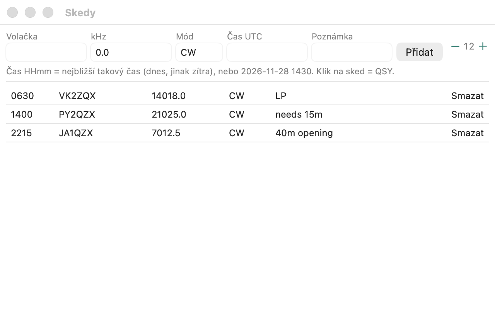

# Skedy

Domluvená spojení, obdoba systému [Sked system](https://n1mmwp.hamdocs.com/manual-windows/sked-system/) v N1MM+.
Okno se otevírá z menu **Okna → Skedy**.

- Formulář: **volací značka, kmitočet (kHz), mód, čas UTC, poznámka**. Kmitočet a mód
  se předvyplní z rádia.
- **Čas:** `1430` nebo `14:30` znamená nejbližší takový čas (dnes, nebo zítra, pokud už
  uplynul). Přesně ho můžete zadat jako `2026-11-28 1430`.
- Skedy se **ukládají se závodem**, takže přežijí restart.
- **Kliknutí na sked** naladí rádio na jeho kmitočet a mód a vloží volací značku do pole.
- **Připomínka** funguje i se zavřeným oknem. Minutu před časem se sked ohlásí
  ve stavovém řádku a v okně Info a v okně Skedy svítí ještě až 5 minut po čase. Deset
  minut předem ukazuje zadávací okno `SKED 1430 DL1ABC`. Uplynulé skedy jsou šedé.

Na rozdíl od N1MM se skedy zatím nekopírují na ostatní stanice multi-op clusteru.
