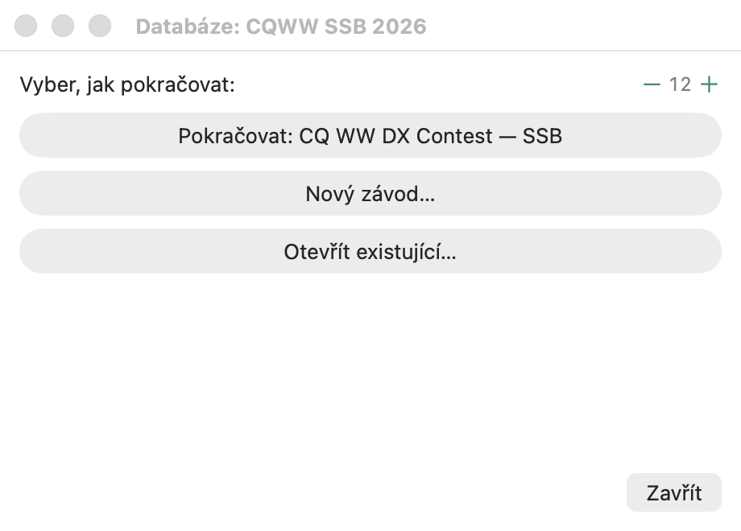
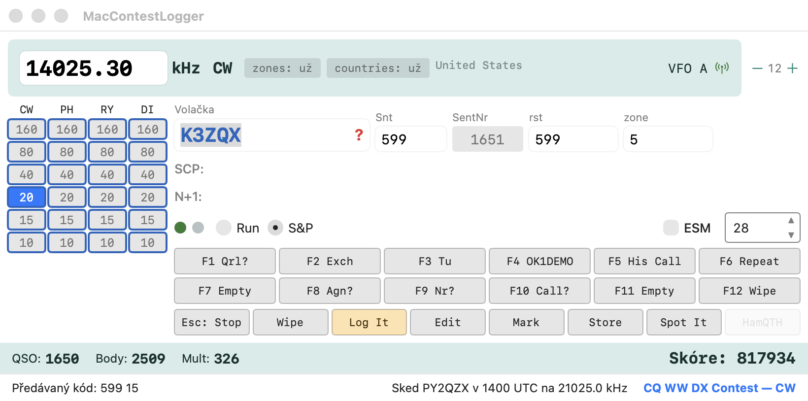

# Začínáme

Průvodce od prvního spuštění až po odeslaný deník. Podrobnosti ke každému kroku jsou na
samostatných stránkách, na které text odkazuje.

## Co potřebujete

| | |
|---|---|
| **macOS** | Apple Silicon i Intel; instalační `.dmg` sestavuje CI, nebo spuštění ze zdrojových kódů: `scripts/bundle.sh --config release` a pak otevřít `build/app/MacContestLogger.app` |
| **Definice závodů** | adresář s `contests/*.yaml` a `multipliers/*.yaml` — repozitář obsahuje `contest-data/` jako výchozí bod. **Nejsou součástí aplikace**; cestu k nim zadáte v Nastavení |
| **Data DXCC** | `~/dxcc-json/` s `cty.dat` (přesnější) nebo `dxcc.json`. Bez nich nebude fungovat určování zemí a násobičů. Získáte je příkazem `git clone https://github.com/k0swe/dxcc-json ~/dxcc-json`. S API klíčem Club Logu umí aplikace použít i `cty.xml` z Club Logu ([Data DXCC](dxcc-data.md)) |
| **Rádio** (volitelně) | přes hamlib `rigctld` — viz [Nastavení](settings.md) |

## První spuštění

Po startu se aplikace zeptá, jak pokračovat:

- **Pokračovat** — otevře poslední závod tam, kde jste skončili.
- **Nový závod…** — vyberete definici a zadáte svou volací značku a údaje stanice.
- **Otevřít existující…** — přepne na jiný závod ve stejné databázi.

**Soubor → Otevřít nedávné** ukazuje posledních 9 závodů otevřených v aktuální databázi,
nejnovější nahoře; kliknutí závod otevře stejně jako **Otevřít závod…** a **Vymazat seznam** seznam
vyprázdní (závody v databázi zůstanou). Seznam se ukládá přímo v souboru databáze, takže každá databáze
má svůj vlastní.

### Okno závodu (N1MM Contest Setup)

- **Nový závod…** má nad seznamem závodů vyhledávací pole (**Hledat závod**, název nebo id) a **Řadit podle názvu**;
  **Pravidla závodu** otevře stránku s pravidly zvolené definice
  (`metadata.officialUrl`), **Nápověda k nastavení** tuto dokumentaci a **Vyplnit podle posledního závodu**
  zkopíruje kategorie Cabrilla a operátory naposledy otevřeného závodu.
- **První pořadové číslo**: pořadové číslo prvního QSO, pro další část závodu, která
  navazuje v číslování.
- **master.scp závodu**: vlastní soubor Super Check Partial závodu (N1MM Associated Files), načtený po dobu, kdy je závod
  otevřený; prázdné = soubor z Nastavení. Stejně fungují i vlastní soubory call history a funkčních kláves závodu.
- **Soubor cílů závodu**: soubor cílů (formát položky **Importovat cíle ze
  souboru…** okna Info; sloupce pásem se sčítají) načtený do cílů okna Info při každém otevření závodu; prázdné =
  cíle zůstanou, jak jsou.
- **Soubor → Nastavení závodu…** otevře totéž okno nad otevřeným deníkem: kategorie, odesílanou
  výměnu, operátory (**Operátoři z deníku** doplní všechny operátory zapsané u QSO), soapbox, časy, první
  pořadové číslo a přiřazené soubory lze změnit dodatečně; QSO zůstanou a skóre se přepočítá.
- **Otevřít závod…** ukazuje závody databáze; tlačítko s košem smaže závod se všemi jeho QSO po
  potvrzení (otevřený závod smazat nelze).
- **Nastavení → Zkratky výměny…** otevře soubor
  `ExchangeAbbreviations.txt` v datové složce: jedna dvojice na řádek, `ALA=AL`; napsaná hodnota rovná
  zkratce se v textových polích výměny (stát, provincie, okres…) zapíše jako její náhrada. Soubor
  se načte znovu při každé změně.

Databáze je jeden soubor SQLite na závod; přes **Soubor → Nová databáze…**
jich můžete založit několik (například jednu na každý víkend).

Než začnete logovat, projděte **Nastavení** (`Cmd+,`): volací značku a
údaje stanice, adresář s definicemi závodů, CAT, klíčovač a zprávy
F-kláves. Vše je popsáno v [Nastavení (Configurer)](settings.md).

## Vstupní okno

Sem píšete volací značku a přijatou výměnu. Co vidíte:

- **Nahoře** kmitočet a druh provozu z rádia; vlevo pruh pásem —
  u rozepsané značky je obarvený podle toho, kde už stanice
  byla navázána ([Call check](call-check.md)).
- **Run / S&P** přepíná sadu zpráv F-kláves ([Run / S&P](run-sp.md)).
- **ESM** = Enter Sends Message: Enter odešle to, co v danou chvíli dává smysl —
  výzvu CQ, výměnu, potvrzení — a zapíše QSO ([ESM](esm.md)).
- **F1–F12** jsou zprávy klíčovače, zvlášť pro CW, SSB a digitální provoz
  ([CW klíčovač](cw-keyer.md), [Hlasový klíčovač](voice-keyer.md), [Digitální provozy](digital-modes.md)).
- **Dole** průběžné skóre a stav CAT.

Klávesy, které ovládají všechno ostatní, jsou v
[Klávesových zkratkách](keyboard-shortcuts.md); do pole volací značky můžete psát také
[textové příkazy](text-commands.md) (QSY, změna druhu provozu, `OPON`, `WIPELOG`...).

## Zápis spojení

1. Napište volací značku. Duplikáty, možné překlepy a násobič, který by QSO přineslo,
   se hlásí už během psaní.
2. Tabulátorem přejděte na výměnu a vyplňte ji. V mnoha závodech je zóna nebo
   okres předvyplněn odhadem podle značky — vždy ho můžete
   přepsat.
3. **Enter** (s ESM) nebo tlačítko **Log It** QSO zapíše.

Zapsaná spojení se objeví v [okně deníku](log-window.md), skóre v
[okně Skóre](score-window.md) a rozpis násobičů v
[oknech násobičů](multipliers-window.md).

## Volné logování (bez závodu)

K logování závod nepotřebujete. Přes **Závod → Žádný (volné logování)**,
příkaz `CLOSE` nebo jednoduše dřív, než závod otevřete, má
vstupní okno jen reporty (odeslaný a přijatý; žádné pořadové číslo ani výměnu) a
**Enter** / **Log It** uloží QSO do otevřené databáze bez závodu — bez
bodů a násobičů, země se doplní jako obvykle.

- [Okno deníku](log-window.md) pak ukazuje jen QSO z volného logování; po opětovném otevření
  závodu jen QSO toho závodu. Oba deníky se nikdy nemíchají.
- Ve volném logování nejsou duplikáty: opakovaná značka se nikdy neoznačí,
  nepípne ani nic nezablokuje. Spodek hlavního okna neukazuje skóre,
  body ani počítadla násobičů — ty se objeví jen se závodem.
- **Export ADIF** zapíše QSO z volného logování (bez `CONTEST_ID`); Cabrillo
  potřebuje závod.
- QSO z volného logování zůstávají na této stanici: neposílají se do
  [síťového deníku](multi-op.md).

## Po závodě

**Soubor → Export**: Cabrillo pro pořadatele, ADIF pro
vlastní deník nebo LoTW, CSV a souhrn pro sebe. Podrobnosti v
[Importu a exportu](import-export.md).

Před exportem projděte v deníku sloupec **⚠** — označuje spojení, u kterých
něco nesedí (podezřelá výměna, nepravděpodobná zóna).

## Kam dál

- [Klávesové zkratky](keyboard-shortcuts.md) — vyplatí se je projít před závodem
- [DX cluster](dx-cluster.md) a bandmapa — spoty, barvy podle stavu, bandplán
- [Multi-op a síť](multi-op.md) — několik stanic na jednom deníku
- [Editor definic závodů](definition-editor.md) — když váš závod chybí
