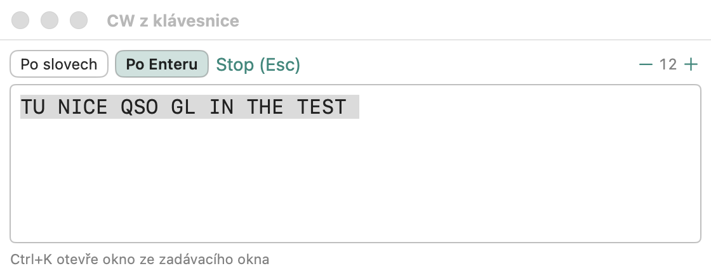
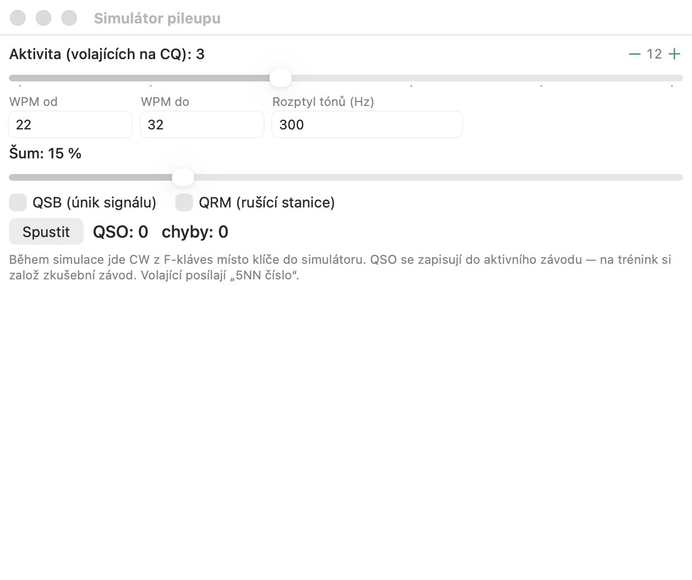

# CW keyer

In CW mode the function keys F1–F12 send CW messages. There are two ways to key,
just as in N1MM+
([Choosing Your CW Method](https://n1mmwp.hamdocs.com/setup/interfacing/#Choosing_Your_CW_Method))
and DXLog
([Winkey configuration](https://dxlog.net/docs/index.php?title=Menu_Options#Winkey_configuration)).

## "Nastavení → CW klíč" (Settings → CW keyer)

| Method | How it works | What it can do |
|---|---|---|
| **Rig keyer via CAT** (default) | text goes through rigctld to the keyer built into the rig (hamlib `send_morse`), e.g. Kenwood TS-590, Icom, Yaesu, Elecraft | plain text. Prosigns are sent as pairs of letters; speed changes `<` `>` inside a message are not supported by the rig |
| **K1EL Winkeyer** | serial port (USB), Winkeyer 2/3 protocol | everything: prosigns (AR, SK...), speed changes inside a message, precise interruption |
| **DTR/RTS line of a serial port** | a simple transistor interface on a serial (USB) port: one line keys CW, the other one PTT | everything a Winkeyer can do from the keyboard (the logger forms the elements); no paddles |
| **Off** | | |

For CAT the transceiver must be connected (icon in the info bar) and **the rig
must be in CW mode**. Otherwise hamlib refuses to transmit. The speed is set on
the rig automatically before the message.

**The rig must also have break-in switched on.** With CW via CAT the rig keys
itself when it receives the text, and most rigs only do that with break-in on;
with break-in off the message is accepted without an error (the CAT log shows
`RPRT 0`) but the rig only plays the sidetone, or nothing, and does not transmit.
On the Kenwood TS-590S/SG press **VOX** in CW mode ("BK-IN" lights up); semi or
full break-in and the delay are set in the rig's CW menu. If the F-keys "do
nothing" on the air, check break-in first.

Other options:
- **Speed (WPM):** default 28. In the entry window you change it with the
  **PgUp / PgDn** keys (±2 WPM) or with the spinner. It is saved when the program quits.
- **Cut numbers:** serial numbers with 0 → T and 9 → N (109 → 1TN).
- **Leading zeros:** serial numbers padded to three digits (007).

### Weight and spacing

- **CW weight (%)** (N1MM Other tab "CW Weight"): 30–70, default 50 (the
  standard 1:1 ratio). Higher values lengthen every mark and shorten the space
  after it, so the speed stays the same.
- **Contest word spacing** (N1MM "Use CW contest word spacing"): 6 dit spaces
  between words instead of 7.

Both apply to keyers that form the elements themselves (the Winkeyer when its
settings are sent). The rig keyer over CAT uses the rig's own weight setting.

### DTR/RTS keying and PTT

N1MM's CW/Other port with DTR or RTS set to *CW* / *PTT*. Choose the port, the
**CW line** (DTR or RTS) and optionally the **PTT line** (the other one). The
port opens with both lines low, so nothing is keyed until a message is sent,
and Esc, closing the keyer and quitting always leave the key up and PTT off.

- **PTT delay before sending (ms)** (N1MM "PTT Delay"): PTT goes on, then the
  first element follows after this delay, so the amplifier relay never
  hot-switches. Default 50 ms.
- **PTT tail after sending (ms):** how long PTT stays on after the last element
  (default 30 ms). Messages sent back to back keep PTT on between them.
- **PTT via radio command (CAT) in CW** (N1MM "PTT via Radio Command", CW
  mode): the rig's CAT PTT (`T 1` / `T 0`) goes on and off around the message,
  with the same delay and tail, in addition to (or instead of) the PTT line.
  Without a connected rig the message is not keyed.

The elements are timed by the logger on its own high-priority thread (weight
and contest word spacing apply); speed changes `<` `>` and prosigns work. Tune
(Ctrl+T) keys PTT, waits the delay and holds the key down.

PTT via radio command per mode: **CW** = the option above (the rig keyer over CAT
and the Winkeyer key their own PTT); **SSB** = *Voice keyer → PTT via CAT*;
**digital modes** = fldigi, TinyFSK or the TNC key PTT themselves.

Note: macOS raises DTR for an instant while a serial port opens; use the RTS line
for PTT if your interface reacts to that.

### Sound-card CW monitor

*Play the sent CW as a tone* (off by default) plays every sent CW message as a
sidetone on the chosen sound output, with its own pitch (300–1200 Hz) and
volume. The tone is formed from the same element sequence as DTR/RTS keying
(weight, word spacing, speed changes, the PTT delay before the first element),
with soft edges. Esc stops it. It is meant for DTR/RTS keying; the Winkeyer and
most rigs have their own sidetone.

### Winkeyer settings

N1MM's Winkey tab. Nothing is sent unless **Send settings to the Winkeyer when it
opens** is checked; without it the Winkeyer keeps its own (power-on) settings, as
before. When checked, the settings are sent after host open and again after every
change (on the next message), with the keyer in Winkeyer 2 mode (WK3 accepts it):

| Setting | Winkeyer command |
|---|---|
| Keying mode: Iambic B (default), Iambic A, Ultimatic, Semi-auto (bug) | mode register |
| Autospace, Reverse paddles, Contest word spacing | mode register |
| Sidetone on, Paddle-only sidetone, Sidetone frequency (400–4000 Hz in the Winkeyer's steps) | sidetone + pin config |
| CW weight | weight |
| PTT output, PTT lead time and tail time (10 ms steps, up to 2.55 s; tail 0 = the hang time decides) | PTT lead/tail + pin config |
| PTT hang time: 1, 1.33, 1.67 or 2 word spaces | pin config |
| First character extension, Keying compensation (ms) | first extension, keying compensation |
| Speed pot: minimum and range (WPM) | speed pot setup |

CW and PTT go to the KEY 1 / PTT 1 outputs. Use a PTT lead time long enough for
your amplifier's relay (N1MM recommends at least 10 ms when PTT is used) so it
never hot-switches.

**Speed pot:** *Ignore the speed pot* (default) — the Winkeyer sends at the
logger's speed whatever the knob says. *The speed pot changes the logger's CW
speed* — turning the knob sets the CW speed in the entry window, just like
PgUp / PgDn (the position is read once when the keyer opens, too). N1MM's third
choice (the pot for paddle and keyboard CW only) is not available.

## "Nastavení → Function Keys → CW" (Settings → Function Keys → CW)

Messages F1–F12 separately for **Run** and **S&P**. The default set corresponds to
the N1MM "CW Default Messages.mc". The tab opens with Alt+K or a right click on an
F-key button of the entry window (on the set the keys send now); hovering over a
button shows its message.

### Function key files (.mc)

The SSB, CW and Digi sets are read and written as N1MM function key files:
**Načíst .mc…** (Load) fills the shown set from a file, **Uložit .mc…** (Save) writes it,
**Kopírovat do schránky** copies it as a file's text. In the file, lines starting with
`#` are comments; every other line is a message (blank lines too), `Label,Message`;
lines 1–12 are the Run messages F1–F12, lines 13–24 the S&P ones (missing S&P messages
repeat the Run ones), `&&` in a label is `&`. N1MM's own `.mc` files load as they are.

**Contest's file (N1MM Associated Files).** With a contest open, **Přiřadit soubor k
závodu…** (assign) loads a file into the set and remembers it for the contest; **Uložit
jako soubor závodu…** saves the set to a new file and assigns it. The contest's files are
loaded whenever the contest opens, and a change of the set in Settings is written back to
its file. **Zrušit přiřazení** removes the assignment.

**Separate files for each operator** (Settings → Other, N1MM "Use Separate Function Key
Files for Each Operator"): an operator other than the station call who signs on with
Ctrl+O or `OPON` gets a copy of the station's messages the first time, and their own
messages afterwards; their changes never touch the station's (master) messages, which
come back when the station call signs on again. The operators' files are kept in
`FunctionKeys/` of the data folder.

| Macro | Meaning |
|---|---|
| `*` or `{MYCALL}` | my callsign |
| `!` or `{CALL}` | callsign from the callsign field; when the field is empty, the last logged one |
| `#` | serial number (according to the cut numbers / leading zeros options) |
| `{SENTRST}` | sent report from the Snt field |
| `{SENTRSTCUT}` | the same with cut digits (599 → 5NN) |
| `{EXCH}` | sent exchange from the contest setup without the report; the automatic serial number is substituted as `#` |
| `]` `[` `+` `=` | prosigns SK, AS, AR, BT |
| `<` `>` | speed +2 / −2 WPM from this point of the message (Winkeyer only) |
| `~` | half space (sent as a space) |
| `{LOG}` | logs the QSO |
| `{WIPE}` | clears the fields |
| `{RUN}` / `{S&P}` | switches the mode |
| `{LDIGFQ}` / `{RDIGFQ}` | the frequency of the left / right rig in kHz (in digital modes dial ± fldigi's audio, see [digital-modes.md](digital-modes.md#frequency-and-mode-fldigi)) |
| `{STACKANOTHER}` / `{SOCALLSTACK}` / `{CLRSTACK}` | [call stack](call-stacking.md): push the call / exchange it with the stack / clear the stack |
| `{GRAB}`, `{LOGTHENGRAB}`, `{DELALL}`, `{DELTOP}`, `{DELSEL}`, `{SCQ}` | the Digital Interface's [Grab window](digital-modes.md#the-grab-window) |
| `{LOGTHENPOP}` / `{LOGTHENNEXT}` | logs the QSO and continues with the next stacked call; the text after the macro goes to the next station ([call stacking](call-stacking.md#logthenpop-log-and-go-on)) |

Other macros in `{}` are not sent yet, and the status line warns about them.

Example exchange for CQ WPX (serial number): `{SENTRSTCUT} #`, for CQ WW
(zone from the contest setup): `{SENTRSTCUT} {EXCH}`.

## Controls

| Key | Action |
|---|---|
| **F1–F12** or click on the button | sends the message. A running message is interrupted, or with [F-key stacking](esm.md#options-settings--function-keys--esm) the new one is queued after it |
| **Esc** | stops transmission. Only the next Esc clears the fields |
| **PgUp / PgDn** | speed ±2 WPM |

The button of the message currently being sent is lit while it transmits. The
duration is calculated from real Morse code timing and the speed.

## More macros (N1MM)

| Macro | Content |
|---|---|
| `{LOGGEDCALL}` | the callsign logged most recently |
| `{NR}` | serial number (same as `#`) |
| `{MYNAME}`, `{MYGRID}` / `{MYLOC}`, `{MYCQZONE}` / `{MYZONE}`, `{MYITUZONE}`, `{MYSTATE}` | station data from "Nastavení → Stanice" (Settings → Station) |
| `{OPERATOR}` | operator at the keyer |
| `{TIME}` | UTC time `HHmm` |
| `{F1}`...`{F12}` | inserts the text of another F-key in the same set (chaining, at most 2 levels) |
| `{CLEARRIT}` / `{RITCLEAR}` | resets RIT |
| `{CQFREQ}` | jump to the CQ frequency (and clear the fields) |
| `{NOSPLIT}` | turns split off |
| `{SPOTME}` | spots your own station to the DX cluster on the entry window's frequency, with the [spot comment](dx-cluster.md#spot-comment-spotting-sp-qsos-and-special-calls) (`CQ` when blank); check that the contest rules allow self-spots |
| `{LASTCALL}`, `{PREVNR}`, `{LASTEXCH}`, `{PREVTIME}` | the last logged QSO: its call, the serial sent, the exchange received, its UTC time `HHmm` (for a fill after the QSO was logged) |
| `{NAME}` | the Name field of the entry window; when it is empty or the contest has none, the name from the call history |
| `{NAMEANDSPACE}` | the same followed by a space (nothing when there is no name) |
| `{CHNAME}` | the name from the call history, even when call history lookup is off |
| `{GRID}` | my locator (Settings → Station); `{CLUSTER}` the DX cluster login (the station call when none is set) |
| `{FREQ}` / `{FREQROUND}` | the entry window's frequency in kHz (`14025R3` in CW: R for the decimal point) / rounded to the kHz |
| `{LRMHZ}` / `{RRMHZ}` | the whole MHz of VFO A / radio 1 and VFO B / radio 2 |
| `{GRIDSQUARE}`, `{GRIDBEARING}`, `{REVGRIDBEARING}`, `{KMGRIDDISTANCE}` | the locator in the entry window, the bearing to it, the reverse bearing and the distance in km from my locator (VHF station passing: `{CALL} {GRIDSQUARE} {GRIDBEARING} deg {KMGRIDDISTANCE} km`) |
| `{TIME2}` / `{TIMEGMT}` | UTC `HHmm` / `HH:mm:ss` |
| `{TIME1}`, `{DATE}`, `{DATE1}`, `{DAYTIME}` | local `HH:mm:ss`, the short date of the system's regional format, `dd.mm.yy`, `yymmddhhmm` |
| `{DATEGMT}`, `{TIMESTAMP}` | the UTC date and time in the regional format / `yyyy-mm-dd hhmm` |
| `{VARYMSG1&Primary&Alternate&N&}` / `{VARYMSG2…}` | alternating text: `N` = 0 always the primary, 1 always the alternate, more than 1 the alternate every N-th send (`{VARYMSG1 &CQ * *&CQ CQ * *&3&}` sends a longer CQ every third time). The counters count sends in every mode |
| `{CQ}` | the key works as the CQ key: Run and the CQ frequency are remembered, like F1 |
| `{QSYCQ}` | the same as `{CQFREQ}` |
| `{EXCHSENT}` | ESM takes the exchange as sent (an exchange sent from another key) |
| `{CTRLHOME}` | the cursor into the callsign field with its text selected |
| `{FORCELOG}` / `{FORCELOGNOTE}` | logs past the exchange check, like Ctrl+Alt+Enter — without the note prompt / with it |
| `{SPACE}` | the space bar in the callsign field (on to the exchange) |
| `{COMMENT text}` | adds the text to the note of the QSO in progress, or of the last logged QSO when the callsign field is empty |

Characters a keyer cannot send (`:` in `{TIMEGMT}`, for example) are left out.

### Actions after the message, rig and station macros

| Macro | Action |
|---|---|
| `{END}` | the end of the text: what follows is never sent; the macros after it run once the message has been sent (`TU {END}{FREQUP}` moves up after "TU"). Esc or a newer message cancels them |
| `{PGUP}` / `{PGDN}` | the rig down / up by the step of "Nastavení → Ostatní → QSY makry {PGUP}/{PGDN}" (Settings → Other, 1 kHz by default) |
| `{FREQUP}` / `{FREQDN}` | the rig up / down by the same step (Sprint QSY, usually after `{END}`) |
| `{TURNROTOR}`, `{LONGPATH}`, `{STOPROTOR}` | the rotator to the bearing of the call in the callsign field, to its long path, stop |
| `{DIGQTCR}`, `{DIGQTCS}`, `{QTC}` | WAE: the QTC window opens to receive / send; `{QTC}` is the header of its series (`26/10`), see [QTC](qtc.md) |
| `{TX}` | in a message that sends nothing else: the active rig's PTT on over CAT until Esc (with the 30 s safeguard of the tune) |
| `{CAT1ASC cmd}` / `{CAT1HEX hex}` | a raw CAT command to radio 1 (`CAT2…` radio 2), through `rigctld`'s `w` command. Several commands are separated by `\`; an ASCII command may hold bytes as `<FE>`; HEX is pairs of hex digits (spaces ignored) |
| `{CATA1ASC …}`, `{CATI1ASC …}` (and `2`, `HEX`) | the same, only while radio 1 is the active / the inactive one |
| `{CATACTASC …}` / `{CATACTHEX …}` | the same to the active radio |
| `{CATDELAY n}` | a pause of n × 50 ms (at most 1 s) after the message's CAT commands |
| `{ANTRX1TOGGLE}`…`{ANTRX4TOGGLE}` | the active rig's antenna port n (hamlib `Y n 0`); the same port again toggles its RX antenna (`Y n 1`); never while transmitting |
| `{AUXANTSEL nn}` | the antenna with code nn from the antenna table, as if chosen by hand ([antennas.md](antennas.md)); the UDP RadioInfo carries it as `AuxAntSelected` |
| `{TELNET cmd}` | sends the command to the DX cluster (Telnet window) |
| `{SETWAVDIR text}` | the value of `{WAVDIR}` in the voice messages' paths (`{SETWAVDIR {OPERATOR}_2}`); the main window's title shows it. A change of operator resets it |

CAT commands are rig-specific and are sent as written: check them against your rig's manual.

### Two radios (SO2R / SO2V), audio and contests

| Macro | Action |
|---|---|
| `{OTHERFREQ}` / `{OTHERFREQROUND}` | the frequency of the other entry window's VFO / radio in kHz (`7025R3` in CW) / rounded to the kHz (for passing a station); with one window the rig's split TX frequency |
| `{OTHERBAND}`, `{OTHERMHZ}`, `{OTHERFREQCUT}` | the other radio's band (`40`, `144`), its MHz (`7.0`, `7R0` in CW) and the last three kHz digits as cut numbers |
| `{JUMPRX}` / `{JUMPRXTX}` | the other entry window becomes the active one (in this app the active window has the receive and the transmit focus together) |
| `{CONDJUMP}` | the same, only when not in split |
| `{FKEY(r1%r2)}` | a different message per radio: the part before `%` on radio 1 (VFO A), the part after it on radio 2 (VFO B); with one entry window the first part. A part that is a key name sends that key's message (`{FKEY(F1%F9)}`), anything else is message text with its own macros (`{FKEY(CQ {MYCALL} UP%CQ {MYCALL} TEST)}`). Works in CW, digital and voice messages |
| `{CTRLF1}`…`{CTRLF12}` | sends that F-key of the other entry window on its radio (`TU {CTRLF1}` thanks here and calls CQ on the other radio). In SO2R only the transmit focus moves (the entry focus stays here); in SO2V, with a call typed in this window, the focus comes back once the message has been sent. Switched off by Ctrl+Shift+L (Nastavení → SO2R → Makro {CTRLFx}) |
| `{STOPTX}` | releases the PTT (a `{TX}` or a tune carrier) |
| `{STEREOON}` / `{STEREOOFF}` | SO2R stereo headphones on / off (OTRSP `RXnS` / `RXn`) |
| `{OTRSP cmd}` / `{OTRSPOTHER RX}` | a command to the OTRSP device as written (`{OTRSP AUX13}`); `RX` alone is the RX command of the active / the inactive radio |
| `{ACTIVEAUDIOTOGGLE}`, `{ACTIVEAUDIOON}`, `{ACTIVEAUDIOOFF}` | mutes / unmutes the active rig's audio over CAT (hamlib `MUTE`; only rigs whose driver has it) |
| `{INACTIVEAUDIOTOGGLE}`, `{INACTIVEAUDIOON}`, `{INACTIVEAUDIOOFF}` | the same for the inactive rig (SO2R) |
| `{POPPREVNEEDEDQ}` / `{POPNEXTNEEDEDQ}` | VHF multi-band: the previous / next station of the log not yet worked on this band comes into the entry window with its exchange (locator…; the serial and reports are not copied) |
| `{SWAPCONTESTS}` | opens the contest opened before this one (File → Open recent); the call and exchange typed move along |
| `{SWAPCONTESTS3}`…`{SWAPCONTESTS6}` | cycles through the last 3–6 contests opened |
| `{SWAPCONTESTS name}` | opens the recent contest whose title holds the name |
| `{MESSAGE}` | multi-user: the rest of the message is not sent on the air but as a talk message over the network log; a first word naming a station sends it to that station only, `-` to all (`{MESSAGE} OP2 need 20m mult {CALL}`). Off the network the rest is dropped |
| `{PASS name}` / `{PASS kHz}` | multi-user: the pass frequency (rounded to kHz; the station's frequency when it announced none) of the named station, or of the station on the band of that frequency (the run station first, then one with a pass frequency); it becomes the last passed frequency |
| `{PASSMSG name}` / `{PASSMSG kHz}` | multi-user: passes the last logged call to that station (as Ctrl+Alt+P) |
| `{LASTPASSEDFREQ}` | multi-user: the frequency of the station last passed to (`{PASS …}`, Ctrl+Alt+P, Předat), R for the decimal point (`14025R5`) |
Other N1MM interface-control macros (`{KEYBOARD}`...) are not sent and are reported in the status line as unknown.

## CW from the keyboard

Equivalent of the N1MM **CW keyboard** (Ctrl+K). **Ctrl+K** in the entry window
(or "Okno → CW z klávesnice", Window → CW from keyboard) opens a window where the
typed text is sent with the keyer:

- **By words** — each word is sent as soon as you type a space (default),
- **By Enter** — the whole line is sent with Enter,
- Enter sends the remainder, **Esc** stops transmission and clears the field,
- the F-key macros apply (`*` my callsign, `!` callsign from the field, `#` number...).

## CW Reader (CW decoding)

The window **"Okna → CW Reader"** (Windows → CW Reader) decodes CW from the
receiver audio (you set the input in "Nastavení → Audio → Příjem", Settings →
Audio → Receive, the same one used for the waterfall).

- The decoder listens at a tone pitch (default = the CW pitch from the settings,
  changeable in the window).
- The speed is estimated continuously from the length of the dots and shown as "~N WPM".
- The threshold adapts to signal strength and noise; a weak signal below the noise is not decoded.
- Callsigns found in the text (newest first, excluding your own) are shown above
  the text as buttons — a click puts the callsign into the callsign field.
- **Pozastavit posuv** (Pause scrolling, as in N1MM): the shown text stops moving so you can read it or click a
  call, while decoding goes on in the background; **Pokračovat** (Resume) shows everything decoded meanwhile.

The decoder is simple (a Goertzel filter plus timing measurement). It works well
on a clean single-tone signal; in a pileup with several stations on the same tone
it gets confused, like any such decoder.

## Pileup simulator (similar to Morse Runner)

**"Okna → Simulátor pileupu"** (Windows → Pileup simulator) starts practice
without a rig: CW from the F-keys (also from ESM and the CW keyboard window) goes
to the simulator instead of the keyer, and both your own CW and the calling
stations play from the speaker (tone = CW pitch, callers spread around it).

- On **CQ / TU / QRZ** callers answer (the number depends on "Aktivita", Activity);
  impatient ones leave after a few CQs.
- If you send a caller's **callsign**, they reply "5NN number"; on
  **? / AGN / NR?** they repeat the exchange.
- On a **partial callsign with a question mark** ("OK1?") the matching stations
  answer; on a callsign **with one error** the station corrects it ("DE OK1ABC OK1ABC").
- After logging, the QSO is compared with what the station sent: the window shows
  the number of QSOs, errors, and for each QSO what was correct.
- Callsigns are taken from master.scp (Database); without it they are made up.

- **QSB (únik signálu)** — every caller fades slowly in and out (each station with its own period, the same
  every time it calls); **QRM (rušící stanice)** — while the callers answer, a weak station 150–450 Hz away calls
  CQ or finishes its own QSO. Both check boxes are off by default and can be switched while the simulation runs;
  they change the sound only — the callers, their speeds and their order stay the same.

QSOs are written to the **active contest**, so create a practice contest for
training. The simulation is simpler than Morse Runner: no flutter, and the exchange is always RST + serial
number.
