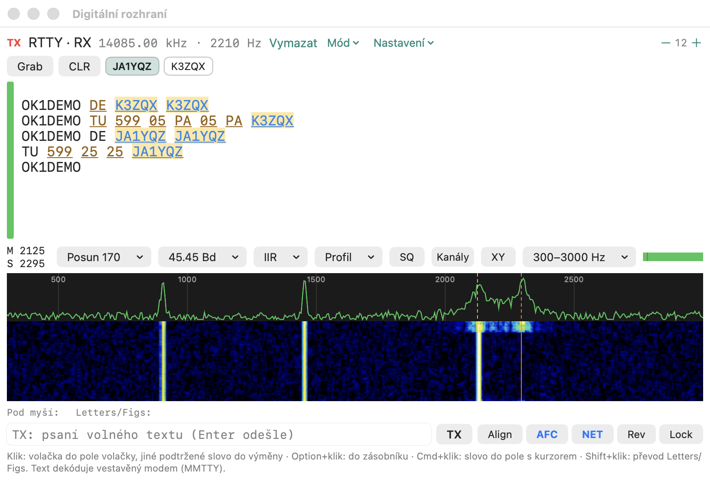

# Digital modes

MCL works with two sound-card modems behind the same Digital Interface window:

- the **built-in RTTY modem** (MMTTY's decoder and modulator, like N1MM's embedded MMTTY) — see
  [The built-in RTTY modem (MMTTY)](#the-built-in-rtty-modem-mmtty);
- **fldigi** for RTTY, PSK and the other modes, controlled over XML-RPC.

Everything described below for the Digital Interface — clicking calls and exchange words, the Grab
window, F-keys, ESM, Esc, Align/AFC/NET/Rev, AutoTRXUpdate, the TX window, message buttons, two
interfaces for SO2V/SO2R — works the same with either modem.

## fldigi as a modem (RTTY, PSK...)

Like N1MM with fldigi, MCL can leave modulation/demodulation to **fldigi** and control it through its
XML-RPC interface.

1. Start fldigi (XML-RPC is enabled by default on port **7362**).
2. In MCL: **"Nastavení → Digitální módy → Modem pro RTTY / PSK → fldigi"**
   (Settings → Digital modes → Modem for RTTY / PSK → fldigi), enter the address
   and port and click **"Vyzkoušet"** (Test; it shows the fldigi version and the
   current modem).
3. The F1–F12 messages for digital modes are in **"Nastavení → Function Keys →
   Digi"** (Settings → Function Keys → Digi), separately for Run and S&P (macros
   as for CW: `*`/`{MYCALL}`, `!`, `#`, `{SENTRST}`, `{EXCH}`, `{LOG}`,
   `{WIPE}`...; numbers are not shortened).

In RTTY/PSK/... mode the F-keys then transmit through fldigi (text into the TX
buffer, TX on, and after sending fldigi switches to receive by itself). ESM and CQ
repeat work; **Esc** interrupts transmission (`main.abort`).

## Frequency and mode (fldigi)

- **AutoTRXUpdate** (N1MM; Settings → Digital modes, or the window's **Nastavení** menu; on by default):
  with the rig in a sideband mode (USB/LSB, PKTUSB/PKTLSB, DATA-U/L) the dial shows the suppressed
  carrier, so the QSO is **logged and spotted** on the dial ± fldigi's audio frequency (USB adds,
  LSB subtracts; read with `modem.get_carrier`). In FSK RTTY (rig mode RTTY/RTTYR) the dial already
  is the mark frequency and nothing is added. As in N1MM it applies only while the Digital interface
  window is open (that is when the audio frequency is polled) and only in a digital mode; a
  frequency typed into the field that differs from the dial is logged as typed. The entry window's
  frequency field keeps showing the dial.
- The window's top bar shows the **exact frequency** (dial ± audio) and the audio frequency, e.g.
  `14082.13 kHz · 2125 Hz`.
- **Mód** (N1MM *Op Mode*) lists fldigi's modems (`modem.get_names`; RTTY, BPSK31/63/125, QPSK and CW
  first, the rest under *Další módy*). Choosing one switches fldigi (`modem.set_by_name`); an RTTY or
  PSK modem also puts the entry window into RTTY or PSK.
- Typing **RTTY** or **PSK** (PSK31, PSK63…) into the callsign field switches the logger **and fldigi**:
  to the modems set in **Settings → Digital modes → fldigi mode for RTTY / PSK** (default `RTTY` and
  `BPSK31`).
- Macros `{LDIGFQ}` and `{RDIGFQ}` send the frequency of the left (VFO A / rig 1) and right (VFO B /
  rig 2) side in kHz with one decimal (dial ± audio as above), e.g. `QSY {LDIGFQ}`.

## Tuning fldigi from the logger (Align, AFC, NET, Rev, Lock)

The buttons next to the TX line (N1MM's fldigi controls):

- **Align** (also `{ALIGN}`) retunes the rig so that the signal under fldigi's cursor lands on the
  **alignment frequency** — the centre of your filter — and moves fldigi's cursor there
  (`modem.set_carrier`). Essential for FSK, where the transmit frequency is fixed by the rig. Settings
  → Digital modes: *RTTY alignment* (default 2210 Hz — fldigi's cursor is the centre, so mark 2125 +
  85) and *Other alignment* (default 1500 Hz). The direction follows the rig mode: USB/PKTUSB up,
  LSB/PKTLSB and FSK RTTY down (RTTYR up).
- **AFC**, **Rev** and **Lock** switch fldigi's AFC, reverse and TX lock (`main.set_afc`,
  `main.set_reverse`, `main.set_lock`); a bold button is on (read when the window opens).
- **NET** (MMTTY's "TX follows RX") is fldigi's Lock off: NET on = Lock off.
- `{ENABLEAFC}` / `{DISABLEAFC}` and `{ENABLENET}` / `{DISABLENET}` in a message do the same.
- *AFC zapnout s CQ a TU* (N1MM "AFC On/Off with CQ"): the Run CQ (F1) and TU (F3) messages turn AFC
  on, the S&P messages off.
- *NET podle Run / S&P* (N1MM "NET On/Off with Run Change"): switching to S&P turns NET on (Lock off),
  to Run off (Lock on).
- *Kompenzace posunu FSK* (N1MM Shift Frequency Compensation): in FSK RTTY (rig mode RTTY/RTTYR) the
  offset (default 170 Hz, may be negative) is added to the logged and shown frequency, for rigs whose
  dial does not show the mark.

## The Digital interface window

**"Okna → Digitální rozhraní"** (Windows → Digital interface) — the equivalent of
N1MM *Digital Interface*. MCL pulls the decoded text from fldigi and draws it
**in its own window**, so you can work with it directly:



- **A click on a callsign puts it into the callsign field** (your own callsign is
  not underlined). You do not click in fldigi — XML-RPC has no "user clicked on a
  word" feature, so there is no path back from there. That is why the text must
  be in the logger's window, as in N1MM.
- **A click on an otherwise underlined word puts it into the exchange.** Where it
  belongs is decided by the contest definition: first the `validation` from the
  YAML (range, length, regex), then the shape according to the field type. In CQ
  WW RTTY, `599` goes into the report and `15` into the zone — it cannot land in
  the report because RST has three digits. Of several matching fields, **the first
  empty one** wins, so a partly filled exchange is not overwritten by a click as
  long as there is somewhere else to write. A word that fits nowhere is not underlined.
- **A double exchange is recognized as a whole.** Fields are assigned by the
  callsign **on the same line**, not by the one being typed — the exchange belongs
  to the station that sent it. In CQ WW RTTY, for `W3LPL 599 05 NY` both the zone
  **and** the state are highlighted, whereas for `DL1ABC 599 14` only the zone is,
  because only W/VE stations send a state. You click into both fields separately.
- Above the text is a **callsign list** in the order in which the callsigns
  appeared. The order is never rearranged — otherwise it would change under the
  cursor in a pileup and a click would hit the wrong callsign.
- The top bar shows the **modem and the TX/RX state** and a **"Vymazat"** (Clear)
  button (it clears only the window; the RX buffer in fldigi stays, so the text
  does not start being read again).
- **F1–F12, Enter and Esc work here too.** After clicking a callsign the keyboard
  stays in this window, so otherwise you could not fire F4 (callsign) or F2
  (exchange) right away. The keys are sent to the entry window, where all the
  logic lives: **Shift+F** takes the message from the opposite set (Run ↔ S&P),
  **Enter** performs an ESM step or logs the QSO, and **Esc** stops transmission.
  Focus stays in the window, so from one place you can pick a callsign, send the
  exchange and log the QSO.

## The receive window (N1MM Digital Interface)

**Mouse** (macOS keys for N1MM's — Ctrl+click is the system's secondary click):

| Mouse | Action |
|---|---|
| click on a callsign | into the callsign field (an exchange word into its field, as above) |
| **Option+click** | the callsign onto the [call stack](call-stacking.md) (N1MM Alt+click) |
| **Cmd+click** | the word under the pointer into the entry field that has the typing cursor, whatever it is (N1MM Ctrl+click) |
| **Shift+click** | the word converted Letters ↔ Figures (RTTY: `TOO` → `599`, `UE` → `73`), then into the callsign field (a callsign), its exchange field, or the field with the cursor |
| **right click** (or Ctrl+click) | with *Pravý klik = Enter (ESM)* it is Enter — a whole QSO can be run with the mouse (N1MM "Rt Click = Return NOT menu"); otherwise the text's menu |

Below the text the **Pod myší** (MouseOver) and **Letters/Figs** indicators show the word under the
pointer and its other-shift reading.

**Colours.** Callsigns are coloured like in the bandmap: by dupe and the number of new multipliers at
the active entry window's frequency and mode. *Ověřování volaček* (N1MM Callsign Validity) in the
**Nastavení** menu chooses: *Vše, co vypadá jako volačka* (generic), *Jen volačky ze zdrojů* (only
calls found in the chosen resources are highlighted and clickable) or *Obojí, neověřené žlutě*
(default: generic, and a callsign that none of the resources knows gets a **yellow** background).
The resources are Master.scp, the call history, the spots of the DX cluster and the callsigns in the
log. *Barva volačky jako pozadí* puts the colour behind the callsign (the unverified mark then
becomes yellow text). *Hledat volačky z Master.scp i v šumu* also finds a known callsign inside a
word that is not a callsign itself (`EEEEW1AWEEEE`); of several, the last one wins.

**Your own transmission.** Text that fldigi returns while it transmits (the echo of your message) is
shown dimmed, and its callsigns never go to the callsign list (N1MM: calls are not grabbed during
transmission).

**Pause.** The green bar left of the text pauses the window (it turns yellow): new text is held back
— fldigi is still read and the callsign list still fills — until the bar is clicked again, so you
can scroll back and click calmly. With *Pozastavit příjem nad volačkou* the pointer over a callsign
pauses the window by itself while the callsign field is empty (N1MM pause routines).

**More options** in **Nastavení**: *Hover* (a callsign under the pointer goes into the callsign field
without a click), *Po kliku na volačku kurzor do výměny* (N1MM "Send Space on Callsign Mouse Click"),
*Neposuvné okno příjmu* (N1MM non-scrolling window: the text on screen never moves; when the incoming
line reaches the bottom the window turns a page so the newest line is at the top, and the incoming
line is underlined) and *V titulku frekvence rigu, ne přesná* (the caption and `{LDIGFQ}`/`{RDIGFQ}`
show the dial instead of dial ± audio).

## The Grab window

The row above the text is N1MM's **Grab window**: the last 10 callsigns recognised in the received
text, the one to be grabbed next highlighted. Not added: your own callsign, the callsign already in
the callsign field, text received while you transmit, and (options in **Nastavení → Grab okno**)
dupes (*Dupy do Grab okna nedávat*, on by default) or callsigns missing from Master.scp. A callsign
taken from the text by a click leaves the list. Only callsigns new since the last read and already
followed by more text are added, so a cleared list does not fill again from old text.

| Key / control | Action |
|---|---|
| **Grab** button, **Alt+G**, `{GRAB}` | the highlighted callsign into a wiped entry window (it leaves the list). In CW/SSB, or with an empty list, Alt+G takes the next callsign of the [call stack](call-stacking.md) instead |
| a click on a callsign in the row | that callsign into the callsign field |
| **CLR** | clears the list |
| right click on a callsign | select it, delete it, clear the list, sort order **LIFO** (newest first, default) or **FIFO** |
| **Insert** (the Help key on a Mac keyboard; also remappable) | with an empty callsign field grabs the highlighted callsign, then sends his call + exchange (F5+F2); with ESM in S&P first F4 until the exchange is entered; a dupe sends F6 in Run (or F5+F2 with *Work dupes*) and nothing without ESM — N1MM's Insert table; the cursor goes to the exchange |
| `{LOGTHENGRAB}` (Run only) | as [`{LOGTHENPOP}`](call-stacking.md#logthenpop-log-and-go-on), with the next callsign taken from the Grab window: `! {LOGTHENGRAB} TU {F5}{F2}`. With an empty list the QSO is logged and the TU message is sent. ESM never chooses this key by itself — use it on its own key (N1MM: do not put it into the TU or Next Call key) |
| `{DELALL}` / `{DELTOP}` / `{DELSEL}` | delete the whole list / its top / the highlighted callsign |
| `{SCQ}` | resume CQ: turns the CQ repeat on (Run) — place it at the end of the TU message |

More options in **Nastavení → Grab okno**: *QSY vymaže Grab okno* (a frequency change of more than
500 Hz clears the list), *CQ vymaže Grab okno* (sending F1 clears it), *Po grabu kurzor do výměny*
(N1MM "Send Space on Using Grab") and *Při grabu dát volačku z pole do bandmapy* (the callsign that a
grab replaces is stored in the bandmap first, as Alt+O).

With Digital Call Stacking on (Run), Alt+G also puts the callsign that was in the field onto the call
stack, and **Ctrl+Alt+G** moves the highlighted Grab callsign onto the stack without touching the
field.

## Transmitting: TX window, macros and buttons

**TX window** (N1MM): the line under the text. **Alt+T** or the **TX** button (in a digital mode) makes
fldigi transmit; every character typed into the line then goes out at once, Enter starts a new line.
**Alt+T** again or **RX** returns to receive after the text (fldigi's `^r`); **Esc** stops at once.
Without transmitting, Enter sends the typed line as a message. **Ctrl+K** in a digital mode opens the
window, transmits and puts the cursor into the TX line (in CW it still opens the CW keyboard).

**Macros of the digital messages** (also everything from the CW keyer):

| Macro | Action |
|---|---|
| `{TX}` / `{RX}` | N1MM messages start with `{TX}` and end with `{RX}`. A message **with `{TX}` and without `{RX}` keeps fldigi transmitting** (the TX window, Alt+T or Esc ends it). A message without either works as before (fldigi returns to receive after it). `{TX}` or `{RX}` alone switch transmit on / back to receive |
| `{ENTERLF}`, `{ENTER}` | a new line |
| `{CLRRX}` / `{CLRTX}` | clears the Digital Interface's received text / fldigi's TX buffer |
| `{ALT-T}` / `{ALT-Q}` | as Alt+T (transmit on/off) / Alt+Q (back to the CQ frequency) |
| `{FILE:name}` | the text of a file in `FunctionKeyMessages` in the data folder (at most 64 kB, line breaks kept) |
| `{DI1}`…`{DI24}` | the text of a message button |
| `{NAME}` | the other station's name from the [call history](call-history.md) |

`{TX}`, `{RX}`, `{CLRTX}` and `{ALT-T}` do nothing in CW and SSB.

**Message buttons.** **Settings → Digital modes → Digital Interface message buttons** (or the window's
**Nastavení → Tlačítka zpráv**) shows 0, 8, 16 or 24 extra buttons DI1–DI24 under the text; their
texts use the same macros and are sent from the active entry window (with its lamp, Esc, `{LOGTHENPOP}`).
**Načíst .mc… / Uložit .mc…** reads and writes them as an N1MM message file (`Label,Text` per line).

**Nastavení → Odeslat textový soubor…** sends a text file through fldigi (at most 64 kB).

**CW ID** (Settings → Digital modes, or the Setup menu): after every digital transmission fldigi
switches to its CW modem, sends the text (default `DE {MYCALL}`), and the previous modem is restored;
Esc stops it like any transmission (the modem is restored too).

**Nastavení → Ukládat přijatý text do souboru** (N1MM "Output Main RX Window to Text File") appends
everything received to `ExportFiles/<MMddyyyy>DigitalInterface1Output.txt` in the data folder.

## Call stacking

**Option+click** (N1MM Alt+click) on a callsign, in the text or in the callsign list, puts it on the
[call stack](call-stacking.md) without touching the callsign field. The window's **Nastavení**
(Setup) menu has N1MM's **Digital Call Stacking**: *Vypnuto* (off), *FIFO*, *LIFO* or *FIFO, násobiče
napřed* (mults first). When it is on and you are in **Run** with a callsign already in the field, a
plain click on another callsign stacks one of them instead of replacing the field: FIFO stacks the
clicked callsign, LIFO stacks the callsign from the field and puts the clicked one in. A
`{LOGTHENPOP}` key (for example `! {LOGTHENPOP} TU {F5}{F2}`, also as the ESM Next Call key) then
works the stacked stations one after the other.

Reading is **incremental**: MCL asks for the length of the RX buffer
(`text.get_rx_length`) and fetches only what it does not have yet (`text.get_rx`).
If you clear the buffer in fldigi, this is detected by the shortening and reading
starts from the beginning, but the history in the window stays. The polling
interval is 300 ms — compared with MMTTY embedded directly in N1MM, the text lags
by that fraction of a second.

With the built-in modem the window reads its receiver's text the same way every 300 ms, from memory instead of
over XML-RPC.

## SO2V / SO2R: two Digital Interfaces

As in N1MM, each entry window can have its own Digital Interface: **Okno → Digitální rozhraní** (DI1)
belongs to VFO A / rig 1, **Okno → Digitální rozhraní 2** (DI2) to VFO B / rig 2. Run a second fldigi
(another XML-RPC port, e.g. `fldigi --xmlrpc-server-port 7363`) and set it in **Settings → Digital modes
→ Second fldigi**; port 0 means no second fldigi (DI2 then shows DI1's fldigi).

- A click in DI2 fills the VFO B window; its keys, Enter and buttons act on the VFO B window.
- While the VFO B / rig 2 window is active, the F-keys and macros transmit through the second fldigi;
  the window that has the transmit focus shows a red **TX** in its top bar.
- **Cmd+Alt+←** / **Cmd+Alt+→** (N1MM Ctrl+←/→, which macOS uses for Spaces) activates VFO A / rig 1
  or VFO B / rig 2 and brings its Digital Interface up.
- Both windows share one Grab window and one call stack.
- **TX lockout mezi DI1 a DI2** (TX lockout between DI1 and DI2; N1MM Config → SO2R *TX lockout
  (digital)*), in Settings → Digital modes: *Vypnuto* (Off, the default — both fldigis may transmit),
  *První vyhrává* (First wins — while one interface transmits, the other one is refused with
  "TX LOCKOUT: DI1 vysílá — nevysílám"), *Poslední vyhrává* (Last wins — the transmitting interface's
  fldigi is aborted and the new transmission goes out).

### Additional RX windows

N1MM can decode the same audio with more decoders. Here every additional decoder is another fldigi
instance listening to the same sound card: list them in **Settings → Digital modes → Additional RX
windows** (`host:port`, up to four). Their text appears attached above DI1's text (N1MM "Enable Attached
RX Windows"), and with *Volačky z nich do Grab okna* (N1MM "RX Windows add to Grab window") their
callsigns join the Grab window. Clicking in them is not possible — they are for reading.

A multi-channel PSK browser (MMVARI multi-channel, fldigi's signal browser) is **not available**: fldigi's
XML-RPC interface does not expose its browser channels. Several fldigi instances as additional RX windows
are the workaround.

## RTTY hardware: TU/TNC, TinyFSK, WinKeyer 3.1

**Settings → Digital modes → RTTY: transmit interface** is N1MM's *Default RTTY Interface*. PSK and the
other sound-card modes always go through fldigi; in RTTY the messages can go to:

| Interface | Transmit | Receive | Esc |
|---|---|---|---|
| **fldigi** (default) | AFSK, or fldigi's own FSK | fldigi | `main.abort` |
| **TU / TNC** (PK-232, KAM, HAL DXP-38, other) | the serial port: the **{TX}** command, the text, the **{RX}** command | the TNC's text in the Digital Interface | the **Esc** command |
| **TinyFSK** (K0SM's Arduino FSK keyer, 9600 8N1) | `[` text `]` | fldigi | `\` |
| **WinKeyer 3.1** (the CW keyer's WinKeyer) | FSK RTTY mode (`00 13`), `[` text `]` | fldigi | `\` |

- TNC commands may use `{CTRL-A}`…`{CTRL-Z}`, `{ENTER}`, `{ENTERLF}`, `{ESC}`; empty fields use the type's
  defaults (N1MM's examples: PK-232 `X{ENTER}` / `{CTRL-D}` / `{CTRL-C}R{ENTER}TC{ENTER}`, KAM `{CTRL-C}T` /
  `{CTRL-C}E` / `{CTRL-C}R RTTY {ENTER}`). The HAL DXP-38 has no preset — enter its commands from its manual.
- WinKeyer: speed 45.45/50/75/100 Bd, *Reverse* and *FSKMAP* (FSK on KEY, PTT keys the rig). Sending CW
  switches the WinKeyer's RTTY mode off first.
- None of these devices reports the end of a transmission: the lamp of the F-key goes out after the
  time the text takes at the RTTY speed (N1MM has the same limitation with a TNC). `{TX}` without `{RX}`,
  Alt+T and the TX window hold the transmission as with fldigi.
- RTTY through a hardware keyer works without fldigi; the Digital Interface then needs fldigi (or the
  TNC) only for receiving.
- **The hardware paths are implemented from the devices' documentation (TinyFSK sketch, K1EL WK 3.1
  API, N1MM's TNC examples) and tested only against fakes — not on real hardware.**

## Appearance

**Settings → Digital modes → Digital Interface appearance** (N1MM Skins, Colors and Fonts): the
font of the received text (empty = the system's monospaced font), its colour and the background
(`#RRGGBB`); the size follows the window's font stepper. *Barva volačky jako pozadí* in the window's
menu puts the status colours behind the callsigns.

## The built-in RTTY modem (MMTTY)

N1MM embeds MMTTY; MCL builds MMTTY's RTTY core in. The decoder and modulator are MMTTY's (Makoto Mori,
JE3HHT, and Nobuyuki Oba, JA7UDE), taken over unchanged through the macOS port **RYRY**; the licences are
in `third-party/MMTTY/NOTICE.md` and in the About box.

**Settings → Digital modes → Modem for RTTY / PSK → "Vestavěný (MMTTY, jen RTTY)"** (Built-in, RTTY
only). PSK and the other modes still need fldigi.

### Two receivers, one stereo input

Each Digital Interface has its own receiver: **DI1** = radio 1 / VFO A, **DI2** = radio 2 / VFO B. The
usual SO2R / SO2V setup is one **stereo** sound-card input with radio 1's audio on the left channel and
radio 2's on the right (N1MM: "2 RX: audio left, audio right"). For each receiver you choose in the
settings:

| Option | Choices | Default |
|---|---|---|
| Input | the receiver input of **Settings → Audio**, or radio 2's own input (the one chosen in the radio 2 windows, e.g. CW Reader 2) | the receiver input |
| Channel | left, right, both (mixed) | receiver 1 left, receiver 2 right |

A mono input gives the same audio on both channels. A receiver listens only while its Digital Interface
window is open, and shares the input with the waterfall, the CW Reader and the contest recorder.

**Tuning is independent per receiver** (mark, shift, speed, AFC, NET, Rev): each window tunes its own
receiver. *Společné ladění obou přijímačů* (Link the tuning of both receivers) makes a change on one
receiver happen on the other too.

### The receiver windows

As in N1MM, each receiver is a group: its decoded text on top and its **RTTY engine pane** (MMTTY's
engine window) under it. DI1 opens on the left half of the screen and DI2 on the right half; both are
in the Windows menu (*Digitální rozhraní*, *Digitální rozhraní 2*) and remember where you put them. A
click on a call or exchange word goes to that radio's entry window.

The engine pane:

- **Spectrum and waterfall** with the **mark** (yellow) and **space** (orange) markers. A **click** puts the
  mark under the pointer (the shift stays); the **right button** sets MMTTY's notch there; the **wheel**
  moves the squelch threshold.
- **M / S** — the mark and space frequencies; with AFC on they follow the signal.
- **Posun** (shift: 170, 200, 425, 850 Hz) and the **speed** (45.45, 50, 75, 100, 110 Bd; also the Op Mode
  menu: `RTTY` = 45.45, `RTTY-50`, `RTTY-75`…).
- **SQ** — the squelch (text only above the threshold, the red line in the level meter).
- **XY** — MMTTY's XY scope: mark against space; a correctly tuned signal is a cross.
- The display range (300–3000, 1000–2500, 1700–2700 or 0–6000 Hz).

**AFC**, **NET** and **Rev** next to the TX line switch the window's receiver, **Align** works as with
fldigi (the carrier is the centre between mark and space, so the default alignment frequency 2210 Hz is
mark 2125 + 85). AutoTRXUpdate logs and spots dial ± that centre in USB/LSB.

### Transmitting

- **AFSK**: the modulator's audio goes to the chosen sound output (*Výstup AFSK*; radio 2 can have its own,
  empty = radio 1's) at *Úroveň AFSK* (default 50 %). **PTT** is keyed over CAT on the rig of the
  transmitting side (*PTT přes CAT*, on by default; off = VOX or the rig's own data PTT).
- **FSK**: choose TinyFSK or WinKeyer 3.1 under **RTTY: transmit interface** — the messages then go to the
  keyer and the built-in modem only receives (as with fldigi). Software FSK on a serial port's TXD line
  (MMTTY's EXTFSK) is not available.
- The F-keys, ESM, the CQ repeat, the TX window, `{TX}`/`{RX}` and the message buttons work as with
  fldigi; **Esc** stops at once (the output stops, PTT is released). Your own text is decoded back from
  the modulator (shown dimmed, never grabbed).
- With two receivers, the side that has the transmit focus transmits; *TX lockout mezi DI1 a DI2* applies.
- The CW ID (Settings → Digital modes) needs fldigi's CW modem and is skipped with the built-in modem.
- Each new receiver starts at mark 2125 Hz, shift 170 Hz, 45.45 Bd with AFC and NET on.

Nothing transmits unless you send a message, press TX or Alt+T; the built-in modem is off until you
choose it in the settings.

## Sharing CAT with fldigi

When MCL controls the rig, its `rigctld` holds the serial port and fldigi **will
not open it**. In fldigi, therefore, set **Configure → Rig Control → Hamlib**, rig
**Hamlib NET rigctl** and device `localhost:4532` — both programs then talk to one
daemon. Leave PTT on "PTT via Hamlib command"; RTS/DTR cannot be used on that
port, and for rigs with hardware handshake (e.g. TS-590SG over USB) hamlib rejects
them.

In the **"Spustit rigctld"** (Start rigctld) mode, however, the daemon is a
subprocess of MCL, so when the application quits it ends too and fldigi loses the
connection (only "Initialize" in its rig control settings helps). Anyone who runs
digital modes regularly should **start the daemon themselves** and choose
**"Připojit k běžícímu"** (Connect to running) in **"Nastavení → Hardware →
Připojení"** (Settings → Hardware → Connection):

```bash
rigctld -m <model> -r <zařízení> -s <rychlost> -t 4532
```

Restarting MCL then does not upset fldigi. On macOS this can be hung on a launchd
agent (`~/Library/LaunchAgents`) so that the daemon starts by itself after login.
