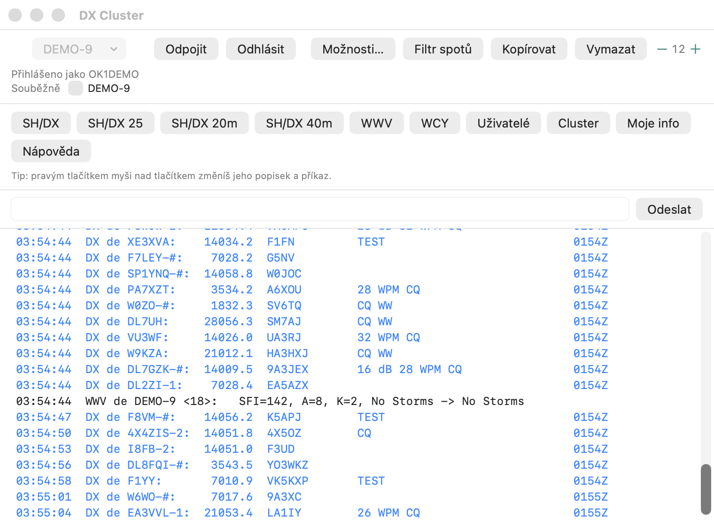
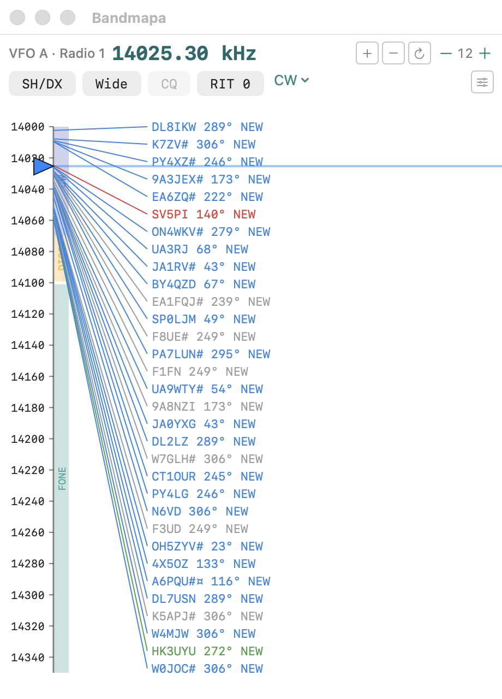

# DX cluster





## Several simultaneous connections (nodes + skimmers)

Equivalent of DXLog.net **DXC** (several nodes and skimmers at once). Besides the
main connection from the **DX Cluster** window, others can run:

1. **"Nastavení → DX Cluster"** (Settings → DX Cluster): for a favorite, tick
   **"Souběžně"** (Simultaneously) (e.g. RBN `telnet.reversebeacon.net:7000`, a
   local CW Skimmer Server, a second node).
2. After OK (and at every start) the simultaneous favorites connect by themselves
   and **log in** with the saved name (callsign).
3. Spots from all connections go into **one bandmap** and one buffer (same
   filters, blacklist, multiplier colors). The listing in the DX Cluster window
   shows lines from the simultaneous connections with the prefix `[name]`.
4. Below the status of the main connection is a line `Souběžně: RBN ✓ · Skimmer ...`
   ("Simultaneously: ...") (✓ logged in, ... connected, ✗ disconnected). A dropped
   connection is reopened after the next save of the settings.
5. The same line in the DX Cluster window is a quick switch: after **"Souběžně"**
   there is one checkbox per favorite (with its state mark), so you can stop
   receiving RBN spots, or start them again, without opening the settings. Ticking
   or unticking works like the checkbox in Settings → DX Cluster plus OK: it is
   saved (so it survives a restart and Settings shows the same) and the connection
   is opened and logged in, or closed ("Souběžné spojení ukončeno").

A favorite to which the main window is currently connected is not duplicated as a
simultaneous one; it is not offered in the switch and cannot be ticked while the
main window uses it. Unticking **"Souběžně"** closes the connection. Commands from
the DX Cluster window go only to the main connection.

## CW Skimmer / RBN

Equivalent of N1MM **CW Skimmer and the Reverse Beacon Network**
([doc](https://n1mmwp.hamdocs.com/manual-windows/telnet-window/#CW_Skimmer_and_the_Reverse_Beacon_Network_RBN_))
and DXLog **DX cluster own station spots**.

- **Connection**: RBN (`telnet.reversebeacon.net`, port 7000 CW / 7001 digital) or
  a local CW Skimmer Server as a favorite — ideally **simultaneously** with a
  regular node.
- **Recognition**: a skimmer spot = the spotter ends with `-#`, or the comment has
  the form `19 dB 28 WPM CQ`.
- **Skimmer count**: the same station reported by several skimmers (within 1 kHz)
  is counted as one spot with a confirmation count; the bandmap shows `OK1XOE ×3`.
- **Filter** (Settings → DX Cluster → "Skimmer spoty: min. skimmerů", Skimmer
  spots: min. skimmers): `0` hides skimmer spots, `1` shows all, `2` and more
  shows only stations confirmed by at least that many skimmers — it filters out
  "busted" spots with a wrongly decoded callsign. Spots from humans are always shown.
- **Own spots**: when RBN / a skimmer hears me, a message arrives in the Info
  window messages, "RBN: ... hears you on 14025.0 kHz, 19 dB, 28 WPM".

## Sharing telnet over the network

Equivalent of N1MM **Multi-User telnet** and DXLog.net **DXC** on a network. In a
network log (cluster sync over MQTT) it is enough for **one** station to have the
DX cluster connected:

- each spot that a station receives from its cluster (main and simultaneous) is
  sent through the broker to the topic `spot/new` (QoS 0, no retain),
- other stations insert it into their bandmap — same colors, filters, blacklist;
  it is not forwarded further and a station does not get its own spots back,
- it is turned on in **"Nastavení → Cluster → Sdílet spoty z DX clusteru"**
  (Settings → Cluster → Share spots from the DX cluster) (on by default; it is
  enough on the stations that should send / receive spots).

The broker must allow the stations `spot/#` — see `docs/cluster-aclfile`
(`pattern readwrite spot/#`). The authority (a separate Java application,
`cluster-app`, Java 21, which is not part of this repository) does not process spots.

## Automatic split from the spot comment

Equivalent of N1MM **Split Mode and Frequencies Set Automatically from Cluster Spots**
([doc](https://n1mmwp.hamdocs.com/manual-operating/single-operator-contesting/#Split_Mode_and_Frequencies_Set_Automatically_from_Cluster_Spots))
and DXLog **DX cluster → auto split**. After a click on a spot (bandmap, cluster
window, Ctrl+↑/↓) the transmit frequency is read from the spot comment and split
is turned on (transmitting on VFO B):

| Comment | I transmit on (spot 14023.0) |
|---|---|
| `UP 5`, `up5`, `UP 2-4` | +5 / +5 / +2 kHz → 14028 / 14028 / 14025 |
| `UP 1.5` | 14024.5 |
| `UP` | default shift: +1 kHz (CW), +5 kHz (phone according to the comment) |
| `DOWN 3`, `DN 3` | 14020 |
| `QSX 14025.5` | 14025.5 |
| `QSX 025`, `QSX25` | completed from the spot frequency → 14025 |

- A split farther than 100 kHz from the spot is ignored (typo, another band).
- A spot without split turns off a split that the previous spot turned on; a
  manually turned-on split (Ctrl+S, Alt+F7) is left alone.
- It can be turned off in **"Nastavení → DX Cluster → Automatický split z komentáře
  spotu"** (Settings → DX Cluster → Automatic split from the spot comment).

## DX Cluster window (the N1MM Telnet window)

Modelled on the N1MM Logger+ [Telnet window](https://n1mmwp.hamdocs.com/manual-windows/telnet-window/).

**Text pane.** The cluster's lines in a monospaced font that follows the window's font stepper (top right). Spot
lines are colour-coded by mode as in N1MM — CW blue, digital magenta, phone in the text colour (the mode the band
map infers: the comment, the digital frequencies, the band plan). A spot the [spot filter](#spot-filter-bands-modes-spotter-origin-workable)
hides elsewhere stays in the pane **greyed out**. A click in the text pauses the scrolling (to read or copy a line);
moving the pointer out of the pane resumes it.

**Buttons.** Ten programmable buttons (right click edits one). A button can contain the N1MM packet/telnet macros:

| Macro | Meaning |
|---|---|
| `{WAIT}` | waits 5 seconds before the rest of the button is sent (`SH/WWV{WAIT}SH/WCY`) |
| `{CONN} name` | connects to the cluster `name` of the list (its name, host or `host:port`) and logs in with its login; the current connection is closed first (`{CONN} RBN`) |

Presses wait behind a button that is still in its `{WAIT}`.

**Možnosti… (Options) → Clustery** (the N1MM Clusters tab); every change applies and is saved at once:

| Option | Meaning |
|---|---|
| Při otevření okna se připojit a přihlásit… | N1MM auto logon: when the window opens and nothing is connected, it connects to the selected cluster and logs in (off by default) |
| Software clusteru | DXSpider, AR-Cluster, CC Cluster, or **Rozpoznat automaticky** (detect): the node's greeting is recognised (`running DXSpider`, `AR-Cluster`, `CC Cluster`); until then DXSpider is assumed. It formats the commands MCL builds itself: DXSpider `SH/DX 30`, AR-Cluster and CC Cluster `SH/DX/30` (N1MM's "DXSpider cluster" checkbox) |
| Počet spotů pro SH/DX z bandmapy | how many spots the band map's **SH/DX** button asks for (1–100, default 30) |
| Zobrazit tlačítka příkazů | N1MM "Show Telnet Buttons": hides the buttons to save space |
| Uložit / Načíst tlačítka… | saves the ten buttons into a text file (`label,command` per line, `#` comments) and loads such a set back; a shorter file keeps the default buttons for the rest |

### Cluster list, saved spots, randomized frequencies

- **Settings → DX Cluster → Importovat / Exportovat seznam…** (N1MM's cluster list import/export): a text file with one
  cluster per line, `name,host:port[,login]`, `#` starts a comment. Passwords are never exported. An import adds only
  the clusters whose `host:port` is not in the list yet; like every Settings change it applies with Save. N1MM's
  *live* cluster list is not offered: it comes from N1MM's own reporting server, there is no public list to read.
- **Možnosti… → Uchovat spoty přes restart programu** (N1MM "Save Spots", off by default): at quit the spot buffer is
  written to `spots.json` in the data directory; after the start the spots still within the *Buffer spotů (min)*
  timeout come back with their original times (blacklisted calls stay out). With the option off the file is removed
  at quit.
- **Možnosti… → Náhodně posunout kmitočet při naladění spotu** (N1MM "Randomize incoming spot frequencies", off by
  default): tuning to a cluster spot (a click, the spot jumps) lands 50–150 Hz (phone 100–250 Hz) above or below it,
  so the operators who click the same spot do not all call on exactly the same frequency. Own spots (Mark, Store)
  are tuned exactly; the split from the spot comment is unchanged.
## Spot comment, spotting S&P QSOs and special calls

The other tabs of **Možnosti… (Options)** in the DX Cluster window, modelled on the N1MM Telnet window's *Spot Comment*
and *Special Calls* tabs; every change applies and is saved at once.

**Komentář spotu (Spot comment).** N1MM's "Comment For All Spots": a comment sent with every spot MCL makes — Spot It
(Alt+P), the prefilled text of Ctrl+P (it can still be edited) and the automatic S&P spot below. Its macros take the
values of the spotted QSO (the entry window's fields, or the logged exchange when Spot It spots the last QSO):

| Macro | Value |
|---|---|
| `{GRIDSQUARE}` | the grid (locator) field |
| `{MODE}` | the QSO's mode |
| `{QTH}` | the state, province, district, IOTA or text field |
| `{ZONE}` | the CQ or ITU zone field |

A macro without a value is left out; the comment is always one line. For a logged QSO the stored exchange is matched
to the contest's fields by order (only a grid is recognised when some fields were empty).

**{SPOTME}.** The function-key macro `{SPOTME}` (CW, SSB and digital messages) spots your own station on the entry
window's frequency with the spot comment (its `{MODE}`; `CQ` when the comment is blank) — the same as the `SPOTME`
text command. Many contests forbid self-spotting: check the rules. Band map buttons refuse it.

**Spotovat všechna S&P spojení (Spot all S&P QSOs)** — N1MM Config → Spot all S&P QSOs. **Off by default.** When on,
every QSO logged in S&P is spotted to the public DX cluster network with the spot comment, unless the call is already
in the band map within 1 kHz of the QSO's frequency. Run QSOs, dupes, QSOs entered after the contest (paper log) and
the pileup simulator are never spotted; while the main cluster connection is down nothing is sent (and nothing is
reported). Spots go to the public network: check that the contest rules allow it.

**Zvláštní volačky (Special calls).** A list of calls — bonus stations, club members, friends — whose spots get a heart
**♥** after the call in the band map and in the Available window (VoiceOver says "special call"). A call matches by its
base (`W1AW` also marks `W1AW/M` and `DL/W1AW`). **Importovat…** adds the calls of an N1MM file (first line
`Type=FAVORITES SubType=`, then one call per line) or of any plain list; **Exportovat…** writes the N1MM file;
**Vymazat seznam** empties the list. *Automaticky zahrnout bonusové stanice závodu* (on by default) adds the active
contest's bonus stations (the `BONUS` command).

## Spots in the bandmap: clicks, call-frame, marks

Modelled on the N1MM Logger+ [Bandmap window](https://n1mmwp.hamdocs.com/manual-windows/bandmap-window/).

**Clicks.** A click on a spot tunes the radio to it (with the automatic split above). A click on the
frequency scale or on an empty place tunes to the frequency under the cursor; a click on the CQ marker
goes back to the CQ frequency.

| Action | Call |
|---|---|
| click on a spot | the call shows in the **call-frame** above the call field |
| double click on a spot | the call goes straight into the call field (replacing what was there) |
| **Space** in an empty call field | takes the call-frame's call (with the predicted exchange) and moves on |

The call-frame is N1MM's: it always shows the spot nearest to the entry window's frequency within the
**tuning tolerance** of the mode, so tuning near a spot (VFO knob, wheel, Ctrl+↑/↓) shows its call too.
A call typed into the field is never replaced. **Settings → DX Cluster** has the switch ("Klik na spot
dá volačku do rámečku nad polem" — a click on a spot puts the call into the call-frame; off = a click
fills the call field at once and tuning within 100 Hz of a spot fills an empty field, as before) and the
**tuning tolerances** for CW, SSB and digital modes (0–20,000 Hz, default 300 Hz, as in N1MM). The
tolerance is drawn as a light blue strip on the scale around the tuned frequency.

**Always use packet spot mode.** "Ladění na spot nastaví i mód spotu" (tuning to a spot also sets the
spot's mode) in Settings → DX Cluster: tuning to a spot sets its mode on the radio and in the entry
window — from the spot comment (`CW`, `FT8`, `SSB`…), the digital frequencies or the band plan. Off by
default. A single-mode contest keeps its mode.

**Marks after the call.**

| Mark | Meaning |
|---|---|
| `♥` | a [special call](#spot-comment-spotting-sp-qsos-and-special-calls) |
| `#` | spot from a CW Skimmer / RBN |
| `!` | spot from your own skimmer (the spotter is your call with `-#`) |
| `¤` | sunrise or sunset at the station's country (within 30 minutes) |
| `291°` | bearing from your grid |
| `×3` | confirmed by three skimmers |
| `QSX 027` | the station listens split (from `UP 2`, `QSX 14027`…): the last three kHz digits on HF |
| `NEW` | spotted less than 3 minutes ago |

**Tooltip.** Hovering over a spot shows the exact frequency the spotter sent, the spotter, how many
minutes ago it was spotted, the comment, the QSX frequency, how many times it was spotted and by how
many skimmers, the bearing, the gray line and "Vlastní spot" (self spotted). VoiceOver reads the same text
as the spot's help.

**Find a callsign.** Right click → "Najít volačku…" (Find a callsign): type a call or a part of it; the
next spot above the tuned frequency that contains it is tuned to (it wraps around to the lowest one), so
using it again finds the next instance. Alt+F8 returns to where you were.

### Cluster queries and spot history

N1MM's queries about one station (its View menu's *Show Last 10 Spots*, *Show Station*, *Show QSL*, *Show
Sunrise/Sunset*) are in the band map's spot menu (**right click on a spot → Dotaz na DX cluster**) and in the DX
Cluster window's right click on a spot line. They go to the main connection, formatted for the node's software; the
answer shows in the DX Cluster window.

| Item | Command (DXSpider / AR-Cluster, CC Cluster) |
|---|---|
| Posledních 10 spotů | `SH/DX 10 CALL` / `SH/DX/10 CALL` |
| Stanice | `SH/STATION CALL` |
| QSL informace | `SH/QSL CALL` |
| Východ a západ slunce | `SH/SUN CALL` |
| Callbook clusteru | `SH/QRZ CALL` |

**Historie spotů CALL** (N1MM *Show Telnet history*) lists every spot of the station received in this session from
every connection — newest first, with the UTC time, frequency, spotter, comment and the parallel connection it came
from — also after the spot left the band map. **Historie spotů mé značky** (*My call spot history*) does the same for
your own call (who spotted you, RBN included). The history keeps the last 20,000 spots and is not saved.

**Naladit na tento spot** (N1MM *Jump to this spot*, the DX Cluster window's right click on a spot line) tunes the
active radio to the spot like a click on it in the band map.

## Band map top bar and user buttons

Modelled on the top of the N1MM Logger+ [Bandmap window](https://n1mmwp.hamdocs.com/manual-windows/bandmap-window/).
Below the tuned frequency the band map has a row of controls:

| Control | Action |
|---|---|
| **SH/DX** | sends `SH/DX 30` (the count and format of the DX Cluster window's options) to the connected DX cluster (the answer shows in the DX Cluster window) |
| **Wide / Narrow** | switches the radio's filter between the wide and narrow width of its mode; the label shows the current one (with CAT; "Wide/Narrow" without it) |
| **CQ** | back to your last CQ frequency on the band (Run), like a click on the CQ marker |
| **RIT +120** | the RIT offset; a click clears it |
| mode (**CW**, **USB**…) | the radio's mode; a click offers CW, USB, LSB, RTTY, PSK, FT8, FT4, AM, FM (the same as typing the mode into the call field) |
| slider icon | opens the user buttons' editor |

The filter widths ("Set Transceiver Filter Codes" in N1MM) are in **Settings → DX Cluster**: CW, SSB
and digital, wide and narrow, in Hz (0 = the radio's default width). Hamlib sets the passband with the
mode (`M CW 250`), so no radio-specific filter codes are needed.

**User buttons.** Up to 36 programmable buttons in rows of four (N1MM "radio control buttons"). Right
click on a button → "Upravit tlačítka…" (Edit buttons), or the slider icon, or right click in the band map
→ "Uživatelská tlačítka…" (User buttons). Each button has a label and a command; `|` separates states
that the button toggles through on each click (`Wide|Narrow` with `{CAT M CW 500}|{CAT M CW 250}`). A
command can contain:

| Part | Meaning |
|---|---|
| `{CAT …}` | a raw rigctld command, e.g. `{CAT L AF 0.3}`, `{CAT M USB 2400}`, `{CAT Y 2 0}`; checked like a plugin's raw CAT (no PTT, no transmit, no frequency outside the bands) |
| `{RUN}`, `{S&P}`, `{WIPE}`, `{CLEARRIT}`, `{CQFREQ}`, `{ALT-Q}`, `{NOSPLIT}`, `{CLRSTACK}` | the control macros of the function keys |
| other text | call field text commands separated by `;` — `14025;CW`, `SPLIT`, `+2`, `RIT 100`, `/14030` (see [text commands](text-commands.md)); the call field keeps its call |

A button never transmits: message macros (`{F1}`, `{TX}`, `{LOG}`…) are refused with a status message.
**⌘⌥⇧0 … ⌘⌥⇧9, ⌘⌥⇧A … ⌘⌥⇧Z** press buttons 1–36 while the Bandmap window is active (N1MM
Ctrl+Alt+Shift+0…Z).

**Telnet filters.** Right click in the band map → "Telnet pásma/módy…" and "Telnet filtry…" (N1MM
Telnet Bands/Modes, Telnet Filters) open the [spot filter](#spot-filter-bands-modes-spotter-origin-workable)
sheet; both parts of the filter are in one sheet.

## Band plan in the bandmap

Equivalent of N1MM **Display of Band Plans in Background of Bandmap Frequency Scale**
([doc](https://n1mmwp.hamdocs.com/manual-windows/bandmap-window/#Display_and_Adjustment_of_Band_Plans_in_Background_of_Bandmap_Frequency_Scale))
and the DXLog band plan in the Radio window. The bandmap shades segments of
operation with a strip right of the frequency axis, with a vertical label inside:

| Segment | Color | Label |
|---|---|---|
| CW | indigo | `CW` |
| Digital | amber | `DIGI` |
| Phone | turquoise | `FONE` |

- The IARU region that applies to **my** station is drawn (according to the
  continent of my own callsign) — it is a guide for my transmitting, not for the
  DX station.
- Segments are taken from `contest-data/bandplan.yaml`, that is, from the same
  source used to estimate the spot mode and Mode Control "according to band plan".
  It is edited in **"Nastavení → Bandplán"** (Settings → Band plan); a change takes
  effect immediately.
- With zoom, segments are clipped to the visible window. A label is drawn only
  when it fits into the height of the segment — in a zoomed-out view a narrow
  digital band therefore stays colored but without text.
- An overlap of two segments (the file allows it; e.g. R2 has digital inside CW on
  80 m) is drawn the same way the mode estimate evaluates it: the earlier segment
  wins, the later one is shortened by the overlap. The bandmap thus never shows a
  different category than the program would use on that frequency.
- It can be turned on/off in two ways: **right click in the bandmap → "Skrýt /
  Zobrazit bandplán"** (Hide / Show band plan), or **"Nastavení → Bandplán →
  Podbarvit úseky v bandmapě"** (Settings → Band plan → Shade segments in the
  bandmap). The choice is saved in the configuration.

### Adjusting the band plan from the bandmap

As in N1MM, the plan can be changed where you see it: **right click in the bandmap → "Bandplán zde (… kHz)"**
(Band plan here) at the frequency under the mouse, then one of

| Item | Effect |
|---|---|
| Začátek / Konec CW zde | the lower / upper edge of the band's CW segment moves to the frequency |
| Začátek / Konec Digi zde | the same for the digital segment |
| Začátek / Konec fonie zde | the same for the phone segment |
| Odebrat úsek zde | the segment under the frequency is removed |

- Only my region (the one the bandmap draws) changes. The frequency is rounded to 0.1 kHz.
- A neighbouring segment that the new edge would overlap is shortened to touch it, or removed when it is covered
  completely, so the plan never overlaps (the rule of Settings → Band plan).
- The change is written to `bandplan.yaml` in the contest data directory and applied at once, exactly like Save in
  Settings → Band plan. Without the file the built-in plan is the starting point; a region without rows of its own
  starts as a copy of R1 (what the bandmap showed for it before).
- The status line says why nothing changed: a frequency outside the bands, no such segment on the band, or an edge
  that would leave the segment empty.

### US license class lines

**Right click → "Zobrazit / Skrýt čáry licenčních tříd USA"** (Show / Hide US license class lines), or **Settings →
Band plan**, draws short red lines across the scale at the US Extra / Advanced / General sub-band edges of
47 CFR §97.301: CW 3525, 7025, 14025, 21025 kHz; phone 3600, 3700, 3800, 7125, 7175, 14150, 14175, 14225, 21200,
21225, 21275 kHz. It is meant for US operators and is off by default. N1MM+ draws a similar set of lines from an older
list of edges; MCL uses the current rule.

## Radio, split and navigation in the bandmap

Equivalent of the N1MM Logger+ Bandmap window's radio display
([doc](https://n1mmwp.hamdocs.com/manual-windows/bandmap-window/)).

- **Header:** the radio — **VFO A** / **VFO B**, or **Rig 1** / **Rig 2** in SO2R — with the rig model from
  Settings while CAT is connected, the receive frequency and, while the rig reports split, the transmit
  frequency **TX 14030.00 kHz** in red.
- **Arrows:** the blue arrow is the receive frequency; while the rig is in split a red arrow marks the transmit
  frequency. Hovering over an arrow shows its exact frequency. **A click on the red arrow turns split off.**
- **Filter width:** a blue bar next to the band plan strip shows the rig's passband (above the frequency in USB,
  below in LSB, around it in CW, RTTY, AM and FM), as the rig reports it over CAT.
- **Zoom:** the + and − buttons, Cmd+= / Cmd+- or keypad + / − while the Bandmap window is active,
  Ctrl+wheel, a drag across frequencies, and **right click → Přiblížit / Oddálit** (Zoom in / out). N1MM's
  Shift+keypad zoom of the second radio's bandmap has no counterpart: there is one bandmap, of the active rig.
- **Right click → Vypnout kolečko myši** (Disable mouse wheel): the wheel neither tunes nor zooms (a lock against
  accidental retuning). Saved in the configuration.
- **Right click → Na spodní / horní okraj úseku pásma** (Go to bottom / top of band segment): QSY to the lower or
  upper edge of the band plan segment (CW, digi, phone) the radio is tuned in; outside every segment to the band
  edge.
- **Right click → Nejnižší kmitočet dole** (Show lowest frequency at bottom): turns the bandmap upside down so that
  frequencies grow upwards. Saved in the configuration.

## Removing spots

The bandmap's right-click menu has N1MM's removal items (the spot under the mouse has its own *Odebrat spot*):

| Item | N1MM | Removes |
|---|---|---|
| Smazat spoty, jen toto pásmo, ponechat vlastní | Remove Spots, This Band Only, Leave Self Spots | the spots of the bandmap's band except my own |
| Smazat spoty, jen toto pásmo | Remove Spots, This Band Only | every spot of the bandmap's band |
| Smazat spoty, všechna pásma, ponechat vlastní | Remove Spots, ALL Bands, Leave Self Spots | every spot except my own |
| Smazat všechny spoty | Remove Spots, ALL BANDS | every spot |

My own spots are the self spots: *Mark*, *Store* and the calls stored when tuning away (drawn bold). The removal
clears the spot buffer, so the spots disappear from the Available Mults window and the spot jumps too; a new spot of
the same station from the cluster shows again.

## Spot filter (bands, modes, spotter origin, workable)

Modelled on N1MM+'s Telnet window (the *Bands/Modes* and *Filters* tabs). Open it with the **Filtr spotů** button in
the DX Cluster window (a dot after the label means a filter is active) or in *Settings → DX Cluster*. Changes in the
window apply and are saved at once; in Settings they apply with Save. The state lives in the `dxCluster` section of
`config.json` (`spotFilter*` keys; a configuration without them means "everything on").

**Bands.** One checkbox per band MCL knows, in four groups: HF (160 m to 10 m, including 60 m), VHF (6 m, 2 m),
UHF (70 cm, 23 cm) and Mw (13 cm, 9 cm, 6 cm, 3 cm). The group buttons switch the whole group: all on turns it off,
otherwise all on.

**Modes.** CW, Fonie (phone) and Digi (RTTY, FT8, PSK and the like). The mode of a spot is the one the band map already
uses: a mode named in the comment, else a digi calibration frequency, else the band plan. A spot whose mode cannot
be determined stays visible unless all three modes are off. *Všechny módy* switches every mode on.

**Contest.** With *Jen pásma a módy aktivního závodu* checked and a contest active, a spot must also be on a band of
the contest definition (when it lists bands) and in a mode the definition allows. Without a contest it does nothing.

**Spotter origin** (N1MM "Filter by Prefix"). *Jen spoty od spotterů z* EU, NA, SA, AS, AF, OC and *Vlastní země*: only
spots whose spotter sits there pass (the spotter's DXCC from its call, `-#` / `-2` suffixes stripped; a skimmer's own
location counts). Nothing checked means no filter; a spotter that cannot be resolved is hidden while a filter is on.

**Spotter prefixes and call areas** (N1MM "Filter by Prefix"). *Prefixy spotterů* takes prefixes separated by spaces or
commas (`OK OM DL`): a spotter whose call starts with one passes. *Call oblasti vlastní země* 0–9: a spotter of your own
DXCC whose call area (the digit of a one-digit portable suffix `/4`, else the prefix's digit) is checked passes. The
origin options combine: a spotter matching **any** of the continents, own country, prefixes or call areas passes.

**Jen spoty stanic z call history** (N1MM "Show only spots in call history"): only calls the loaded call history knows.
**Jen spoty stanic, které už jsou v deníku**: only calls already in the log (any band).

**Skrýt spoty majáků NCDXF/IARU**: hides spots of the 18 International Beacon Project stations (4U1UN, VE8AT, W6WX,
KH6RS, ZL6B, VK6RBP, JA2IGY, RR9O, VR2B, 4S7B, ZS6DN, 5Z4B, 4X6TU, OH2B, CS3B, LU4AA, OA4B, YV5B, with or without `/B`).
Beacons you load yourself with `BEACONS` (Nástroje → Načíst soubor majáků…) are your own spots and stay.

**Odstranit chybné (busted) spoty** (N1MM "Remove Busted Spots"): among the live spots, two calls within the tuning
tolerance of the mode (Settings → DX Cluster) that differ by one character (a changed, added or missing character)
are a correct call and its busted copy — typically a skimmer's wrong decode. The call reported fewer times (spots,
skimmers) is hidden; with equal reports the one that came later. *I chyby ve dvou znacích* ("Two Character Errors")
also treats two-character differences as busted. Calls shorter than four characters and your own spots are never
compared. A busted spot comes back as soon as the option is off or its call gets more reports.

**Preferovaní spotteři** (N1MM preferred spotters, typically your own skimmer): up to three calls; `OK1ABC` also
matches `OK1ABC-2`, `OK1ABC-#` and `OK1ABC/3`. Their spots are not filtered but highlighted: bold on a tinted
background in the DX Cluster window, `★` after the call in the band map and before the spotter in the Available Mults
window. *Obnovit výchozí* keeps them.

**Zobrazovat nepracovatelné spoty** (N1MM "Show non-workable spots", on by default). When off and a contest is active,
spots on a band or in a mode the contest does not allow are hidden. The contest definitions express no other
"cannot be worked" rule, so this is the same test as the *Contest* option; dupes are not non-workable and stay
(coloured as dupes).

**Obnovit výchozí** puts everything back: all bands and modes on, no origin filter, Contest off, non-workable shown,
the call history / worked / beacon / busted options off (the preferred spotters stay).

**Blacklists.** The Blacklist window (Okno → Blacklist) has N1MM's controls for the shown list (calls or spotters):
*Blacklist zapnutý* switches both lists off without losing them (spots already dropped do not come back, new ones are
kept), *Importovat…* adds the calls of a text file (one per line, or separated by commas or spaces; `#` lines are
comments), *Exportovat…* writes the list one call per line, *Vymazat seznam* empties it after a confirmation.

### Spot flow

```
cluster node(s) / RBN / shared by a master station
        |  raw spot (all connections; blacklists and the skimmer minimum apply here, in the buffer)
        v
  spot buffer  --->  plugin spot-received events, network sharing   (never filtered)
        |
        |  spot filter (bands, modes, contest, origin, workable) applied when the spots are read
        +--> DX Cluster window: `DX de` / `SH/DX` lines greyed  (command replies and other text always shown)
        +--> band map
        +--> Available Mults (then its own band / mode filter on top)
        +--> spot jumps (Ctrl/Alt + Up/Down)
```

The buffer is never changed by the filter, so unhiding a band brings its spots back immediately. Own spots (Mark,
Store, self-spots) are never hidden. Every station applies its own filter to the spots it receives; a spot shared by
a master station arrives unfiltered. The world map, the multiplier grids and the callbook prefetch read the whole
buffer. The spot timeout is the existing *Buffer spotů (min)* setting and a QSY that moves away from a spotted
frequency uses the existing self-spot threshold; neither has new settings. The [Available window](available-window.md)'s
focus-radio filter (SO2R / SO2V) is not part of this filter.
