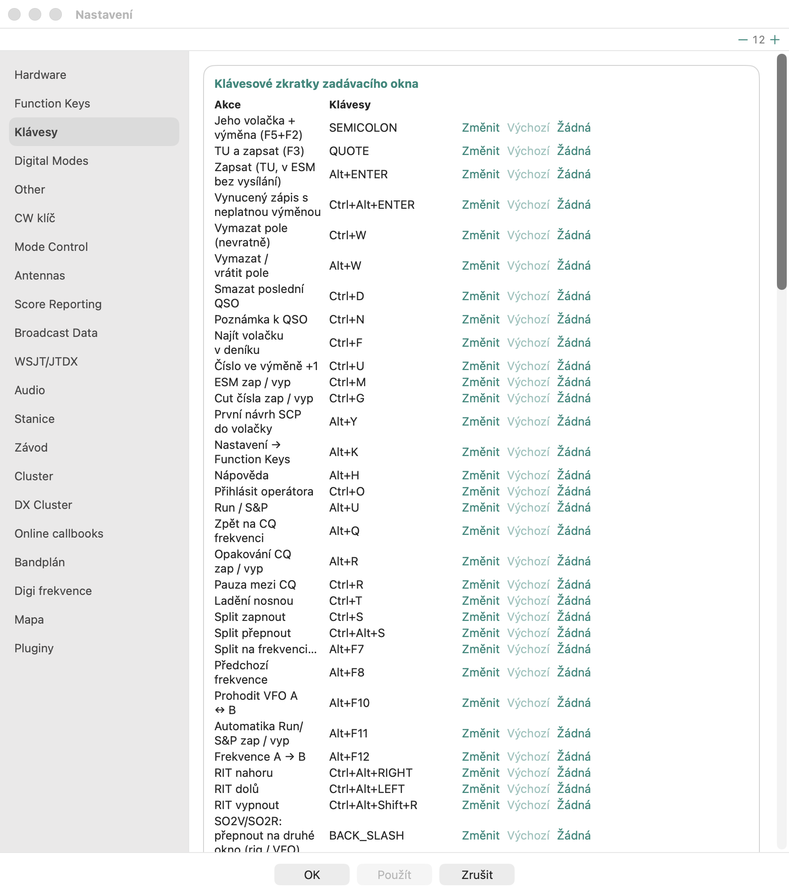

# Entry window keyboard shortcuts

The shortcuts follow N1MM+
([Keyboard Shortcuts](https://n1mmwp.hamdocs.com/setup/keyboard-shortcuts/#Key_Assignments_Short_List)).
On a Mac, **Alt** is the **Option (⌥)** key. Below are the **default** keys — most of
them can be remapped (see [Remapping keys](#remapping-keys)).

## Why Ctrl and not Cmd

On a Mac you would expect **⌘**, but the default here is **Ctrl** and **Alt** — and
that is deliberate. A contester usually knows N1MM, operates on other people's
machines and has `Ctrl+W`, `Alt+Q`, `Ctrl+D` in their head. If it were translated to
⌘, N1MM help from others would no longer apply and switching to another computer
would be confusing. In a contest, muscle memory beats platform habit.

In practice this is not a problem: **macOS system shortcuts use ⌘**, so
`Ctrl+letter` is free. The application also takes them before they reach the field.
The exception is **Ctrl+arrows**, which Mission Control takes — which is why
jumping between spots defaults to **Cmd+↓/↑** instead (see below).

**Cmd is a fully valid choice.** In **Nastavení → Klávesy** (Settings → Keys) every
action can be remapped and `Cmd+…` is a valid combination (stored as `"Cmd+DOWN"`).
Anyone who wants a mac-native logger can remap all of it; nobody else is affected.

## Moving between fields

| Key | Action |
|---|---|
| **space bar** | next field, **skipping the reports** (599/59 are pre-filled). From the callsign it goes to the exchange, from the last field back to the callsign |
| **Tab** / **Shift+Tab** | next / previous field including the reports |
| **Enter** | logs the QSO (with ESM see [esm.md](esm.md)); runs a command in the callsign field ([text-commands.md](text-commands.md)) |
| **Esc** | stops transmitting, tuning and CQ repeat; when nothing is running, clears the fields |

## Logging

| Key | Action |
|---|---|
| **Alt+Enter** | sends TU (F3) and logs. With ESM it only logs, transmits nothing |
| **Ctrl+Alt+Enter** | logs even with an **invalid exchange**; asks for a note (empty = "Forced QSO") |
| **;** | sends his callsign + exchange (F5 + F2), like N1MM Insert |
| **'** (apostrophe) | sends TU (F3) and logs |
| **Ctrl+W** | clears the fields (irreversibly) |
| **Alt+W** | clears the fields; another Alt+W with empty fields **restores** them |
| **Ctrl+Shift+W** | SO2V / SO2R: clears the fields of the **other** entry window (the focus stays here) |
| **Ctrl+D** | deletes the last QSO (with confirmation) |
| **Ctrl+N** | note: with a callsign filled in, for the QSO in progress, otherwise for the last logged one |
| **Ctrl+F** | finds the callsign from the field in the log (opens the QSO overview with the search `call:`); again with the same callsign selects its next QSO (Find Again) |
| **Ctrl+Y** | edits the last logged QSO in a dialog (also the **Edit** button), see [Entry window](entry-window.md#editing-a-qso) |
| **Ctrl+Q** / **Ctrl+A** | QuickEdit: the logged QSOs one back / forward in the entry fields; Enter saves, Esc cancels, see [Entry window](entry-window.md#quickedit) |
| **Ctrl+Z** | WAE: QTC mode on / off — opens the QTC window to receive (Europe) or send, see [QTC](qtc.md#qtc-mode-ctrlz) |
| **Ctrl+U** | serial number in the exchange +1; a Sweepstakes serial with its precedence keeps it (`23B` → `24B`, also inside `23B 72 CT`) |
| **Alt+Y** | next call of the Check window's panes into the callsign field (again = the next one; in an exchange field the first value of the exchange pane), see [Check window](call-check.md#alt-y) |
| **↑ / ↓** | with SCP suggestions, moves within the suggestions, otherwise tunes the rig |
| **Ctrl+O** | operator login |

`SH/DX` (also `SH/DX/30`) typed into the callsign field and Enter goes to the connected DX cluster, as in N1MM; it is never logged.

## Messages and keying

| Key | Action |
|---|---|
| **F1–F12** | message (phone voice keyer, CW keyer) — [voice-keyer.md](voice-keyer.md), [cw-keyer.md](cw-keyer.md) |
| **Shift+F1…F12** | message from the opposite set (Run ↔ S&P); holding Shift shows the labels |
| **Ctrl+Shift+F1…F12** | records a message (phone) |
| **=** | in ESM repeats the last message |
| **PgUp / PgDn** | CW speed ± the CW speed step (2 WPM by default) |
| **Shift+PgUp / PgDn** | CW speed ± the secondary step (1 WPM by default; Settings → Other) |
| **Ctrl+G** | cut numbers on / off |
| **Ctrl+M** | ESM on / off |
| **Alt+R** / **Ctrl+R** | CQ repeat on / off; pause between CQs |
| **Ctrl+T** | **tune**: continuous carrier (Winkeyer key-down, via CAT PTT in CW). Ctrl+T or Esc ends it, **30 s safety cutoff** |
| **Alt+K** | Settings → Function Keys |
| **Ctrl+K** | **keyboard CW** window — typed text is sent word by word or on Enter, Esc stops; in a digital mode the Digital Interface's TX window (transmitting) |
| **Ctrl+Alt+P** | **pass** — hands the callsign from the field to another station of the network log (directly to the only online station, otherwise a choice in the Network status window) |
| **Ctrl+Alt+M** | multi-op: this station's type **Run ↔ Mult** (saved, shown to the other stations; Settings → Cluster) |
| **Alt+Z** | multi-op: sets this station's **pass frequency** (kHz, the current one offered; empty = clear) and announces it to all stations; a call passed to this station then lands in its band map on that frequency |
| **Alt+=** | VHF and up: the typed call and grid are searched in the call history and the log — the [Check window](call-check.md) opens with its reverse lookup on (N1MM *Search entered info from both the Callsign field and the Gridsquare field*) |
| **Alt+-** | VHF and up: the grid field toggles through the call history's grids of the typed call (Loc1, Loc2) and the grid you typed — three at most |
| **Alt+A** / **Shift+Alt+A** | the next / previous spot of the [Available window](available-window.md) list is tuned and taken (the list wraps around) |
| **Ctrl+Alt+G** | the callsign from the field onto the [call stack](call-stacking.md); the fields are wiped for the next call |
| **Alt+G** / **Ctrl+Alt+K** | the next callsign from the [call stack](call-stacking.md) (own and partner's) into a wiped entry window; Alt+G in a digital mode takes the Digital Interface's [Grab window](digital-modes.md#the-grab-window) callsign first |
| **Cmd+Alt+← / →** | SO2V/SO2R: both foci (RX and TX) to VFO A / rig 1 or VFO B / rig 2; in a digital mode with Digital Interface 1 / 2 (N1MM Ctrl+←/→) |
| **Pause** (**F15**) | SO2V/SO2R: both foci to the other window, or the transmit focus to the entry focus when they are split (N1MM Pause) |
| **Alt+F5** / **Alt+F6** | SO2V/SO2R: swap frequency, mode and call between the radios / VFOs, with / without moving the focus |
| **Cmd+Shift+↓/↑**, **Ctrl+Alt+Shift+↓/↑** | SO2V/SO2R: the other radio to the next spot / multiplier spot (N1MM Ctrl+Shift+↓/↑, Shift+Ctrl+Alt+↓/↑) |
| **Ctrl+Shift+PgUp/PgDn**, **Alt+Shift+Q** | SO2V/SO2R: the other radio one band up / down, to its CQ frequency |
| **Alt+PgUp/PgDn** | CW, SO2V/SO2R: the speed of the radio without the transmit focus |
| **Ctrl+B** | SO2R: Dueling CQs on / off |
| **Ctrl+Shift+K** / **Ctrl+Shift+L** / **Ctrl+`** | SO2R: FocusOther / the `{CTRLFx}` macro / the stereo and OTRSP RX macros on / off |
| **Ctrl+F1 … F12**, **Ctrl+Enter** | SO2V/SO2R: the other window's F-key / next ESM step on its radio — see [SO2R](so2v.md#so2r--two-rigs) |
| **Alt+T** | digital: transmit on / back to receive; the Digital Interface's TX window takes the typing |
| **Insert** (Help) | digital: the Grab window's callsign into an empty field, then F5+F2 (N1MM Insert table) |

## Rig

| Key | Action |
|---|---|
| **↑ / ↓** (without SCP suggestions) | tune by a step: **↑ down, ↓ up**; 20 Hz in CW and digital, 100 Hz in phone |
| **mouse wheel** over the entry window | tune by a step; **Alt** to the next whole 1 kHz, **Ctrl** 10 kHz, **Ctrl+Alt** 100 kHz |
| **Ctrl+PgUp / PgDn** | one band up / down. Returns to the last frequency on the band, otherwise to the start of the mode segment. In a contest only its bands, WARC is skipped |
| **Alt+F8** | back to the previous frequency (after a jump to a spot, Alt+Q...) |
| **Alt+U / Alt+Q / Alt+F11** | Run/S&P, back to the CQ frequency, Run/S&P automation — [run-sp.md](run-sp.md) |
| **Ctrl+Alt+Q** | to the last CQ frequency on any band (Run); the band map follows the rig |
| **Ctrl+S** | turns on split (transmit on VFO B); with split on, listens on the transmit frequency, again back on the receive one |
| **Alt+S** | in split, puts the receiver back on the transmit frequency (optionally after every Run QSO: Settings → Other) |
| **Ctrl+Alt+S** | toggles split on / off |
| **Alt+F7** | split to the entered frequency or offset (`+2`); empty = turn split off |
| **Ctrl+Enter** | frequency in the callsign field = transmit (split) frequency |
| **Alt+F10** | swaps VFO A ↔ B |
| **Alt+F12** | VFO A frequency to VFO B; on a rig with "Sub receiver always on" (Settings → TCVR) the sub receiver (dual watch) on / off |
| **Ctrl+Alt+D** | SO2V: CQ repeat on VFO A with the sub receiver on (tune the sub receiver between the CQs); again = off |
| **Alt+'** | the rig's filter to the other width of its mode, wide ↔ narrow (the band map's Wide/Narrow button; widths in Settings → DX Cluster) |
| **Ctrl+Alt+R** | CW reverse on / off (the rig's CW ↔ CWR mode, the filter width kept) |

## Bandmap and spots

| Key | Action |
|---|---|
| **Cmd+↓ / Cmd+↑** | next spot **higher / lower** on the band (dupes are skipped) |
| **Ctrl+Alt+↓ / ↑** | next spot that is a **new multiplier** |
| **Shift+Alt+↓ / ↑** | next **own** spot (Store / self-spot) |
| **Shift+↓ / Shift+↑** (fixed) | with the waterfall / spectrum window open: next **signal** in the spectrum higher / lower (dupes and marked frequencies skipped; with the CQ markers shown, the next CQ frequency); otherwise tunes like ↓ / ↑ — see [Waterfall](waterfall.md#signals-spots-and-the-cq-finder) |
| **Alt+D** | removes the spot of the callsign in the field (or the spot on the frequency); in the Bandmap window the spot under the mouse. With an empty callsign field and a non-empty call stack it deletes the next stacked call |
| **Alt+Shift+D** | the same and puts the callsign on the **blacklist** (also in the Bandmap window) |
| **Alt+P** / **Spot It** button | spot to the DX cluster (needs a frequency, as above) |
| **Ctrl+P** | spot with a comment (needs a frequency, as above) |
| **Alt+O** / **Store** button | stores the callsign from the field in the bandmap at the current frequency (needs a frequency: connect the radio or type it into the frequency field) |
| **Alt+M** / **Mark** button | marks the frequency in the bandmap as occupied (needs a frequency, as above; also while the Bandmap window has the focus) |
| **Ctrl+Tab** | show / hide the DX cluster window |

Alt+M, Alt+D and Alt+Shift+D also work while the Bandmap window is the active window, with your own key assignments. In the Bandmap window Alt+D removes the spot under the mouse pointer; with the pointer elsewhere it acts as in the entry window.

In the Bandmap window **Cmd+=** / **Cmd+-** (or keypad **+** / **−**) zoom the bandmap in and out.

In the Bandmap window **⌘⌥⇧0 … ⌘⌥⇧9, ⌘⌥⇧A … ⌘⌥⇧Z** press the band map's user buttons 1–36 (N1MM
Ctrl+Alt+Shift+0…Z), see [DX cluster → Band map top bar](dx-cluster.md#band-map-top-bar-and-user-buttons).

## Rotator and antennas

| Key | Action |
|---|---|
| **Alt+J** | rotator to the callsign in the field (otherwise the last QSO), short path; a number 0–360 in the call field turns to that heading |
| **Alt+L** | the same via the long path |
| **Ctrl+Alt+J** | stop the rotator |
| **Ctrl+Alt+A** | next antenna for the band |
| **F1–F10** (Rotator window active) | the rotor setup's preset bearings |

The rotator keys are N1MM's. Up to version 1.1.1 MacContestLogger had the long path and stop the other way round
(long path **Ctrl+Alt+J**, stop **Alt+L**). Only the defaults changed: if you remapped either action in
"Nastavení → Klávesy" (Settings → Keys), your keys stay as you set them. **Výchozí** (Default) or **Vše na výchozí
(N1MM)** (All to default (N1MM)) switches to the N1MM keys.

## Other

| Key | Action |
|---|---|
| **Alt+H** | help (project documentation; also Nápověda → Dokumentace) |

## Remapping keys

An equivalent of the N1MM **Key Mapper**: **Nastavení → Klávesy** (Settings → Keys)
lists all entry window actions with their keys.

- **Změnit** (Change) — press the new combination (Esc cancels). The combination must include Ctrl, Alt
  or Cmd; without a modifier only F-keys, **;** and **'** are allowed (otherwise the shortcut
  would override typing in the fields).
- **Výchozí** (Default) restores the N1MM key, **Žádná** (None) removes the key from the action,
  **Vše na výchozí (N1MM)** (All to default (N1MM)) cancels all remapping.
- Remapped keys are in **bold**, a collision of two actions in **red**. In a collision the
  remapped action wins.
- Saved to `config.json` (`keyBindings`: action id → e.g. `"Cmd+DOWN"`) and effective immediately after OK.

The basics of entry cannot be remapped: F1–F12 (messages and their Shift/Ctrl+Shift variants),
Enter, Esc, Tab, space bar, arrows (tuning / SCP suggestions), PgUp/PgDn (CW speed) and "=".

Typical use on a Mac: **Ctrl+↓/↑** (the N1MM key for jumping between spots) is taken by
Mission Control, so the jumps default to **Cmd+↓/↑** and you do not have to change system
shortcuts. An existing remapping you saved keeps working; remap to **Ctrl+↓/↑** if you
turned the Mission Control shortcuts off.

## macOS: conflicts with the system

- **Ctrl+↑/↓/←/→** are used by macOS by default for Mission Control and Spaces, which is why
  the jumps between spots are on **Cmd+↓/↑** here. To use the N1MM keys **Ctrl+↓/↑** instead,
  turn the system shortcuts off in System Settings → Keyboard → Keyboard Shortcuts →
  Mission Control and remap the action in Settings → Keys.
- **F-keys:** when they change brightness or volume, hold **fn**, or turn on "Use
  F1, F2, etc. keys as standard function keys".
- **Option+F11** may be captured by the system. Run/S&P automation can also be toggled with the command
  `AUTORSP` / `NOAUTRSP`.
- The **;** and **'** keys are taken by physical position on a US keyboard
  (next to L). On a Czech keyboard these are the **ů** and **§** keys.

## Unsupported N1MM shortcuts

Filters **Alt+'**, callsign stack
**Alt+G / Ctrl+Alt+G**, multi-op **Ctrl+Alt+M / Alt+Z**, autosend **Ctrl+Shift+M** (the AutoSend threshold itself is
set in Nastavení → Práh AutoSend (CW)…, see [ESM](esm.md#autosend-cw)).

## RIT

| Key / command | Action |
|---|---|
| **Ctrl+Alt+→ / ←** | RIT one step up / down (20 Hz CW and digital, 100 Hz phone) |
| **Ctrl+Alt+Shift+R** | RIT off (Ctrl+Alt+R is CW reverse, as in N1MM) |
| `RIT 120`, `RIT -50` | RIT to the given offset in Hz |
| `NORIT`, `RITCLEAR` | RIT off |

RIT is set via CAT (hamlib `J` + the `RIT` function). The entry window shows
`RIT +120`; after a QSO is logged, RIT resets itself (N1MM "Clear RIT after logging",
`ritClearAfterLog` in `config.json`). The keys can be remapped in Settings → Keys.
