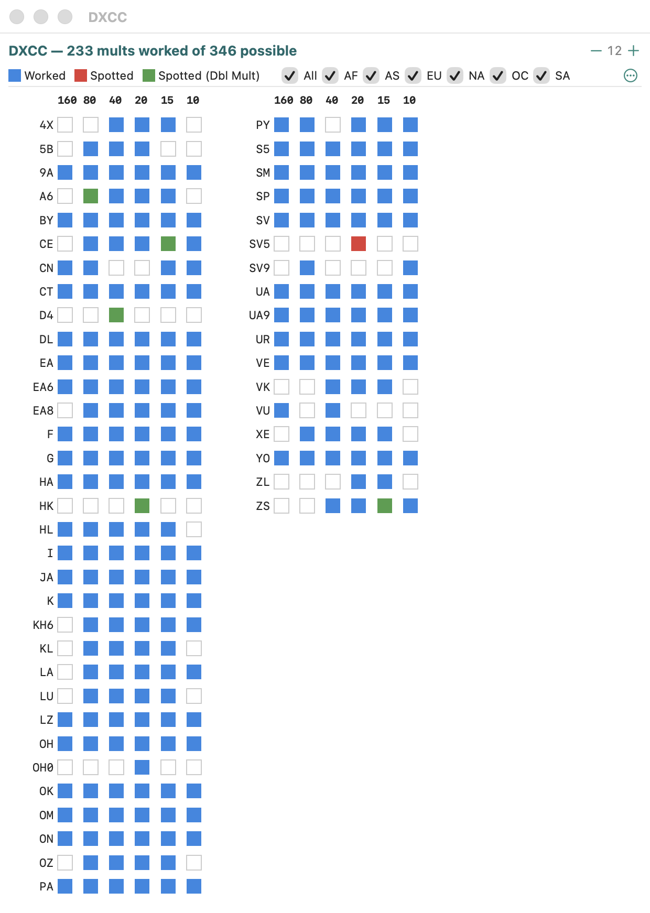
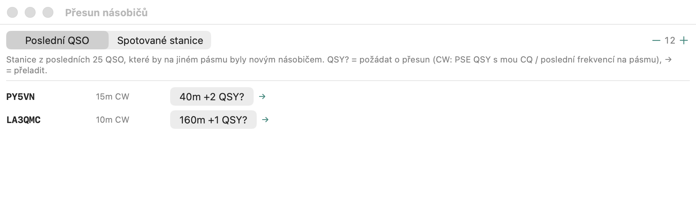

# Multiplier windows

An equivalent of the N1MM+ **Multipliers window**
([Key Common Features](https://n1mmwp.hamdocs.com/manual-windows/multipliers-window/#Key_Common_Features))
and DXLog **Worked DXCC**. Open via the menu **Multiplikátory** (Multipliers).

| Window | What it shows |
|---|---|
| **DXCC** | countries (a DXCC-type set), continent filter |
| **Velké čtverce** (Large squares) | Maidenhead fields (`grid_fields`) |
| **ITU / CQ** | zones |
| **Okresy** (Districts) | multipliers from a received field of type `DISTRICT` (e.g. OK-OM DX) |
| **Section/States** | multipliers from a `STATE` / `PROVINCE` field (W states, VE provinces, ARRL sections) |
| **Ostatní** (Other) | the contest's first additional multiplier: IARU HQ, WPX prefixes... |

Each row = a multiplier value, columns = bands 160–10 m: **worked**,
**spotted** (a new multiplier in the cluster, double multiplier separately), empty. Clicking a
spotted cell tunes to the spot. For enumerated sets (countries, zones, districts, states) the
unworked values are shown too, along with a "worked of possible" count; for open sets
(prefixes, squares) only the worked ones.

A click on a spotted cell also switches to the spot's mode (N1MM: the radio goes to the multiplier's band
and mode), even with *Always use packet spot mode* off; in a single-mode contest the mode stays.

**Mouse-over a prefix** shows the country, continent, CQ and ITU zone, short- and long-path headings and the
distance (the heading and distance need the station's latitude and longitude in Settings); on the large
squares window the field's heading and distance.

**Right-click a multiplier** (its prefix or any of its cells):

- **Pracované stanice a spoty** (Calls worked and spots) — every QSO that counted it, on all bands, and its
  current spots.
- **Země v zóně** (Countries in zone) — on the CQ and ITU zone windows, the countries of the zone.
- **Natočit anténu** (Turn antenna) — turns the rotator to the short-path heading of a country or field.
- **Nastavit rover QTH** (Set rover QTH) — on the districts and large squares windows in a contest with a
  rover QTH, makes the multiplier the rover's location (like the `ROVERQTH` command).

**The ⋯ menu** at the right of the legend:

- **Zobrazená pásma** (Bands displayed) — which band columns the window shows, 160 m up to the microwave
  bands (160–10 m by default). Remembered per window.
- **Zobrazit všechny možné násobiče** (Show all possible multipliers) — every multiplier of the set; off
  (the default, N1MM *Show only worked & expected*) only the worked, spotted and expected ones.
- **Očekávané násobiče…** (Expected multipliers) — the list of multipliers you expect to work, one per line
  in upper case as the window shows them (`CE0X`, not `CE0/X`; anything after the first word, such as
  N1MM's band in MHz, is ignored). Expected multipliers are shown even when not worked, their prefix in bold.
  **Importovat… / Exportovat…** read and write the list as a plain text file; **Exportovat pracované
  násobiče…** saves the multipliers worked in this contest with their bands, ready to import later.

Which category a multiplier belongs to is decided by the set type and the exchange field type in the
contest definition — a new contest with districts or states appears in the windows by itself. Spotted cells
are supported only for DXCC, zones and squares (a district or state cannot be inferred from a spot).

## Grid square map (VHF and up)

An equivalent of the N1MM **Grid Square Map**
([VHF and up](https://n1mmwp.hamdocs.com/manual-operating/vhf-and-up-contesting/)). Open via
**Multiplikátory → Mapa lokátorových čtverců** (Multipliers → Grid square map).

The window is a matrix of 4-character Maidenhead squares (`JN79`), north up, centred on the station's own
square (Settings → Station → grid square); as many squares as fit the window are shown, the longitude wraps
around the globe. A square is **blue** when worked (a received locator of a QSO in the log, not deleted, not an
X-QSO), **red** when spotted and not worked (the grid of a spot is taken from its comment, the grid database or
the callbook), **brown** when it is on the expected list and neither, empty otherwise. **Pásmo** (Band) shows
one band only; *Všechna pásma* (All bands) is the default. The headline counts the worked squares, the
mouse-over of a square shows its heading and distance and the number of QSOs in it.

**Right-click a square**:

- **Pracované stanice a spoty** (Calls worked and spots) — the QSOs in the square on all bands and its spots.
- **Natočit anténu** (Turn antenna) — turns the rotator to the heading of the square's centre (it needs a
  rotator set up in Settings; without one nothing turns).
- **Nastavit rover QTH** (Set rover QTH) — in a contest with a rover QTH, makes the square the rover's location.
- **Nastavit střed mapy sem** (Set map centre here) — the square becomes the centre;
  **Střed na vlastní čtverec** (Centre on own square) above the map goes back.
- **Azimut ke středu čtverce** (Beam heading to square centre) — the bearing and distance from your locator.

**The ⋯ menu** holds **Očekávané násobiče…** (the expected squares, one per line; import and export of a plain
text file), **Vymazat očekávané násobiče** (clear the list) and **Exportovat pracované násobiče…** — the worked
squares with their bands in MHz (`JN79 144 432`), readable back as an expected list.

## Move Multipliers

An equivalent of N1MM **Move Multipliers**
([doc](https://n1mmwp.hamdocs.com/manual-windows/the-move-multipliers-window/)) and
DXLog **QSY wizard**. Open via **Okno → Přesun násobičů** (Window → Move multipliers).

- It goes through the last 25 QSOs and for each station shows the contest bands where it would be
  a **new multiplier** and would not be a dupe (`40m +2` = two new multipliers).
- **QSY?** asks for a move: in CW it sends `PSE QSY 7025` — the frequency is my CQ
  frequency on the target band, otherwise the last frequency I was on there
  (without it just `PSE QSY 40M`). In phone it hints in the status line what to say.
- **→** tunes the rig to that frequency.
- It is evaluated as a preview according to the contest rules (dupe, multiplier scope), nothing is
  logged.

### Spotted stations

The **Spotované stanice** (Spotted stations) view of the same window is N1MM's Move Multipliers over the spot
table: one row per spotted call and mode (not your own call or your own spots), a column per band. The
spotted bands are shaded. **Zobrazit** (Show) chooses what the band cells say:

- **Násobiče** (Multipliers, default) — `M1` one new multiplier if worked on that band, `M2` two or more,
  blank none (a dupe never counts). Only stations with a new multiplier somewhere are listed.
- **Body QSO** (QSO points) — the points the QSO would earn (0 for a dupe), the same in every column.
- **Počty QSO** (QSO counts) — how many times the call was already worked in that mode on each band (`-` where
  not).

With points or counts, **Rozsah** (Range) hides the stations outside a range such as `0-6` (the default),
`3-5` or `5`. **Módy** (Modes: contest modes, all, CW, phone, digital) and **Pásma** (Bands; the contest's
bands by default) choose what is listed. The choices are remembered.

Like N1MM the list does not follow every spot: it is built when the view opens, when an option changes and
on **Aktualizovat** (Refresh). Clicking a shaded cell tunes to that spot (frequency and mode); clicking the
call goes to its first spotted band and each further click to the next one. **Shift+click** puts the spot's
frequency in VFO B instead. **Skrýt řádek** (Hide row, right click) hides a station until the next refresh.
