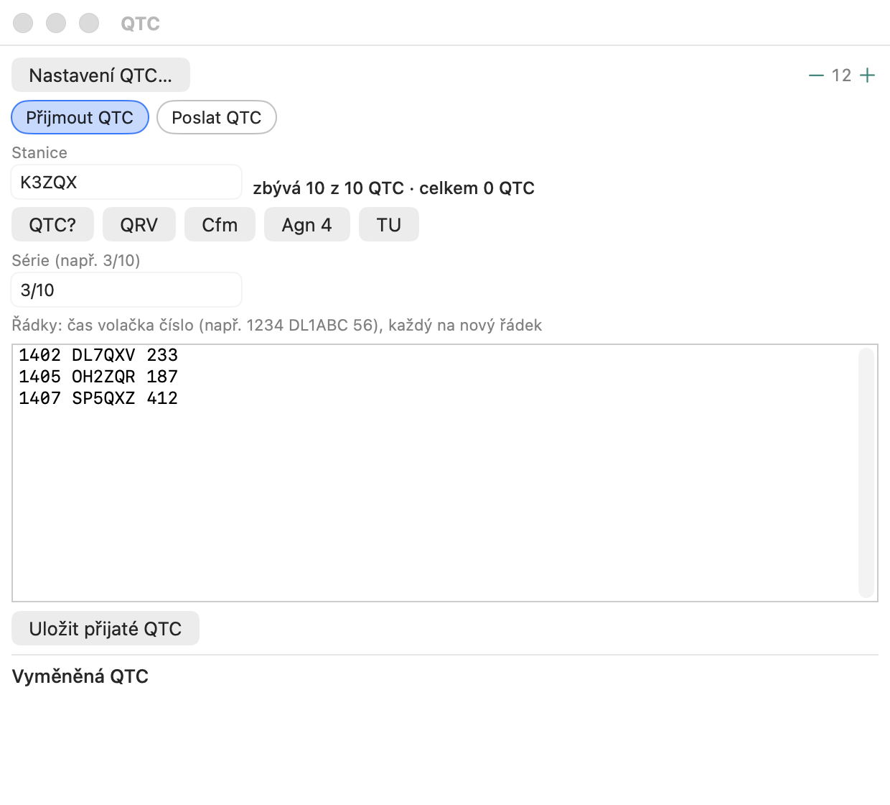

# QTC (WAE DX Contest)



Equivalent of the N1MM **QTC window** for the [WAE DX Contest](https://www.darc.de/der-club/referate/conteste/wae-dx-contest/en/).
The contests `wae-cw`, `wae-ssb` and `wae-rtty` are in the contest data.

## Rules in the definition

```yaml
scoring:
  qtc: { points: 1, maxPerStation: 10, groupSize: 10 }
  total: "(qsoPoints + qtcPoints) * multTotal"
multipliers:
  - { id: countries, set: dxcc_entities, from: callsign, scope: PER_BAND,
      bandWeights: { 80m: 4, 40m: 3, 20m: 2, 15m: 2, 10m: 2 } }
```

- Each QTC = 1 point, at most 10 QTCs with one station.
- Multipliers per band with a **band weight** (`bandWeights`, 80 m ×4, 40 m ×3,
  higher ×2) — a general DSL feature, usable elsewhere as well.

## The QTC window

**"Okno → QTC (WAE)"** (Window → QTC (WAE)):

- **Receive QTC** ("Přijmout QTC", a European station): station, series (`3/10`)
  and lines `time callsign number` (`1234 DL1ABC 56`). Unreadable lines are shown
  in red.
- **Send QTC** ("Poslat QTC", a non-European station): a series from your own log
  — chronologically, only QSOs not yet reported and not QSOs with the same
  station, at most the free count. **"Odvysílat CW"** (Send CW) sends
  `QTC 3/10 1234 DL1ABC 56 ...` with the keyer, **"Potvrzeno — uložit"**
  (Confirmed — save) records the series.
- The limit of 10 QTCs per station is enforced, and the list of exchanged QTCs can
  be deleted.
- QTC points are in the score immediately (also after recalculation), and in
  Cabrillo as `QTC:` lines after the QSOs:
  `QTC: freq mo date time sender series/count recipient time callsign number`.

**WAE RTTY** (`wae-rtty`): everybody works everybody and QTCs go in both directions between stations on
different continents — any station uses both **Receive QTC** and **Send QTC**. The limit of 10 counts the QTCs sent
and received with one station together, as the RTTY rules require.

QTCs are stored in the log (table `qtc`); cluster sync does not transfer them
between stations.

## QTC mode (Ctrl+Z)

As in N1MM, **Ctrl+Z** in the entry window toggles the QTC mode: it opens the QTC window — to **receive** for a
European station, to **send** for a station elsewhere — and closes it again. The partner is the call in the entry
window (else the last QSO's). Outside Europe, a complete QSO still in the entry window is logged first (N1MM: "if
you've forgotten to log the QSO, Ctrl+Z will do it for you"); a dupe is never logged this way. A contest without QTC
says so in the status line.

The F-key macros `{DIGQTCR}` and `{DIGQTCS}` open the window to receive / send, and `{QTC}` is the header of the
series in the open window (`26/10`; a header typed as `12` alone means `12/10`), e.g. in a TU message.

## Message buttons

The row under the station field holds N1MM's QTC messages for your side and the entry window's mode. They go out
through the entry window's keyer — the CW keyer, the voice keyer (SSB: wav files, `[text]`), fldigi (RTTY) — only
when you press them; the simulator and the transmit gate apply as for the F-keys.

| Side | CW | SSB | RTTY |
|---|---|---|---|
| Receive | **QTC?**, **QRV**, **Cfm**, **Agn n**, **TU** | **QRV**, **Cfm**, **Agn n**, **TU** | **QRV**, **All Agn**, **Agn n**, **Save QTC** |
| Send | **TU** | **TU** | **RU QRV?**, **Save QTC**, and **Odvysílat sérii (digi)** |

**Agn n** asks for the QTC after the lines copied so far (`$` in the message is its number). A TU message left empty
sends the normal TU key (F3). In RTTY, **Odvysílat sérii (digi)** sends N1MM's "Send All": the heading, every line
and the ending, joined by the QTC spacing.

## QTC setup

**"Nastavení QTC…"** (QTC setup…) in the window's top bar is N1MM's Config → WAE (every change is saved at once):

- **Ctrl+Z pošle QTC? automaticky** — Ctrl+Z in Run and CW as a European station sends the ask message first
  (off by default).
- **Enter v hlavičce série pošle QRV (CW)** — Return in the series field sends QRV.
- **QTC v jedné sérii** — N1MM's "Default Number of QTCs to Send" (1–10).
- **Max. QTC pro barvy v bandmapě** — N1MM's "Max QTC Number for callsign colors in Band Map".
- The messages: CW (QTC?, QRV, Cfm, Agn, TU), SSB (wav files of QRV, Cfm, Agn, TU, looked up like the F-key wav
  files), RTTY (RQTC: RX Ready, All Agn, Agn, Save QTC; SQTC: RU QRV, Send All Heading, Send All Ending, Save QTC;
  the QTC spacing, `{ENTER}` by default). The F-key macros work in them, plus `{QTC}` and `$`.

## Band map colours

In a QTC contest the band map follows N1MM's colours: **red** a new multiplier, **green** a new station you can
still exchange QTCs with, **blue** a new station without QTCs left, **black** (light grey in the dark appearance) a
dupe you can still exchange QTCs with, **grey** a dupe with nothing left. QTCs are left while fewer than the colour
limit were exchanged with the station and the continents allow them (Europe ↔ elsewhere; in WAE RTTY any two
continents).

Not carried over from N1MM: the per-line Agn buttons and the field-by-field receive grid with its keys (Shift+1…3,
Alt+A / Ctrl+A to change the count) — the received lines are typed into one text area here, so the CW options tied to
those fields ("send CFM when leaving the serial field", "Hdr Agn / Agn clear the fields") have no counterpart.
