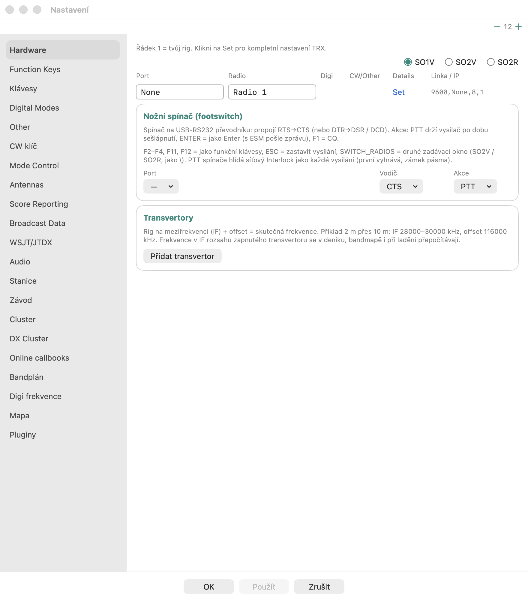
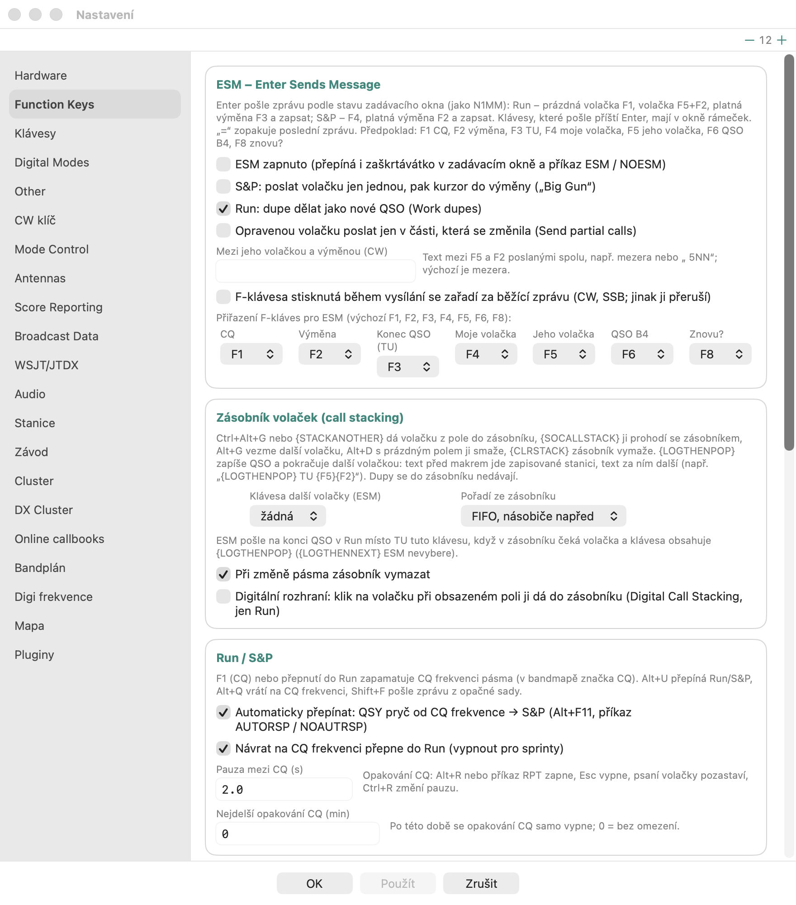

# Settings (Configurer)



There are 19 tabs; almost all of the logger's behavior is hidden beneath them. Two
of them are visited most often:




All Settings tabs are functional (the earlier mock-ups of the N1MM layout have been replaced):

| Tab | Contents |
|---|---|
| Hardware | rig (hamlib), SO1V / SO2V / SO2R, rig 2 and OTRSP, foot switch, transverters |
| Function Keys | CW, voice and digital messages F1–F12, ESM, [call stacking](call-stacking.md) |
| Klávesy (Keys) | remapping of shortcuts |
| Digital Modes | how to log the rig's data mode (PKTUSB → FT8 / RTTY / DIGITAL...) |
| Other | CW speed step and secondary step (Shift+PgUp/PgDn), tuning and RIT step (CW / phone), the QSY step of the `{PGUP}`/`{PGDN}`/`{FREQUP}`/`{FREQDN}` macros, separate function key files for each operator, RIT clearing after a QSO, resetting RX to the TX frequency after a Run QSO in split, dupe beep |
| CW klíč (CW keyer) | Winkeyer / CAT keying; *Zobrazovat odesílané CW ve stavovém řádku* (N1MM *Display Sent CW*); CW weight and contest word spacing; DTR/RTS keying with PTT line, PTT delay and CAT PTT; the sound-card CW monitor; the Winkeyer settings (N1MM Winkey tab, see [CW keyer](cw-keyer.md#winkeyer-settings)) |
| Mode Control | mode in the log taken from the rig / band plan / always fixed; RTTY sent to the rig as FSK or AFSK |
| Antennas | antenna table, rotator (rotctld, UDP) |
| Score Reporting | online scoreboard, Club Log Live Stream, DXCC from Club Log ([DXCC data](dxcc-data.md)) |
| Broadcast Data, WSJT/JTDX, Audio, Stanice (Station), Závod (Contest), Cluster, DX Cluster, Online callbooks, Bandplán (Band plan), Digi frekvence (Digi frequencies), Mapa (Map) | unchanged |

## OK, Apply and Cancel

The buttons at the bottom are **OK**, **Použít** (Apply) and **Zrušit** (Cancel).
OK saves everything and closes the window. **Apply** (also ⌘S) does exactly the
same save and applies the same changes (reconnects, language, keys, ...) but keeps
the window open on the same tab, so you can carry on editing; it is greyed out
while nothing has changed. Cancel afterwards closes the window without undoing what
was applied. If saving fails, the window stays open with your edits and an error is
shown, for both OK and Apply.

## Interface language

The texts in the application are in Czech and are translated using files in the
**`language`** directory in the application data (macOS
`~/Library/Application Support/MacContestLogger/`). The list of languages is **not
written into the application** — it is the contents of that directory, so anyone can
add a translation by copying a file there.

**Convention: `lang_<code>.json`** (`lang_de.json`, `lang_pl.json`, `lang_pt_BR.json`).

```json
{
  "_name": "Deutsch",
  "Skóre": "Punkte",
  "Mapa": "Karte"
}
```

- the **key** is the Czech text exactly as it appears in the application; the **value** is the translation;
- **`_name`** (optional) is the language name for the menu — without it the code is shown in capital letters;
- **anything missing stays in Czech**, so you can translate in parts and an incomplete file breaks nothing;
- a **faulty file** does not crash the application: the language stays in the menu, it is just not translated.

**Nastavení → Other → Jazyk / Language** (Settings → Other → Language) offers the
list of languages found, **Načíst znovu** (Reload, after copying a file) and
**Otevřít adresář** (Open directory). The language switches immediately after OK,
without a restart.

The application ships with **English** (`lang_en.json`) and **German**
(`lang_de.json`); both files are extracted into the directory on first launch and
also serve as templates. An existing file is never overwritten, so your own edits
are preserved.

To start a new translation, use `lang_en.json` from the `language` directory as the
template — it contains all the keys. Copy it to `lang_<code>.json` and replace the
values with your translation; what is still untranslated stays visible as the
original. Do not write the keys by hand — a hand-written list drifts apart from the
code as soon as a text is renamed.

Some messages contain **`%s`** as a placeholder for a value filled in at runtime
(`"Opraveno %s z %s QSO"`). The translation must keep the same number of
placeholders; their order may be rearranged.

## Mode Control

- **Podle módu rigu** (By the rig's mode) — the default.
- **Podle bandplánu** (By the band plan) — CW in the CW segment, SSB in phone, in the digital
  segment the specific digital mode from the rig (FT8...), otherwise DIGITAL. Useful
  when the rig reports USB even for digital operation.
- **Vždy** (Always) — a fixed mode (e.g. RTTY when operating through an external program).
- **RTTY to the rig**: FSK (the rig's RTTY mode) or AFSK (data mode PKTLSB).
- **Other digital modes to the rig** (PSK, FT8…; N1MM "Mode sent to radio"): PKTUSB (the rig's data mode, the
  default), PKTLSB, USB or LSB — USB/LSB for a rig without a data mode; the logged mode then follows the rule
  above.

A single-mode contest has its mode set by the definition; the rules apply to free
logging and multi-mode contests.

## Windows and their restoration

Each tool window remembers its **position and size** (`windowGeometry` in
`config.json`), and open windows are reopened after a restart (`openWindows`): log,
CAT log, available multipliers, DX cluster, bandmap, blacklist, HamQTH log, Info,
skeds, score, multiplier transfer, dupesheet (VFO A and VFO B), rotator, statistics, propagation
forecast, band notes, waterfall, definition editor, QTC, map (also in DXCC mode)
and the multiplier windows (DXCC, zones, districts...). The second SO2V/SO2R entry
window opens automatically according to the mode in Settings → Hardware. Dialogs
(New contest, operator...) are not restored.

### Window layouts and lost windows

N1MM's Tools → Save / Restore Window Positions:

- **Nástroje → Uložit rozložení oken…** (Tools → Save window layout) saves the open windows and their places
  under a name — the operator's call is offered, so each operator can keep a layout
  (`layouts/<name>.json` in the data directory).
- **Nástroje → Obnovit rozložení oken…** (Restore window layout) moves the open windows to the saved places and
  opens the layout's windows that are closed (no window is closed).
- **Okno → Přesunout ztracená okna na hlavní obrazovku** (Window → Move lost windows to the main display) brings
  every window that is off all connected displays (a monitor that was unplugged) to the top left of the main
  display — N1MM's Ctrl+Shift+click recovery.
- N1MM's Ctrl+Tab rotation between the windows is the macOS **Cmd+`** (and Cmd+Shift+`); Ctrl+Tab in the entry
  window keeps its N1MM meaning.

## Appearance

**Nastavení → Other → Vzhled** (Settings → Other → Appearance):

- mode **follow the system** (default), **light** or **dark** — applies to all windows,
- **color accent**: teal (default), blue, orange, or **high contrast**
  (black background, white text, yellow accent — for night operation),
- each window has its own font size (A− / A+ at the top right), and the window remembers it.

### Skins, colours and fonts

The equivalent of N1MM's Configurer **Colors**, **Fonts** and **Skins** tabs, also in **Settings → Other**:

- **Skiny** (Skins) — a skin is the appearance mode, the accent, the colours and the fonts at once. Pick a
  built-in one (Default, N1MM classic, Night operation, High contrast), **Načíst skin…** (Load skin) from a
  `.mclskin` file or **Uložit skin…** (Save skin) to share your look with another Mac. A skin goes into the
  settings; OK saves it.
- **Barvy** (Colours) — a colour well per item: the call colours of the entry window (new QSO, multiplier, double
  multiplier), dupe/error, the multiplier info, the QuickEdit background, the **background of the field with the
  caret** (N1MM's focus colour, off by default), the connected-radio lamp, the bandmap and Available spot colours
  (new QSO, one multiplier, two or more, dupe), the band plan strips and the band notes. A changed colour replaces
  the built-in one in both the light and the dark appearance; the arrow next to it, or **Všechny barvy výchozí**,
  returns to the default (which follows the appearance).
- **Písma** (Fonts) — the family of the proportional texts and of the fixed-width texts (tables and the entry
  fields). Sizes stay per window. Empty = the system font.
- **Bublinová nápověda u spotů** (Spot tooltips) — the tooltip of a spot in the bandmap and the multiplier windows
  (spotter, age, comment...) can be turned off. N1MM's "balloon" tooltip style is a Windows look; macOS has one
  tooltip style. VoiceOver reads the spot details either way.

## Settings profiles

An equivalent of N1MM's multiple configurations / DXLog profiles. **Nastavení →
Profily nastavení…** (Settings → Settings profiles...):

- **Uložit aktuální** (Save current) — the entire configuration (station, rig, keys, F-key messages, cluster,
  appearance...) under a name, e.g. "Home", "Expedition", "Multi-op" (`profiles/<name>.json`
  in the data directory),
- **Načíst** (Load) — overwrites the current settings with the profile and immediately applies keys, modes,
  rig mode and contest definitions; connections to the rig and networks need to be re-established (or
  restart the application),
- **Smazat** (Delete) a profile.

Logs and databases are not changed by a profile.

### Settings backups and reset

- Once a day, at start, `config.json` is copied to `config-backups/config-<date>.json`; the last **7** are kept
  (N1MM's daily INI backups).
- The Settings profiles window lists them; **Obnovit** (Restore) takes a backup's settings.
- **Výchozí nastavení…** (Default settings, N1MM "Clear INI file settings") returns every setting to its default.
  The station data stays.
- Both ask first and back the current settings up before they change anything. The databases, the contest data
  folder, the open windows and their places are kept. Reconnect the rig and the networks afterwards (as after
  loading a profile).

### Data folder (N1MM UserDir)

**Settings → Other → Datová složka** shows where the app keeps its data. **Spustit s jinou datovou složkou…**
(Restart with another data folder) quits the app and starts it again over the chosen folder (through
`MCL_DATA_DIR`): its own settings, profiles, backups and, by default, databases — for another user, a club
station or a test setup. **Spustit s výchozí datovou složkou** returns to the default one. `config.json` holds
absolute paths, so do not copy a data folder; start a new one (it begins like a first run) or carry the settings
over with a profile.

### Station per database

**Settings → Stanice → Údaje stanice podle databáze** (Station data per database) — like N1MM, every database
remembers its station: switching databases saves the station next to the database left (`<name>.station.json`)
and takes the opened database's own. A database without one takes the current station. Off by default.

## Language

**Nastavení → Other → Jazyk / Language**: Czech (default) or English, plus any other
language file found in the `language` directory (see above). In English, the menus,
window titles, Settings tabs, log table headers and the main labels of the entry
window and score bar are translated; status line messages and the documentation
remain in Czech. The key is the Czech text and a missing translation is displayed in
Czech; a test checks that the entire menu is translated.

## Time synchronization

An equivalent of DXLog **Sync time** / N1MM time synchronization. **Nastavení → Other →
Synchronizace času** (Settings → Other → Time synchronization):

- **NTP server** (default `pool.ntp.org`, empty = off) — at startup, after saving the
  settings and every half hour, the deviation of the computer's clock is measured (SNTP),
- a deviation above 1 s: a warning in the status line and messages, and `HODINY +2.3 s`
  ("CLOCK +2.3 s") in the entry window,
- **Opravovat čas nově zapsaných QSO** (Correct the time of newly logged QSOs) — the QSO time is shifted by the
  measured deviation (the system clock is not changed; that requires administrator
  rights — it is recommended to turn on automatic time in System Settings). A manually
  entered time (late entry) is not changed.

## Call history (Závod tab)

**Závod → Call history** (Contest → Call history) holds the main call history file, the additional files merged after
it (**Přidat soubory…** / **Odebrat**), the open contest's own file (**Přiřadit závodu…**, applied at once), the total of
loaded callsigns and three switches: **Zapnout dohledávání v call history** (Enable call history lookup, also a check
item in the Nastavení menu), **Zobrazovat informace uživatele (UserText)** (Show user information) and **Při změně
volačky smazat výměnu doplněnou z call history nebo spotu** (N1MM *Clear auto-populated exchange on callsign change*).
Details: [Call history](call-history.md).

## Menu bar

The menus follow N1MM+: **Soubor** (File), **Úpravy** (Edit), **Závod** (Contest), **Nástroje** (Tools),
**Nastavení** (Settings), **Okno** (Window) and **Nápověda** (Help). The application menu keeps About,
Settings `Cmd+,` and Quit.

| Menu | Items |
|---|---|
| Soubor (File) | New contest, Open contest, Open recent (the last 9 contests of the open database), New / Open database, Copy contest to another database, Import (QSOs, Merge log, Import call history), Export (ADIF, ADIF by date, Cabrillo, EDI, CSV / text / summary, call history), Post result to 3830, Print log |
| Úpravy (Edit) | the entry window's actions with your current keys shown next to them (wipe, restore, +1 to the number, note, find, delete last QSO), then Undo, Redo, Cut, Copy, Paste and Select All for the text fields |
| Zobrazení (View) | Show ? on unmatched calls, Look up the call on QRZ.com, Search the call on Google (the call typed in the active entry window, opened in the browser) |
| Závod (Contest) | Late entry, Record contest, None (free logging) |
| Nástroje (Tools) | Rescore, Rescore last N hours, Recalculate DXCC in the log, Assign call to country, Download master.scp, Update definitions, Update DXCC from Club Log, Import / Remove a country list ([DXCC data](dxcc-data.md#import-a-country-list-from-a-file)), Update call history, Clear call history, Load beacon file, Definition editor, Program execution logging, Open diagnostics folder, Check for new program version, Check for a new version at start (see below) |
| Nastavení (Settings) | Settings (all tabs), Keys, Settings profiles, Enable call history lookup (a check item, see [Call history](call-history.md#enabling-the-lookup)), Exchange abbreviations, Announcements for blind operators (VoiceOver, see [Entry window](entry-window.md#announcements-for-blind-operators-voiceover)) |
| Okno (Window) | the application's windows, Multiplikátory (Multipliers) and, after a separator, **Vlastní** (Custom) with the windows of window plugins ([Plugin windows](plugin-windows.md)) |
| Nápověda (Help) | Documentation (`Alt+H`), Keyboard shortcuts, Text commands, Contest rules (the `officialUrl` of the open contest's definition), Contest calendar (WA7BNM), Report a bug (GitHub issues), View error log, Open data folder (honours `MCL_DATA_DIR`), Check for updates |

The keys in the Edit and Help menus are only shown: the entry window's own key handling (Settings → Keys)
stays the one that reacts to them, so a remapped key is shown as remapped.

A `menu.json` of your own (below) replaces the built-in menu as a whole. If you made one before this
layout, it keeps your old structure; to get the new one, create a fresh copy with **Vytvořit menu.json k
úpravám** after moving the old file away. A node whose `id` starts with `sep.` is a separator line.

### Program version, error log and diagnostics

- **Nástroje → Zkontrolovat novou verzi programu…** (also **Nápověda → Zkontrolovat aktualizace…**) asks
  GitHub for the latest published release of MacContestLogger and compares it with the running version. A newer
  release is offered in a dialog whose **Otevřít stránku vydání** button opens its page in the browser; nothing is
  downloaded or installed by the application. The request is made only when you choose the item, or — when you
  tick **Kontrolovat novou verzi při spuštění** in the same menu (off by default) — once at every start; then a
  dialog appears only when a newer version exists. With `MCL_INERT_NETWORK` no request is ever made.
- **Nápověda → Zobrazit chybový log** opens `<data folder>/diagnostics/errors.log`: every program message of the
  Info window (failed downloads and uploads, Cabrillo warnings, definition updates…) is kept there with its time.
- **Nástroje → Logování běhu programu (diagnostika)** (a check item, off at every start; `MCL_DIAGNOSTICS=1` turns it
  on from the start) writes `<data folder>/diagnostics/program.log`: the messages, every status line and every
  menu action. Attach it to a bug report. **Otevřít složku diagnostiky** shows the folder in Finder. Both logs are
  rotated at 1 MB (the previous part is kept as `….log.1`).
- The PDF manual of N1MM has no counterpart: the documentation is these online pages (**Nápověda → Dokumentace**).

## Application menu

The menus in the top bar (and the list of Settings tabs) are described by `menu.json`.
The application looks for it **in the data directory**:

```
~/Library/Application Support/MacContestLogger/menu.json
```

Until the file exists there, the built-in definition from the application is used —
it cannot be edited because it is packaged inside the bundle. You create your own
copy in **Nastavení → Other → Menu aplikace** (Settings → Other → Application menu)
with the **Vytvořit menu.json k úpravám** (Create menu.json for editing) button; the
button does not overwrite an existing file. **Otevřít adresář** (Open directory) shows
it in Finder, **Načíst menu znovu** (Reload menu) applies your edits to the running
application (no restart needed).

Each node has an `id` (it does not change — it identifies the action), an optional
`label` (any caption you want) and a `state`:

| `state` | What it does |
|---|---|
| `enable` | the item is visible and works (default) |
| `disable` | the item is visible but grayed out |
| `hidden` | the item is not shown at all |

An unknown value is treated as `enable`, so a typo (`hide` instead of `hidden`)
shows up as the item remaining visible.

A faulty file does not deprive the application of its menus: at startup a dialog
with the reason is shown (including the line and column in the JSON) and the
built-in menu runs. Deleting the file returns you to the built-in definition.
