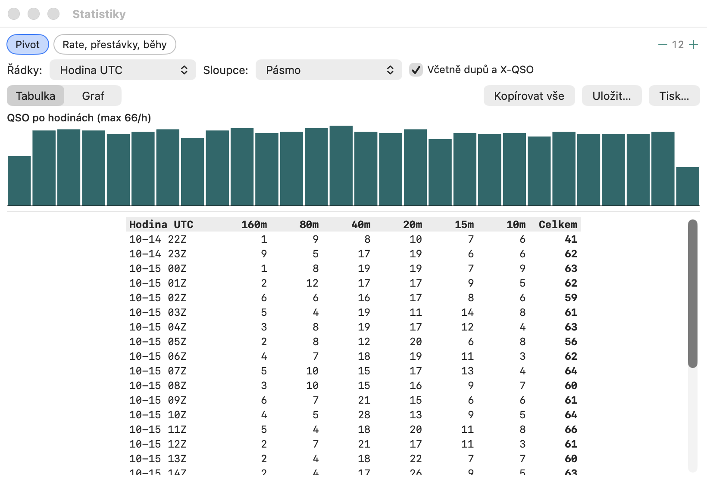

# Statistics

## Pivot statistics

An equivalent of N1MM+ **Statistics** and DXLog **Summary / Statistics**. Open via
**Okno → Statistiky** (Window → Statistics).

- At the top a **QSOs per hour** chart (with the maximum).
- A table: **Řádky** (Rows) × **Sloupce** (Columns) from the dimensions UTC hour, day, band, mode, continent,
  country, operator, Run / S&P (columns also "—" = total only). Hours and days are in
  chronological order, bands by frequency, the rest by QSO count.
- Row totals, column totals and the overall count; deleted QSOs are not counted.
- More dimensions like N1MM: rows **by 5, 10 or 15 minutes**, **band and mode** together (`20m CW`) and the
  multi-op **station**. With a contest open also its own: the QSO **points**, **new multiplier** (MULT / —),
  each received **exchange field** (zone, section, grid, county in QSO parties, …) and each **multiplier** of
  the contest. These come from a replay of the log by the contest rules, so they match the score.
- **Včetně dupů a X-QSO** (Include dupes and X-QSOs) — off leaves dupes and X-QSOs out of the table, the chart
  and the reports.
- **Tabulka / Graf** (Table / Graph) — the same pivot as stacked bars, one bar per row, a colour per column.
- **Kopírovat vše** (Copy all) puts the table on the clipboard as tab-separated text (pastes into a
  spreadsheet), **Uložit…** (Save…) writes it to a text file, **Tisk…** (Print…) prints it.
- Typing letters or digits while the Statistics window is in front goes on in the Entry window's call field,
  like in N1MM.

Typical views: hour × band (when and where), continent × band (propagation), operator ×
mode (multi-op), 10 minutes × station (multi-op rates), multiplier × band.

## Rate, breaks, runs

An equivalent of N1MM **Rate** reports and DXLog statistics. In the Statistics window, switch to
**Rate, přestávky, běhy** (Rate, breaks, runs):

- **Best rate** over 10 and 60 minutes (QSO count, per-hour equivalent, window start).
- **Breaks** of at least 30 minutes between QSOs and their total (a check of off-time rules).
- **Run streaks** — consecutive Run QSOs on one band and frequency (±2 kHz, gap
  up to 10 min, at least 5 QSOs): start, band, frequency, count, length, rate.
