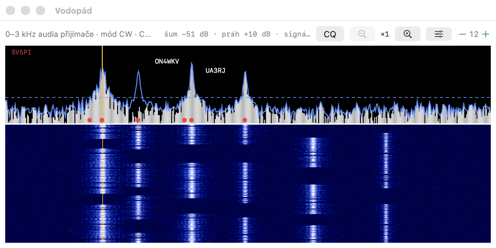

# Waterfall and receiver audio

## Waterfall and spectrum display

An equivalent of the spectrum / panadapter in N1MM+ (Spectrum Display) and DXLog — without an
SDR, from the **receiver audio**. Open via **Okno → Vodopád** (Window → Waterfall).

- **Nastavení → Audio → Příjem** (Settings → Audio → Receive): the sound card input that carries the audio
  from the rig (USB audio CODEC), and the receiver's **CW tone** (default 600 Hz).
- The window draws an FFT of the audio, 0–3 kHz: the **spectrum pane** on top and the **waterfall** below
  (newest line at the top; noise in dark blue, strong signals up to yellow). The waterfall brightness adapts
  to the noise floor.
- Hovering the mouse shows the frequency on the band according to the rig's mode (CW, CW-R, USB, LSB, data).

### Spectrum pane

- The **white** columns are the instant levels, the **blue** line the decaying levels (it jumps up with a
  signal and falls at the decay speed), the **blue dashed** line the signal threshold above the noise floor.
- The **yellow** line is the receive frequency (in CW the CW tone), the **red** line the transmit frequency
  when the rig reports split.
- The box above the panes shows the noise floor, the threshold, the number of signals found and the
  resolution (Hz per bin).

### Mouse

| Where | Action | Effect |
|---|---|---|
| Spectrum | click | tunes the rig there; with **Snap to signal** (on by default) onto the centre of the nearest signal within ±2 kHz |
| Spectrum or waterfall | **Cmd+click** (N1MM Ctrl+click) | sets the split transmit frequency there (VFO B, no snapping); the receive frequency stays |
| Waterfall | click | tunes the rig exactly there (no snapping, as in N1MM): in CW so that the station sounds at the CW tone; in SSB click on the lower edge of the signal (USB) |
| Spectrum | wheel | moves the signal threshold (the blue dashed line) |
| Spectrum | **Cmd+wheel** (N1MM Ctrl) | moves the reference level (the whole trace up / down) |
| Spectrum | **Cmd+Shift+wheel** | changes the displayed dB range |
| Waterfall | wheel | tunes the rig by the tuning step of the mode (Settings → Other); with Shift or Cmd ten steps at a time |

The threshold, reference and range are remembered.

### Signals, spots and the CQ finder

- **Signal detection**: every run of bins above the threshold line is a signal; a **red dot** marks it at the
  bottom of the spectrum and the box shows how many there are. Move the threshold with the mouse wheel until
  the dots sit on the real signals.
- **Static crash rejection** (Static sensitivity, 0 = off … 100): a line whose whole noise floor jumps up at
  once is shown but not taken into the decaying line, the signal detection or the CQ average — **Static**
  lights up in the window while that happens.
- **Shift+↓ / Shift+↑** (in the entry window) tune to the next detected signal higher / lower, skipping signals
  within the tuning tolerance of a dupe spot or a marked frequency (Alt+M). At the edge of the spectrum they
  stop. With the window closed they tune by a step like ↓ / ↑.
- **Spots over the spectrum**: telnet and local spots in the shown range are drawn at their frequency (grey =
  dupe, red = new multiplier); the spot you are tuned to is framed; a click on a call goes to the spot (with its
  split). Options: hide the spots, or show **only spots you can hear** (a signal within the tuning tolerance).
- **Marker filter**: mark all signals, all **except dupes and non-workable**, **only unknown** signals (no spot
  within the tuning tolerance — heard before the RBN spots them), or **only multipliers**. Shift+arrows follow
  the same filter.
- **Unknown signals as @frequency spots** (off by default): every 2 s the unknown signals go into the band map
  and the Available window as local spots called `@14025.3` (kHz); they expire after 90 s without the signal and
  disappear when the option is turned off or the window is closed. They are never sent anywhere.
- **CQ** finds up to five frequencies with no signal above the threshold in the last minute (a 60-second
  average of the shown range; 500 Hz wide in CW, 3 kHz in phone, 1 kHz in digital modes), numbered 1–5 by how
  quiet they are. While they are shown Shift+arrows jump between them; press the button again (**Zrušit** / Cancel) to remove them.

### Zoom and options

- **−** / **+** zoom the spectrum and the waterfall (×1 … ×16) around the receive frequency.
- The **options** button (sliders icon) opens the display options (N1MM's right-click menu and gear dialog):
  - **Orientation**: automatic (horizontal when the window is wider than tall), horizontal, or vertical
    (bar chart: frequency up the window, the waterfall on the left moving from right to left);
    optionally low frequencies at the top;
  - **Show waterfall** and the **spectrum size** (20–80 % of the window);
  - **Noise floor as a line** (horizontal only): the instant levels as a line and the decaying levels above
    the threshold filled;
  - **Show instantaneous levels below the threshold** (off = only what rises above the threshold);
  - **Signal decay speed** (slow / medium / fast — fast for SSB and crowded bands, slow for quiet bands);
  - **Background** (black, gray, white);
  - **Snap to signal** and **Clear the spectrum while tuning** (reduces smearing when the frequency changes);
  - the signal markers, the marker filter, the spots, the static sensitivity and the @frequency spots (above).

The input is opened only while the window is open (and for other users of the audio — CW decoder,
contest recording) and is released after it is closed. Nothing in the window transmits; it only tunes the rig.

## Contest recording

An equivalent of N1MM **QSO recording** / DXLog **Audio recorder**. **Závod → Nahrávat závod
(zap / vyp)** (Contest → Record contest (on / off)):

- the receiver audio (Settings → Audio → Receiver input) is written to WAV files by
  UTC hour: `…/MacContestLogger/recordings/20261128-12.wav` (12 kHz, 16 bit, mono —
  about 86 MB per hour),
- `● REC` lights up in the entry window, and the setting is remembered after a restart,
- **Přehrát nahrávku QSO** (Play QSO recording) in the context menu of a log row plays 10 s before and 5 s after
  the QSO time (a dispute over a callsign or number),
- after a restart within the same hour, recording continues into the same file.
